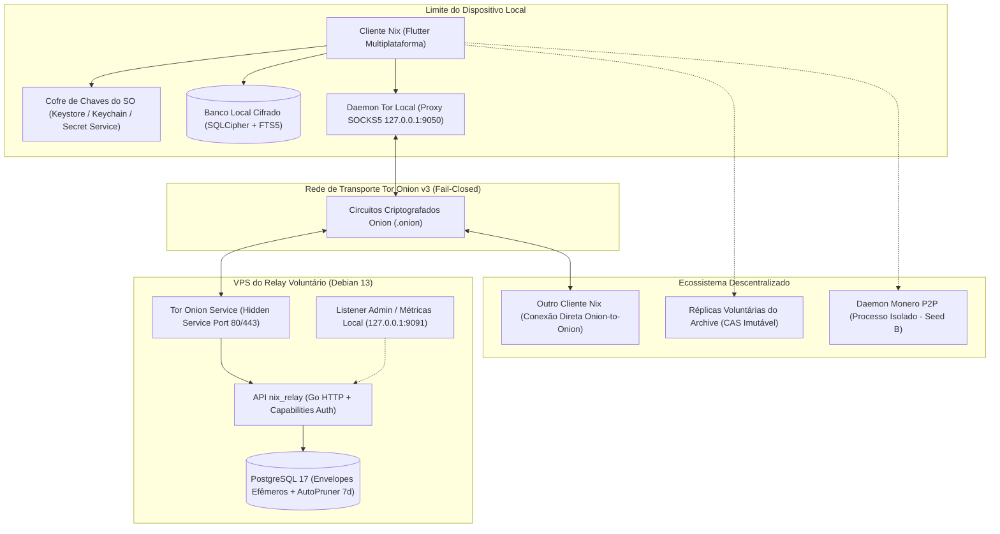
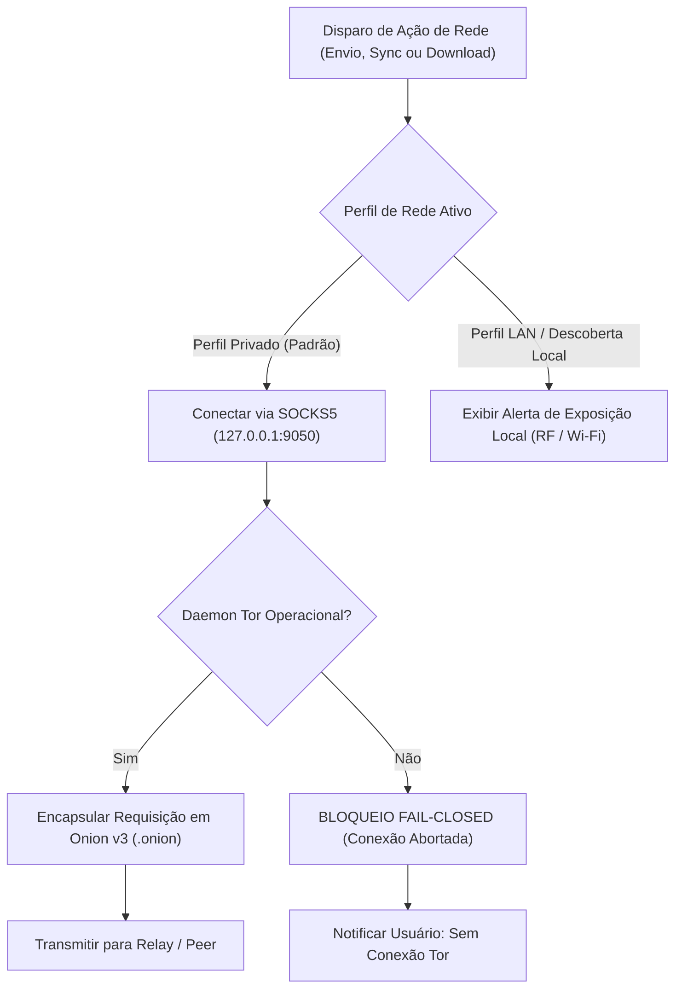
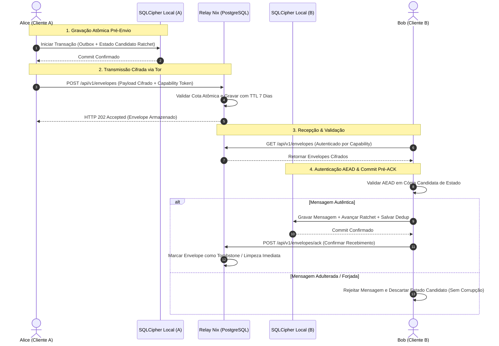
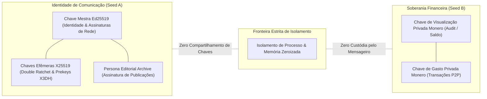

# 🏴‍☠️ PROJETO NIX

> **Comunicação inviolável, publicação de conhecimento imutável e transações financeiras soberanas com privacidade verificável por padrão.**

[](LICENSE)
[](ROADMAP.md)
[](docs/AUDIT_REPORT_V4.md)
[](docs/DEPLOYMENT_ONION_V3.md)
[-FF6600.svg)](docs/WALLET.md)

---

## 🧭 Sumário Executivo & Transparência Técnica

O **Nix** é um ecossistema modular, auto-hospedável e de código aberto projetado para assegurar comunicação confidencial, publicação descentralizada de conhecimento, acervo local de mídia e transações financeiras não custodiais exclusivamente em Monero (XMR).

> ⚠️ **Aviso de Engenharia:** O Nix encontra-se atualmente em **fase pre-alpha de desenvolvimento ativo e homologação arquitetural**. A auditoria técnica formal realizada em Novembro de 2026 identificou que, embora o protótipo apresente uma interface gráfica rica e módulos isolados, a **mensageria fim a fim e a camada de transporte estão em fase de refatoração crítica (Marcos P0)**. Nenhum binário atual deve ser considerado pronto para uso em ambientes de risco elevado antes da conclusão dos gates criptográficos e de rede.

---

## 🎨 Identidade Visual & Design System V4.1

O Projeto Nix adota uma linguagem visual de **alto contraste, ergonomia adaptativa e discrição operacional**, inspirada na estética de terminais técnicos e no visual de painéis compactos do Telegram Desktop.

```
┌────────────────────────────────────────────────────────────────────────┐
│                        PALETAS DE CORES OFICIAIS                       │
├────────────────────────────────────────────────────────────────────────┤
│  DARK YELLOW (Padrão Noturno / Baixa Emissão de Luz):                  │
│  - Background:      #08090B (Preto Profundo / AMOLED)                  │
│  - Surface Card:    #17191E (Superfície Primária de Painéis)           │
│  - Surface Elev:    #292C33 (Cards Elevados e Modais)                  │
│  - Accent Amber:    #FFC928 (Dourado Técnico de Alto Contraste)        │
│  - Text Primary:    #FFFFFF (Legibilidade Máxima WCAG 2.2 AAA)         │
│                                                                        │
│  LIGHT YELLOW (Modo Diurno / Alto Contraste Solar):                    │
│  - Background:      #FDFBF7 (Branco Quente Orgânico)                   │
│  - Surface Card:    #F4F0E6 (Linho Técnico Suave)                      │
│  - Accent Amber:    #B8860B (Dark Goldenrod com Contraste AA)          │
│  - Text Primary:    #1A1710 (Preto Carvão para Leitura)                │
└────────────────────────────────────────────────────────────────────────┘
```

### Tokens de Ergonomia e Painéis Interativos
* **Splitters Redimensionáveis (`PanelResizeDivider`):** Divisão horizontal flexível entre o *Spaces Dock* (64px–110px) e a *Channels Sidebar* (220px–480px) com persistência de largura e reset por duplo clique.
* **Tokens de Curvatura (`NixTokens`):** Painéis internos (16px), cards e listas (14px), balões de chat (16px), inputs (12px) e botões compactos (10px).
* **Avatar Universal Reativo (`NixUserAvatar`):** Identidade visual unificada com modos `local_file`, `monogram`, `sentinel` e `none`.

---

## 🧱 Arquitetura Geral do Sistema (C4 Containers)

O Nix opera no modelo **local-first**: todo o código, chaves privadas e mensagens residem no dispositivo do usuário em banco de dados cifrado. A VPS do relay atua unicamente como um buffer opaco e cego de armazenamento temporário.



---

## 🔒 Política de Transporte Tor & Isolamento Fail-Closed

O princípio fundamental de transporte do Nix é o **Fail-Closed**: nenhum dado privado trafega pela rede se o circuito Tor estiver indisponível. Conexões diretas via IP clearnet são terminantemente bloqueadas no perfil de segurança padrão.



---

## 📬 Ciclo de Vida da Mensageria E2EE & Buffer Efêmero

As mensagens são protegidas por criptografia de ponta a ponta (Double Ratchet + X3DH + XChaCha20-Poly1305) com commits transacionais no dispositivo e expurgo automático no relay.



---

## 🔑 Modelo de Identidade Compartimentada (Seed A vs Seed B)

Para mitigar correlação financeira e vazamento cruzado de privacidade, o Nix impõe a separação criptográfica absoluta entre a identidade de comunicação e a carteira financeira.



---

## 📊 Matriz de Maturidade dos Componentes (Auditoria 2026)

A auditoria técnica formal classificou os 62 requisitos do ecossistema de acordo com evidências demonstráveis em laboratório:

| Estado | Quantidade | Descrição Operacional |
|---|---:|---|
| `PARTIAL` | **29** | Capacidade parcialmente implementada; possui partes funcionais locais mas requer fechamento de contrato ou persistência. |
| `MISSING` | **16** | Especificação ou interface proposta sem implementação operacional de retaguarda. |
| `UI_ONLY` | **9** | Interface gráfica construída no Flutter operando sobre `MockData` sem conexão aos módulos de produção. |
| `BROKEN` | **6** | Código funcionalmente falho reproduzido por testes e probes (ex: corrupção de ratchet, SOCKS stream listen). |
| `UNVERIFIED`| **2** | Testes de integração distribuída e capacidade de carga que dependem de infraestrutura operacional ativa. |
| `IMPLEMENTED`| **0** | Nenhuma capacidade distribuída de ponta a ponta é dada como pronta antes dos gates formais. |

### Prioridades em Andamento no Roadmap
1. **Marcos P0 (Fundação Crítica):**
   * **P0-0:** Base reproduzível, CI integrada no GitHub Actions, estado de segurança honesto e correção do manifesto Android.
   * **P0-1:** Fechamento de ADR criptográfico, canonicalização e eliminação de mutação indevida de ratchet em falhas de decifração.
   * **P0-2:** Persistência em banco local SQLCipher com cofre nativo do SO e chaves raw.
   * **P0-3:** Transporte Tor real com leitor SOCKS único e TLS nativo para endpoints HTTPS.
   * **P0-4:** Relay Go com adapter PostgreSQL, autenticação via capabilities, quotas persistentes e métricas isoladas.
   * **P0-5:** Demonstração integrada de dois clientes operando com mensagens privadas via Tor.
   * **P0-6:** Operação recuperável com backup criptografado de metadados e scripts de restauração.
2. **Marcos P1:** Anexos reais em chunks E2EE, QR Code interoperável padronizado, grupos distribuídos com *Sender Keys*, Archive imutável e Media & Index com busca FTS5.
3. **Marcos P2:** Descoberta Starwire com downloads conscientes, mercado Monero P2P não custodial e distribuição offline autenticada de APK.

---

## 🛠️ Compilação e Execução de Protótipos Locais

### Pré-requisitos
* **Flutter SDK:** 3.27.x ou superior / Dart 3.6.x
* **Go:** 1.22 ou 1.23 (para desenvolvimento do relay)
* **Docker & Docker Compose:** para execução do banco PostgreSQL em testes locais

### 1. Execução do Cliente Desktop (Linux)
```bash
cd apps/nix_client
flutter pub get
flutter run -d linux
```

### 2. Execução dos Testes Automatizados de Todos os Módulos
```bash
# Testes do Core Criptográfico
cd modules/core_crypto
dart test

# Testes de Transporte e SOCKS
cd ../transport
dart test

# Testes do Relay Go com Detecção de Race Conditions
cd ../../services/nix_relay
go test -v -race ./...

# Testes de Interface e Widgets do Cliente
cd ../../apps/nix_client
flutter test
```

### 3. Portão de Privacidade Estática
```bash
chmod +x scripts/verify_privacy_matrix.sh
./scripts/verify_privacy_matrix.sh
```

---

## 📚 Documentação Técnica de Referência

* [`docs/AUDIT_REPORT_V4.md`](docs/AUDIT_REPORT_V4.md) — Relatório detalhado da Auditoria Técnica V4.
* [`docs/PRIVACY.md`](docs/PRIVACY.md) — Declaração pública de privacidade e limites operacionais.
* [`docs/PRIVACY_MATRIX.md`](docs/PRIVACY_MATRIX.md) — Matriz dos 21 critérios de privacidade (*The Hated One*).
* [`SECURITY.md`](SECURITY.md) — Política de divulgação responsável de vulnerabilidades e modelo de ameaças.
* [`ROADMAP.md`](ROADMAP.md) — Cronograma técnico detalhado de dependências e marcos de engenharia.
* [`docs/adr/`](docs/adr/) — Registros formais de decisões de arquitetura (ADRs).
* [`database/`](database/) — Schemas SQL, migrações e scripts de backup do banco local e do relay.

---

## ⚖️ Licença

O Projeto Nix é distribuído sob os termos da licença **GNU General Public License v3.0 (GPL-3.0)**. Consulte o arquivo [`LICENSE`](LICENSE) para obter o texto completo da licença.
