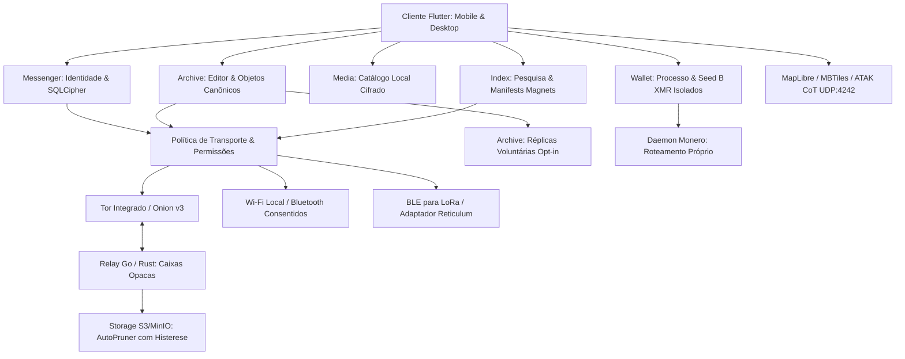

# 🏴‍☠️ PROJETO NIX

> **Comunicação, conhecimento e mídia com privacidade verificável, resiliência off-grid e soberania digital.**

[](LICENSE)
[](ROADMAP.md)
[](docs/TRANSPORTS.md)
[-FF6600.svg)](docs/WALLET.md)

---

## 📌 Sumário Executivo

O **Nix** é um ecossistema modular, auto-hospedável e de código aberto projetado para assegurar comunicação inviolável, publicação de conhecimento verificável, catálogo local de mídia e transações financeiras não custodiais exclusivamente em Monero (XMR).

O projeto é guiado por um objetivo prático inicial: **atender confiavelmente 50 usuários simultâneos** em uma infraestrutura mínima de **2 vCPU, 2 GB RAM e 40 GB NVMe** (orçamento de US$ 5–10/mês), com cliente Flutter multi-plataforma (mobile/desktop), relay leve em Go ou Rust, persistência local cifrada em SQLCipher, suporte a rádio off-grid (LoRa, Reticulum) e interoperabilidade com ATAK-CIV via Cursor-on-Target (CoT).

---

## 🏛️ Princípios de Engenharia

1. **Criptografia Consolidada:** Utilização de bibliotecas mantidas e protocolos padronizados (Double Ratchet, XChaCha20-Poly1305, Ed25519, Argon2id). Sem criptografia proprietária ou improvisada.
2. **Privacidade por Padrão:** Zero coleta de número de telefone, SMS, e-mail, CPF ou agenda de contatos para criar identidade.
3. **Compartimentação Estrita:** Chaves, identificadores e bancos de dados separados entre mensageria, publicação (Archive), catálogo de mídia e finanças.
4. **Armazenamento com Limpeza Dinâmica:** O relay é um buffer efêmero com TTL base de 7 dias e expurgo progressivo por histerese.
5. **Transporte sem Regressão Silenciosa:** Se a rede Tor falhar, o cliente entra em *fail-closed* e **jamais** estabelece conexão IP direta desprotegida no perfil privado.
6. **Realismo Off-Grid:** Rádio (LoRa) dedicado estritamente a textos curtos, alertas e telemetria essencial em Protobuf (< 240 bytes). Áudio, vídeo e arquivos usam transporte IP.
7. **Finanças Exclusivamente em Monero (XMR):** Processo isolado e **Seed B** independente, garantindo que nenhuma chave financeira se misture ao mensageiro.
8. **Matriz de Privacidade Verificável:** Avaliação contínua dos 21 critérios derivados de *The Hated One* (Account, Usage e Service).

---

## 🧱 Arquitetura Modular



### Divisão de Responsabilidades

| Componente | Diretório | Função Primária |
|---|---|---|
| **Cliente Nix** | `apps/nix_client/` | App Flutter para Android, Linux, Windows, macOS e iOS com UI tática/escura. |
| **Relay Nix** | `services/nix_relay/` | Servidor Go/Rust assíncrono para caixas de mensagens temporárias e WebSocket. |
| **Criptografia** | `modules/core_crypto/` | Implementação de primitives criptográficas, envelopes e derivação de chaves. |
| **Transporte** | `modules/transport/` | Camadas de rede: Onion Services Tor, SOCKS5 e socket local. |
| **Off-Grid** | `modules/offgrid/` | Adaptadores BLE para Meshtastic, Reticulum (RNode), mapas MBTiles e CoT. |
| **Archive** | `modules/archive/` | Editor Markdown, objetos canônicos JSON v1, CIDs e grafo de refutações. |
| **Wallet** | `modules/wallet/` | Bindings Monero, isolamento de Seed B, criação de transações e mural P2P. |
| **Media & Index** | `modules/media/`, `modules/index/` | Catálogos locais, sanitização de metadados e pesquisa de manifests. |
| **Protocolo** | `proto/` | Definições de mensagens serializadas via Protocol Buffers v3. |
| **Documentação** | `docs/` | Matriz com 23 especificações técnicas completas e registros de decisão (ADRs). |

---

## 🗂️ Estrutura do Repositório

```text
.
├── .github/                  # CI/CD Workflows, templates de issues e PR
├── .vscode/                  # Configurações otimizadas para VS Code (Dart, Go, Rust)
├── apps/
│   └── nix_client/           # Aplicação Flutter multi-plataforma
├── services/
│   └── nix_relay/            # Servidor Relay em Go (alta concorrência, baixo consumo)
├── modules/                  # Módulos especializados com limites rígidos de isolamento
│   ├── core_crypto/          # Primitivas criptográficas e limites de memória
│   ├── transport/            # Gerenciador de conexões Tor e P2P
│   ├── offgrid/              # LoRa, Reticulum e ponte ATAK CoT
│   ├── archive/              # Publicações canônicas, claims e refutações
│   ├── wallet/               # Carteira Monero e mural P2P de ofertas
│   ├── media/                # Catálogo local de mídia
│   └── index/                # Pesquisa de fontes e magnets
├── proto/                    # Esquemas Protocol Buffers versionados (v1)
├── docs/                     # Matriz completa de documentação técnica
│   ├── ARCHITECTURE.md       # Arquitetura e fluxos de dados
│   ├── SECURITY.md           # Modelo de ameaças e postura criptográfica
│   ├── PRIVACY_MATRIX.md     # Matriz The Hated One (21 critérios verificáveis)
│   ├── INFRASTRUCTURE.md     # Setup de VPS, firewall e Prometheus
│   ├── RETENTION.md          # Histerese do AutoPruner e TTL
│   ├── WALLET.md             # Isolamento estrito de sementes e RPC Monero
│   └── adr/                  # Architecture Decision Records
├── scripts/                  # Scripts de verificação, setup e CI
├── ROADMAP.md                # Roadmap detalhado em 10 fases (0 a 9)
├── CONTRIBUTING.md           # Guia de contribuição para a comunidade
├── CODE_OF_CONDUCT.md        # Código de conduta
└── LICENSE                   # GNU General Public License v3.0
```

---

## ⚙️ Ambiente de Desenvolvimento & VS Code

O projeto está configurado para uma experiência de desenvolvimento unificada no **VS Code**:

1. **Abra o workspace:**
   ```bash
   code nix.code-workspace
   ```
2. **Extensões recomendadas:**
   Ao abrir, o VS Code solicitará a instalação das extensões listadas em `.vscode/extensions.json` (Flutter, Go, Rust Analyzer, Protobuf, GitLens, Mermaid).
3. **Tarefas pré-configuradas (`Ctrl+Shift+P` -> `Tasks: Run Task`):**
   - `Client: Run Flutter (Debug)`
   - `Relay: Run Local Server (Go)`
   - `Test: Run All Tests`
   - `Lint: Verify Code & Privacy Rules`
   - `Proto: Compile Schemas`
   - `Security: Verify Privacy Matrix`

---

## 🚀 Como Começar

### Pré-requisitos
- **Git** (`>= 2.30`)
- **Go** (`>= 1.22`) ou **Rust** (`>= 1.75`)
- **Flutter SDK** (`>= 3.22`)
- **Protobuf Compiler** (`protoc`)

### Configuração Inicial
```bash
# Clone o repositório
git clone https://github.com/foros049695/nix.git
cd nix

# Execute o script de verificação do ambiente
./scripts/setup_dev.sh

# Verifique o cumprimento das regras da Matriz de Privacidade
./scripts/verify_privacy_matrix.sh
```

---

## 🛡️ Matriz de Privacidade (The Hated One)

O Nix avalia sistematicamente sete eixos de proteção em três contextos operacionais:

| Eixo | Account (Conta) | Usage (Uso) | Service (Serviço) |
|---|---|---|---|
| **Linkability** | `L-A` Duas personas sem vínculos | `L-U` Tor padrão, sem saída direta | `L-S` Zero SDKs de rastreamento |
| **Identifiability** | `I-A` Sem telefone, email ou CPF | `I-U` Falha fechada em queda de proxy | `I-S` Zero PII em discos e logs |
| **Nonrepudiation** | `N-A` Denoability criptográfica | `N-U` Protocolo off-the-record | `N-S` Histórico purgado pós-TTL |
| **Detectability** | `D-A` Sem cadastro civil | `D-U` Tor ativo por padrão | `D-S` Métricas apenas agregadas |
| **Data Disclosure** | `DD-A` SQLCipher + Argon2id | `DD-U` E2EE ponta a ponta | `DD-S` Código auditável, retenção mínima |
| **Unawareness** | `U-A` Chaves com finalidade única | `U-U` Avisos de exposição explícitos | `U-S` Sem terceiros proprietários |
| **Noncompliance** | `C-A` Sem retenção indevida | `C-U` Revogação instantânea | `C-S` Resposta a incidentes |

Veja os detalhes e procedimentos de teste em [`docs/PRIVACY_MATRIX.md`](docs/PRIVACY_MATRIX.md).

---

## 🤝 Como Contribuir

Contribuições de código aberto são muito bem-vindas! Por favor, leia nosso guia [`CONTRIBUTING.md`](CONTRIBUTING.md) antes de enviar Pull Requests.

> **Regra de Ouro:** Nenhuma contribuição que adicione identificação civil, telemetria oculta, desative o Tor sem aviso explícito ou enfraqueça a separação de chaves será aceita.

---

## 📄 Licença

Distribuído sob a licença **GNU General Public License v3.0 (GPLv3)**. Veja [`LICENSE`](LICENSE) para mais detalhes.
