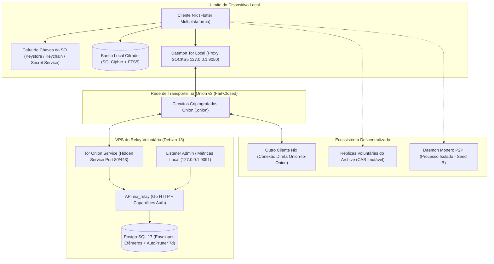
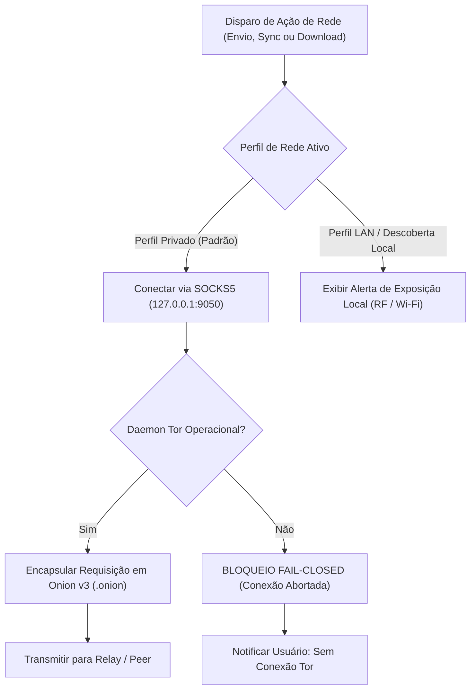
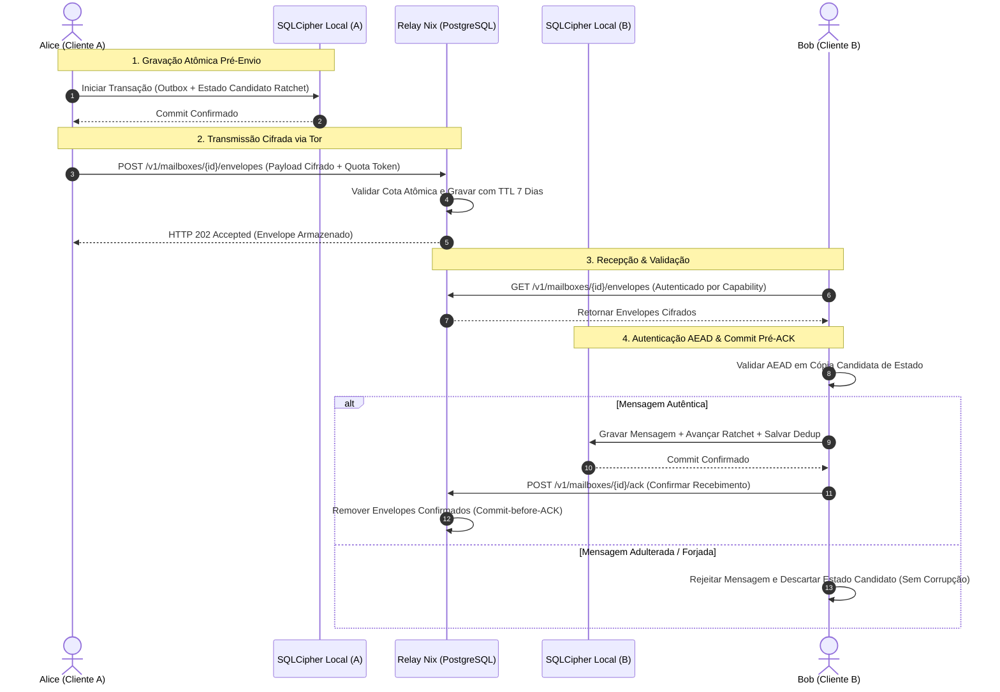
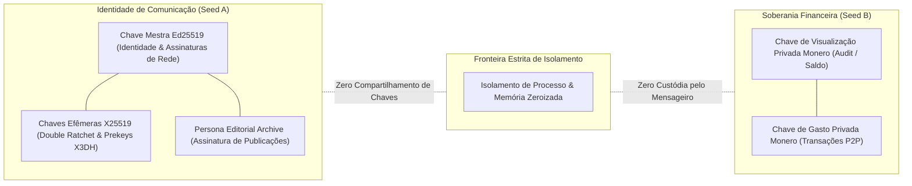

# 🏴‍☠️ PROJETO NIX

> **Comunicação inviolável, publicação de conhecimento imutável e transações financeiras soberanas com privacidade verificável por padrão.**

[](LICENSE)
[](ROADMAP.md)
[](docs/AUDIT_REPORT_V4.md)
[](docs/DEPLOYMENT_ONION_V3.md)
[-FF6600.svg)](docs/WALLET.md)

---

## 🧭 Sumário Executivo & Transparência Técnica

O **Nix** é um ecossistema modular, auto-hospedável e de código aberto projetado para assegurar comunicação confidencial, publicação descentralizada de conhecimento, acervo local de mídia e transações financeiras não custodiais exclusivamente em Monero (XMR).

> ⚠️ **Aviso de Engenharia:** O Nix encontra-se atualmente em **fase pre-alpha de desenvolvimento ativo e homologação arquitetural**. A auditoria técnica formal realizada em Novembro de 2026 identificou que, embora o protótipo apresente uma interface gráfica rica e módulos isolados, a **mensageria fim a fim e a camada de transporte estão em fase de refatoração crítica (Marcos P0)**. Nenhum binário atual deve ser considerado pronto para uso em ambientes de risco elevado antes da conclusão dos gates criptográficos e de rede.

---

## 🎨 Identidade Visual & Design System V4.1

O Projeto Nix adota uma linguagem visual de **alto contraste, ergonomia adaptativa e discrição operacional**, inspirada na estética de terminais técnicos e no visual de painéis compactos do Telegram Desktop.

```
┌────────────────────────────────────────────────────────────────────────┐
│                        PALETAS DE CORES OFICIAIS                       │
├────────────────────────────────────────────────────────────────────────┤
│  DARK YELLOW (Padrão Noturno / Baixa Emissão de Luz):                  │
│  - Background:      #08090B (Preto Profundo / AMOLED)                  │
│  - Surface Card:    #17191E (Superfície Primária de Painéis)           │
│  - Surface Elev:    #292C33 (Cards Elevados e Modais)                  │
│  - Accent Amber:    #FFC928 (Dourado Técnico de Alto Contraste)        │
│  - Text Primary:    #FFFFFF (Legibilidade Máxima WCAG 2.2 AAA)         │
│                                                                        │
│  LIGHT YELLOW (Modo Diurno / Alto Contraste Solar):                    │
│  - Background:      #FDFBF7 (Branco Quente Orgânico)                   │
│  - Surface Card:    #F4F0E6 (Linho Técnico Suave)                      │
│  - Accent Amber:    #B8860B (Dark Goldenrod com Contraste AA)          │
│  - Text Primary:    #1A1710 (Preto Carvão para Leitura)                │
└────────────────────────────────────────────────────────────────────────┘
```

### Tokens de Ergonomia e Painéis Interativos
* **Splitters Redimensionáveis (`PanelResizeDivider`):** Divisão horizontal flexível entre o *Spaces Dock* (64px–110px) e a *Channels Sidebar* (220px–480px) com persistência de largura e reset por duplo clique.
* **Tokens de Curvatura (`NixTokens`):** Painéis internos (16px), cards e listas (14px), balões de chat (16px), inputs (12px) e botões compactos (10px).
* **Avatar Universal Reativo (`NixUserAvatar`):** Identidade visual unificada com modos `local_file`, `monogram`, `sentinel` e `none`.

---

## 🧱 Arquitetura Geral do Sistema (C4 Containers)

O Nix opera no modelo **local-first**: todo o código, chaves privadas e mensagens residem no dispositivo do usuário em banco de dados cifrado. A VPS do relay atua unicamente como um buffer opaco e cego de armazenamento temporário.



---

## 🔒 Política de Transporte Tor & Isolamento Fail-Closed

O princípio fundamental de transporte do Nix é o **Fail-Closed**: nenhum dado privado trafega pela rede se o circuito Tor estiver indisponível. Conexões diretas via IP clearnet são terminantemente bloqueadas no perfil de segurança padrão.



---

## 📬 Ciclo de Vida da Mensageria E2EE & Buffer Efêmero

As mensagens são protegidas por criptografia de ponta a ponta (Double Ratchet + X3DH + XChaCha20-Poly1305) com commits transacionais no dispositivo e expurgo automático no relay.



---

## 🔑 Modelo de Identidade Compartimentada (Seed A vs Seed B)

Para mitigar correlação financeira e vazamento cruzado de privacidade, o Nix impõe a separação criptográfica absoluta entre a identidade de comunicação e a carteira financeira.



---

## 📊 Estado Real dos Módulos (Auditoria Técnica Local — Nov/2026)

Após a integração dos PRs `#1`–`#18`, fechamento das Issues `#11` e `#12` e conclusão das correções P0/P1 de laboratório local:

| Componente | Estado Verificado | Evidência Principal |
|---|---|---|
| **Core Criptográfico (`modules/core_crypto`)** | `VERIFIED` | Ed25519/X25519, AEAD XChaCha20-Poly1305, Argon2id, X3DH, Double Ratchet atômico, `SignedRecord`, `ReplayGuard`, `PqxdhCombiner`, `SignedReleaseManifest` (`dart test` 10/10). |
| **Transporte Tor / SOCKS5 / TLS (`modules/transport`)** | `FIXED & VERIFIED` | SOCKS5 `ATYP 0x03`, TLS real via `RawSecureSocket` (Issue `#11`), `EmbeddedTorManager` com verificação ControlPort, Mesh `NIXB` e Radio `<=240B` (`dart test` 22/22). |
| **Relay Cego Go (`services/nix_relay`)** | `VERIFIED` | `BlindMailboxStore` + `PostgresMailboxStore` (PG 17), capabilities SHA-256 com escopos/revogação, `AutoPruner`, admin isolado em loopback (`go test -race ./...`). |
| **Mensageria UI + Transacionalidade (`apps/nix_client`)** | `FIXED & VERIFIED` | `NixState.sendDirectMessage` → `SovereignMessenger` unificado, transação SQLite atômica, injeção de falhas nos 6 estágios, troca real entre 2 instâncias via relay+SOCKS5 e recuperação pós-reinício (`flutter test` 89/89). |
| **SQLCipher, KeyVault, Onboarding, Monero P2P, Archive, Media, Starwire, APK Offline** | `FIXED & VERIFIED` (local) | `requireEncryption` bloqueando SQLite comum, backup/restore cifrado, verificação fail-closed ativa no onboarding, anúncios Monero assinados Ed25519 isolados da Seed A, tokenizador HTML anti-XSS, conectores opt-in, proibição de bypass clearnet e APK autenticado Ed25519. |
| **Infraestrutura Externa & Hardware Físico** | `UNVERIFIED` / `PARTIAL` | VPS Debian 13 (soak 60 min Onion v3), APK Android físico (NDK/TEE), Bluetooth BLE / LoRa RF físicos, `monero-wallet-rpc` stagenet/mainnet e replicação Archive externa (ver [`docs/IMPLEMENTATION_NEXT_STEPS.md`](docs/IMPLEMENTATION_NEXT_STEPS.md)). |

> ⚠️ **Aviso de Engenharia:** Embora todos os núcleos P0/P1 estejam validados em laboratório local com suítes reproduzíveis, o Nix permanece em **fase pre-alpha** até a conclusão da validação em VPS externa, dispositivos móveis físicos e auditoria criptográfica independente.

---

## 📚 Documentação Técnica & Relatórios da Auditoria

* [`docs/REPOSITORY_DIAGNOSTIC.md`](docs/REPOSITORY_DIAGNOSTIC.md) — Diagnóstico real por módulo e divergências corrigidas.
* [`docs/IMPLEMENTATION_GAPS.md`](docs/IMPLEMENTATION_GAPS.md) — Lacunas P0/P1/P2 auditadas com arquivo, símbolo e teste.
* [`docs/PR_ISSUE_VERIFICATION.md`](docs/PR_ISSUE_VERIFICATION.md) — Verificação individual das Issues `#11`–`#12` e PRs `#1`–`#18`.
* [`docs/LOCAL_INTEGRATION_TEST_REPORT.md`](docs/LOCAL_INTEGRATION_TEST_REPORT.md) — Relatório completo das execuções locais.
* [`docs/IMPLEMENTATION_NEXT_STEPS.md`](docs/IMPLEMENTATION_NEXT_STEPS.md) — Plano para etapas de VPS, Android físico, BLE/LoRa e RPC externo.
* [`docs/PRIVACY.md`](docs/PRIVACY.md) · [`docs/PRIVACY_MATRIX.md`](docs/PRIVACY_MATRIX.md) · [`SECURITY.md`](SECURITY.md) · [`ROADMAP.md`](ROADMAP.md) · [`docs/adr/`](docs/adr/) · [`database/`](database/)

---

## 🛠️ Compilação e Execução de Protótipos Locais

### Pré-requisitos
* **Flutter SDK:** 3.27.4 ou superior, com o Dart incluído no SDK
* **Go:** 1.22 ou 1.23 (para desenvolvimento do relay)
* **SQLite no Linux:** instale `libsqlite3-dev` (Debian/Ubuntu) para os testes do cliente.
* **Docker & Docker Compose:** para execução do banco PostgreSQL em testes locais

### 1. Execução do Cliente Desktop (Linux)
```bash
cd apps/nix_client
flutter pub get
flutter run -d linux
```

### 2. Compilação do APK Android Release

Instale o Android SDK e o JDK 17, inclua o `apksigner` do Android SDK
Build Tools no `PATH` e confirme o ambiente com `flutter doctor -v`.
Configure a keystore de distribuição em
`apps/nix_client/android/key.properties` com as propriedades `storeFile`,
`storePassword`, `keyAlias` e `keyPassword`, ou use as variáveis
`NIX_KEYSTORE_PATH`, `NIX_KEYSTORE_PASSWORD`, `NIX_KEY_ALIAS` e `NIX_KEY_PASSWORD`.

```bash
cd apps/nix_client
flutter pub get
flutter build apk --release
sha256sum build/app/outputs/flutter-apk/app-release.apk
apksigner verify --verbose --print-certs build/app/outputs/flutter-apk/app-release.apk
```

O APK homologado na Etapa 7 tem 54.719.573 bytes e um assinante no esquema
APK Signature Scheme v2. O relatório registra Flutter 3.27.4, Dart 3.6.2,
Android SDK 35.0.0 e OpenJDK 17.0.21.1. O SHA-256 abaixo identifica o
artefato histórico. [Relatório de validação Android](docs/ANDROID_VALIDATION_REPORT.md)

```text
d99cd9c4b1d4ba748fd76831287696d3e83095b235c656c9942588a5a57a2756
```

### Builds do piloto

O workflow manual [Nix pilot builds](.github/workflows/pilot-builds.yml)
empacota o desktop **Linux x86-64** e um **APK Android de teste**. No Linux,
extraia o tarball e execute `./bundle/nix_client`. O APK usa a assinatura
de depuração do runner e serve para instalações de teste.

Para distribuição, passe as chaves públicas oficiais pelo Dart com
`--dart-define=NIX_RELEASE_PUBLISHER_KEY_HEX=<chave-publica>` e
`--dart-define=NIX_CATALOG_PUBLISHER_KEY_HEX=<chave-publica>`. A partir da
raiz do repositório, após `flutter pub get` no cliente:

```bash
dart --packages=apps/nix_client/.dart_tool/package_config.json \
  scripts/sign_release.dart apps/nix_client/build/app/outputs/flutter-apk/app-release.apk \
  <versão> <arquivo-privado-com-seed-ed25519-hex>
```

O cliente usa o manifesto `app-release.apk.sig.json` junto ao APK. Mantenha
a seed Ed25519 e a keystore de distribuição fora do repositório.

Para ensaiar BLE sem VPS, use dois Android em modo avião com Bluetooth
reativado. Em ambos, habilite o modo off-grid e a malha BLE, troque os
Card IDs assinados e envie mensagens de texto entre os contatos.
A interface oferece retentativa e preserva a confirmação como pendente.

O relay exige provisionamento explícito de `read_ack` pelo administrador
local. Antes de atualizar instalações antigas, provisione credenciais
aleatórias e configure-as no cliente. O relay rejeita o formato legado dos
tokens de leitura derivados do identificador público.

### 3. Testes e verificações

A partir da raiz do repositório:

```bash
(cd modules/core_crypto && dart pub get && dart analyze && dart test)
(cd modules/transport && dart pub get && dart analyze && dart test)
(cd services/nix_relay && go vet ./... && go test -race ./...)
./scripts/verify_privacy_matrix.sh
./scripts/verify_automation_policy.sh
(cd apps/nix_client && flutter pub get && flutter analyze --no-fatal-infos && HOME="$(mktemp -d)" flutter test)
```

Os testes de transporte devem rodar em namespace de rede isolado, sem um
serviço escutando em `127.0.0.1:9050`. Consulte as condições para rodar
os testes do catálogo completo no [registro de implementação](docs/IMPLEMENTATION_PROGRESS.md).

---

## 📚 Documentação Técnica de Referência

* [`docs/AUDIT_REPORT_V4.md`](docs/AUDIT_REPORT_V4.md) — Relatório detalhado da Auditoria Técnica V4.
* [`docs/PRIVACY.md`](docs/PRIVACY.md) — Declaração pública de privacidade e limites operacionais.
* [`docs/PRIVACY_MATRIX.md`](docs/PRIVACY_MATRIX.md) — Matriz dos 21 critérios de privacidade (*The Hated One*).
* [`SECURITY.md`](SECURITY.md) — Política de divulgação responsável de vulnerabilidades e modelo de ameaças.
* [`ROADMAP.md`](ROADMAP.md) — Cronograma técnico detalhado de dependências e marcos de engenharia.
* [`docs/adr/`](docs/adr/) — Registros formais de decisões de arquitetura (ADRs).
* [`database/`](database/) — Schemas SQL, migrações e scripts de backup do banco local e do relay.

---

## ⚖️ Licença

O Projeto Nix é distribuído sob os termos da licença **GNU General Public License v3.0 (GPL-3.0)**. Consulte o arquivo [`LICENSE`](LICENSE) para obter o texto completo da licença.
