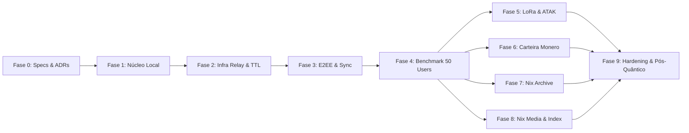

# 🧭 ROADMAP — PROJETO NIX

> **Comunicação, conhecimento e mídia com soberania, privacidade verificável e resiliência off-grid.**  
> Base de especificações: `README_NIX.md` · Revisão de Engenharia: Novembro/2026.

---

## 🎯 Visão Geral do Roadmap

O desenvolvimento do **Nix** é orientado por **marcos verificáveis** e **critérios rígidos de aceite (gates)**, e não por cronogramas arbitrários. Nenhuma caixa marcada é aceita sem teste correspondente, documentação e auditoria de limites de segurança.

O caminho crítico inicial prioriza o **núcleo de mensageria E2EE com privacidade rígida, suporte a Tor e infraestrutura enxuta para 50 usuários simultâneos**, isolando rádio LoRa, carteira Monero, Nix Archive e Nix Media até que o núcleo esteja estável e validado.

---

## 📅 Detalhamento das Fases

### 🔷 Fase 0 — Especificação, Ameaças e Fronteiras Arquiteturais
*Foco: Formalizar as decisões de engenharia, definir os limites do sistema e garantir alinhamento com a Matriz de Privacidade.*

- [ ] **Inventário de Escopo e Licenças:** Mapeamento de bibliotecas (libsodium, SQLCipher, protobuf) e compatibilidade com licença GPL-3.0.
- [ ] **ADRs Fundamentais:**
  - `ADR-0001`: Registro formal de decisões de arquitetura.
  - `ADR-0002`: Definição de bibliotecas criptográficas e primitivas (XChaCha20-Poly1305, Ed25519, X25519, Argon2id).
  - `ADR-0003`: Arquitetura de isolamento absoluto entre **Seed A** (mensageiro) e **Seed B** (Monero).
- [ ] **Modelagem de Ameaças:** Formalização de `docs/SECURITY.md` cobrindo apreensão de VPS, operadores desonestos, análise de tráfego e coerção.
- [ ] **Registro da Matriz de Privacidade (The Hated One):** Setup dos 21 IDs (`L-A` a `C-S`) em `docs/PRIVACY_MATRIX.md`.
- [ ] **Política de Transporte "Fail-Closed":** Especificação da regra que proíbe fallback para IP direto se o Tor falhar.
- **Critério de Aceite (Gate 0):** Documentação técnica revisada, matriz com todas as 21 células mapeadas para testes futuros, sem alegações de segurança absoluta.

---

### 🔷 Fase 1 — Núcleo Local do Mensageiro (Cliente Flutter)
*Foco: Criar a base de dados local segura, UI tática e identidade descentralizada no aparelho.*

- [ ] **UI Flutter Base:** Interface em tons escuros/táticos (OLED-friendly, alta legibilidade e acessibilidade).
- [ ] **Identidade Local Soberana:** Geração de chaves locais sem telefone, SMS, e-mail ou envio de lista de contatos (`I-A`).
- [ ] **Persistência Segura (SQLCipher):** Banco de dados local cifrado com chave de 256 bits derivada via Argon2id.
- [ ] **Isolamento de Memória:** Implementação de rotinas de limpeza (`sodium_memzero`) para buffers sensíveis na fronteira Dart/FFI.
- [ ] **Exclusão Criptográfica:** Mecanismo de deleção de chaves locais que inviabiliza recuperação do banco.
- [ ] **PIN de Coação (Duress PIN):** Mecanismo opcional para acionar limpeza local sem comprometer a carteira financeira.
- **Critério de Aceite (Gate 1):** Demonstração de ausência total de texto claro em dumps de disco/RAM, desbloqueio e restauração via mnemônico testados, zero bibliotecas de telemetria/rastreamento (`L-S`).

---

### 🔷 Fase 2 — Infraestrutura Enxuta e Armazenamento Dinâmico (Relay)
*Foco: Backend em Go/Rust para buffers temporários sem retenção durável e com proteção estrita de metadados.*

- [ ] **Relay Enxuto:** Servidor em Go ou Rust projetado para rodar em VPS de referência (2 vCPU, 2 GB RAM, 40 GB NVMe).
- [ ] **Conexão Onion Service:** O relay opera exclusivamente como Hidden Service Tor (v3) no modo privado (`L-U`, `I-U`).
- [ ] **Armazenamento com TTL Base de 7 Dias:** Mensagens e anexos privados expiram automaticamente (`expires_at = created_at + 7d`).
- [ ] **AutoPruner Dinâmico com Histerese:**
  - `< 75%`: Operação normal, TTL 7 dias.
  - `≥ 75%`: Teto reduzido para 4 dias para pendências antigas.
  - `≥ 85%`: Teto reduzido para 48h; upload limitado a 10 MB.
  - `≥ 92%`: Rejeição de novas mídias; reserva exclusiva para texto.
- [ ] **Quotas por Token Anônimo:** 500 MB em trânsito por identidade de quota e 50 MB por anexo.
- [ ] **Métricas Minimizadas (Prometheus):** Coleta de CPU, RAM e contagem agregada de conexões; **zero** labels de IPs, IDs de mensagens ou endereços XMR (`D-S`).
- **Critério de Aceite (Gate 2):** Simulação de pressão de disco validando a histerese sem corrupção; reinício limpo sem ressuscitar mensagens expurgadas; auditoria de logs confirmando zero PII gravado em `/var/log` ou journal.

---

### 🔷 Fase 3 — Protocolo Criptográfico e Sincronização Assíncrona
*Foco: Comunicação ponto a ponto autenticada, anexos cifrados e resiliência de entrega.*

- [ ] **Sessões Assíncronas (X3DH / Double Ratchet):** Implementação formal de catracas de chaves com Forward Secrecy e PCS.
- [ ] **Verificação Fora de Banda:** Comparação de contatos por QR Code ou fingerprints e alerta visual de troca de chaves (`DD-A`).
- [ ] **Anexos e Mídias Cifrados:** Cifra simétrica ponta a ponta (XChaCha20-Poly1305) com remoção prévia de metadados EXIF.
- [ ] **Sender Keys para Grupos:** Distribuição eficiente de chaves de remetente com re-keying ao adicionar/remover membros.
- [ ] **Fila Store-and-Forward:** Fila assíncrona local para suportar envio offline e entrega quando destinatário conectar.
- [ ] **Temporizadores de Mensagens Efêmeras:** Apagamento automático sincronizado de mensagens visualizadas.
- **Critério de Aceite (Gate 3):** Testes automatizados de ataque replay, reordenação de pacotes, corrupção de mensagens e troca forçada de transporte sem vazamento de chaves.

---

### 🔷 Fase 4 — Benchmark e Validação de Carga (50 Usuários Simultâneos)
*Foco: Validar empiricamente a hipótese da VPS de US$ 5-10/mês sob tráfego real.*

- [ ] **Bot de Carga Distribuído:** Simulador de 50 nós trocando mensagens de texto, imagens de 2 MB, reconectando e saturando filas.
- [ ] **SLO de Latência e Consumo:**
  - RSS do processo relay: `< 500 MB` sob carga estável.
  - Latência p50 e p95 sob rede Tor monitoradas e documentadas.
- [ ] **Teste de Estresse de 60 Minutos:** Ensaio contínuo de 1 hora sem perda de mensagens, vazamento de memória ou pânico de concorrência.
- **Critério de Aceite (Gate 4):** Relatório reproduzível publicado em `docs/PERFORMANCE.md` com logs de métricas e limites medidos.

---

### 🔷 Fase 5 — Redes Off-Grid: Rádio LoRa, Reticulum e Mapas Offline
*Foco: Comunicação tática em áreas sem conectividade de internet celular ou cabeada.*

- [ ] **Adaptadores de Hardware:** Suporte a transceivers LoRa via Bluetooth Low Energy (BLE) para Meshtastic e nós Reticulum (RNode/KISS).
- [ ] **Filtro Estrito de Rádio (Protobuf):** Serialização de pacotes pequenos (< 240 bytes); bloqueio automático de imagens e anexos (`radio.proto`).
- [ ] **Gestão de Airtime e Hops:** Controle de ciclo de trabalho regulatório (duty cycle), limites de saltos (TTL de rede) e deduplicação.
- [ ] **Mapas Offline (MapLibre / MBTiles):** Renderização de mapas locais sem requisições HTTP a serviços de tiles de satélite/rua.
- [ ] **Ponte ATAK-CIV (Cursor-on-Target):** Servidor local UDP (`127.0.0.1:4242`) traduzindo pontos de interesse para CoT XML/binário sob consentimento explícito.
- **Critério de Aceite (Gate 5):** Transmissão bem-sucedida em hardware real (ex: RAK4631 / Heltec); bloqueio de mídia garantido antes da camada de fragmentação; compartilhamento de localização estritamente por clique do usuário.

---

### 🔷 Fase 6 — Nix Wallet: Pagamentos e Mural P2P em Monero (XMR)
*Foco: Soberania financeira e transações descentralizadas sem custódia.*

- [ ] **Processo e Seed Isolados:** **Seed B** gerada em processo separado; total isolamento de chaves de chat ou personas (`L-A`).
- [ ] **Integração de Biblioteca Monero:** Conexão nativa C++/Go/Rust com verificação de integridade e compilação reproduzível.
- [ ] **Suporte a Nós Remotos Onion / Locais:** Escolha do nó pelo usuário, com roteamento forçado via Tor.
- [ ] **Subendereços Descartáveis:** Geração de novos subendereços para cada transação e contraparte.
- [ ] **Mural P2P Efêmero:** Ofertas locais/ponto a ponto assinadas sem custódia central, sem tokens e sem reputação global compartilhada.
- **Critério de Aceite (Gate 6):** Suíte de testes em `stagenet` completada; tentativa deliberada de um processo de mensageiro assinar uma transação é rejeitada; zero seeds em backups gerais.

---

### 🔷 Fase 7 — Nix Archive: Publicações Canônicas, Claims e Refutações
*Foco: Plataforma de publicação de conhecimento resistente à adulteração.*

- [ ] **Editor Markdown Seguro:** Sanitização rigorosa de tags HTML/SVG, rascunhos locais cifrados no cliente.
- [ ] **Esquema de Objeto Canônico v1:** Hash/CID calculado sobre bytes canônicos (`schema: nix.archive.article.v1`).
- [ ] **Grafo de Refutações e Afirmações (Claims):** Refutações atreladas a trechos específicos e versões exatas via `claim_id`.
- [ ] **Votos e Avaliação de Evidência:** Distinção explícita entre integridade criptográfica do objeto e opinião coletiva (votos não provam fatos).
- [ ] **Réplicas Opt-in (S3 / IPFS Seguro):** Armazenamento voluntário fora do relay transitório; ausência de conexão desprotegida a DHT pública.
- **Critério de Aceite (Gate 7):** Detecção de qualquer byte adulterado em artigo histórico; integridade das referências `supersedes`; prova de que publicação no Archive não revela a chave de chat.

---

### 🔷 Fase 8 — Nix Media e Nix Index
*Foco: Catálogo unificado de mídia e descoberta de fontes de informação.*

- [ ] **Catálogo Pessoal e Seguro:** Listas de filmes, séries, animes, mangás e livros salvas localmente no SQLCipher.
- [ ] **Conectores em Sandbox:** TMDB, AniList e Jellyfin acessados com controle de cookies, sem rastreadores e sem pixels de rastreamento.
- [ ] **Indexador de Magnets e Manifests:**
  - Separação mandatória entre **Pesquisar Metadados**, **Resolver Magnet** e **Transferir Arquivo**.
  - Pesquisa não conecta a swarms BitTorrent nem ativa DHT pública no perfil privado.
- **Critério de Aceite (Gate 8):** Captura de tráfego de rede durante busca de mídia confirmando zero vazamento de IP; conectores desativados imediatamente revogam conexões.

---

### 🔷 Fase 9 — Endurecimento, Criptografia Pós-Quântica e Expansão
*Foco: Maturidade de longo prazo e segurança avançada.*

- [ ] **Trilha Pós-Quântica (PQXDH / ML-KEM):** Implementação de acordo de chaves híbrido pós-quântico com proteção contra downgrade.
- [ ] **Builds Reproduzíveis e SBOM:** Compilação auditável bit a bit de todos os binários (relay e cliente) com Software Bill of Materials.
- [ ] **Assinatura Criptográfica de Releases:** Chaves de release verificadas via minisign / signifies.
- [ ] **Topologia Multi-Relay e Partição:** Testes de rede federada/descentralizada com tolerância a partições de rede e nós maliciosos.
- **Critério de Aceite (Gate 9):** Auditoria externa independente publicada em `docs/SECURITY.md`; conformidade integral com as 21 células da matriz `docs/PRIVACY_MATRIX.md`.

---

## 📊 Matriz de Rastreabilidade (Gates vs Módulos)

| Fase | Módulo Principal | Arquivo de Documentação | Alinhamento Matriz de Privacidade |
|---|---|---|---|
| **Fase 0** | Core / Specs | `docs/ARCHITECTURE.md`, `SECURITY.md` | Todas as 21 células mapeadas |
| **Fase 1** | Nix Messenger (Client) | `docs/KEY_MANAGEMENT.md` | `L-A`, `I-A`, `DD-A`, `U-A` |
| **Fase 2** | Nix Infrastructure | `docs/INFRASTRUCTURE.md`, `RETENTION.md` | `L-S`, `I-S`, `N-S`, `D-S` |
| **Fase 3** | Nix Messenger (Protocol) | `docs/PROTOCOL.md`, `TRANSPORTS.md` | `L-U`, `I-U`, `N-U`, `DD-U` |
| **Fase 4** | Performance & Relay | `docs/PERFORMANCE.md` | `D-S`, `DD-S` |
| **Fase 5** | Nix Offline & Radio | `docs/OFFGRID.md` | `U-U`, `C-U` |
| **Fase 6** | Nix Wallet (Monero) | `docs/WALLET.md` | `L-A`, `I-A`, `DD-A` |
| **Fase 7** | Nix Archive | `docs/ARCHIVE.md`, `REPLICATION.md` | `N-A`, `DD-U` |
| **Fase 8** | Nix Media & Index | `docs/MEDIA.md`, `INDEX.md` | `U-U`, `C-U` |
---

## 🏁 Marco Anterior: Protótipo v0.2.0 (Living AMOLED & Starwire)

- [x] **Design System Nix Living AMOLED:** Fundo `#000000` AMOLED absoluto, paletas reativas dinâmicas (`context.accentColor`), superfícies elevadas e contraste refinado.
- [x] **Card ID & Passaporte Cultural:** Abertura universal por clique, hover isolado exclusivamente no peer com lockout anti-reabertura no `X`, posicionamento lateral não-obstrutivo e destaques culturais.
- [x] **Organização de Navegação:** Dock dedicado exclusivamente a Espaços e Pastas combinadas; HomeSidebar agregando Conversas Diretas, Solicitações, Mercado Monero P2P e GitHub Discovery.
- [x] **Ações de Mensagens Completas:** Menu de contexto desktop/mobile, cópia segura UTF-8, encaminhamento com seletor de destino (`ForwardMessageDialog`), deleção local/geral e reações com emojis toggleable.
- [x] **Configurações Avançadas de Canal:** Painel multi-categoria com permissões de mensagens, segurança anti-spam (slow mode), expurgo efêmero e suporte a `FLAG_SECURE` contra screenshots.
- [x] **Catálogo Starwire Integrado:** Ingestão de 4.188 repositórios sob licença CC0-1.0 com métricas de crescimento semanal, busca instantânea e salvamento de 1 clique no Acervo Cultural.

## 🚀 Marco Atual: Protótipo Experimental v0.4.0-dev (V4 Telegram Layout & Yellow)

- [x] **Identidade Visual & Emblema Vetorizado Transparente:** Pipeline em `scripts/brand/process_logo.py` gerando variantes transparentes (`ink`, `light`, `medallion`), splash, desktop e ícones Android.
- [x] **Design System V4:** Dois temas oficiais (**Nix Dark Yellow** `#08090B`/`#17191E`/`#292C33`/`#FFC928` padrão inicial e **Nix Light Yellow** `#FFFFFF`/`#F6F7F9`/`#E9EBEF`/`#FFC928`), variação **AMOLED** `#000000`, modo **Sistema** e seletor reativo de cor de destaque.
- [x] **Layout 3 Áreas & Janela Desktop Redimensionável:** Dock esquerdo com pastas personalizáveis e drag-and-drop (sem apagar chats), lista de conversas com filtros/busca e **Mensagens Salvas**, além de bordas redimensionáveis (mínimo `720x500`, início não maximizado).
- [x] **Card ID Limpo & Privacidade:** Remoção de QR duplicado e status "Assistindo", fallback determinístico `NX-XXXX`, upload local (PNG/JPEG/WebP) com recorte e sanitização EXIF/chunks, correção de hover sem flickering em Solicitações e bloqueio real por `Visibilidade do Card ID`.
- [x] **Mensageria, Starwire Analytics, Monero P2P e Share Offline:** Edição/resposta/fixação/multi-seleção/encaminhamento, `ConversationInfoPanel` clicando no cabeçalho, gráficos Starwire com dados reais, proteção fail-closed para download ZIP, verificação Ed25519 + expiração no P2P Monero e modal `Compartilhar Nix Offline` estilo Briar.
- [x] **Módulos Criptográficos, Transporte & Relay Go:**
  - `modules/core_crypto`: `Ed25519`, `X25519`, `XChaCha20-Poly1305`, `Argon2id`, `X3DH`, `DoubleRatchet`, `SignedRecord` & `ReplayGuard` (5/5 testes unitários).
  - `modules/transport`: política *fail-closed* para `.onion` v3, conector `SOCKS5` sem vazamento de DNS (`ATYP 0x03`), `TorControlClient` e `RelayClient` (4/4 testes unitários).
  - `services/nix_relay`: API Store-and-Forward em Go com TTL base de 7 dias e `AutoPruner` em 4 bandas com histerese (2/2 suítes Go aprovadas + smoke test do binário).
- [x] **Validação Multiplataforma de Protótipos (Não Lançamento Oficial):**
  - 7/7 testes de widgets Flutter (`flutter test`), 5/5 `core_crypto`, 4/4 `transport`, 2/2 pacotes Go `nix_relay`.
  - Protótipos compilados localmente em Linux x86_64 e Android APK (assinatura `debug` para desenvolvimento local).
