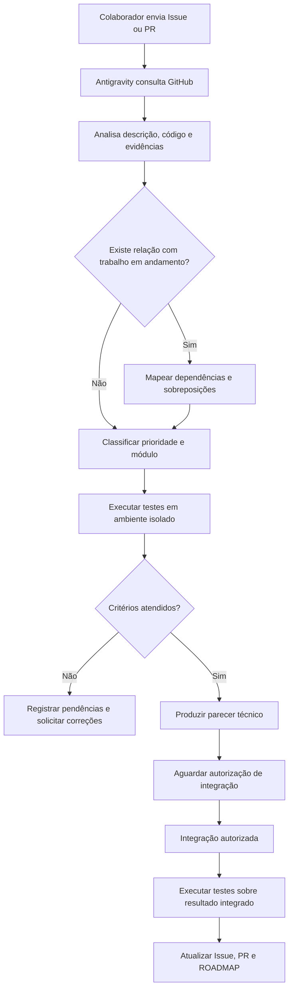

# 🧭 ROADMAP — PROJETO NIX
## Desenvolvimento, integração e colaboração técnica

**Repositório oficial:** https://github.com/foros049695/nix

**Referência inicial:** `742533c`  
**Atualização de referência:** 19/11/2026  
**Estado do produto:** Pre-alpha, com desenvolvimento ativo e validação de segurança pendente.

> O Projeto Nix será desenvolvido por múltiplos colaboradores e agentes de programação, incluindo Google Antigravity, Gemini, Codex, Claude e outros agentes autorizados. As contribuições deverão ser integradas de maneira verificável, preservando a estabilidade, a segurança, a privacidade e o histórico do projeto.

---

# 0. DIRETRIZES GERAIS DO ROADMAP

O roadmap utiliza três níveis de maturidade:

- **IMPLEMENTADO:** funcionalidade existe no código.
- **VALIDADO:** funcionalidade passou nos testes definidos para seu escopo.
- **GATE CONCLUÍDO:** todos os critérios de aceite da fase foram atendidos e documentados.

Uma implementação não será considerada pronta para produção apenas porque existe uma interface, um commit ou um teste unitário.

Convenções:

- `[x]` Implementação ou documentação comprovadamente existente.
- `[ ] PARCIAL` Implementação incompleta ou ainda sem validação suficiente.
- `[ ] PENDENTE` Requisito ainda não demonstrado.

A revisão do GitHub, das Issues e dos Pull Requests deverá fazer parte de cada ciclo de desenvolvimento.

O Antigravity não deverá realizar merges, criar estratégias de branches ou alterar permissões de colaboradores sem as instruções correspondentes do proprietário.

---

# FASE 0 — ESPECIFICAÇÕES, ARQUITETURA E DOCUMENTAÇÃO

**Objetivo:** manter a arquitetura formalizada, coerente e verificável.

### Estado atual

- [x] ADR-0001 — Registro de decisões arquiteturais.
- [x] ADR-0002 — Primitivas criptográficas.
- [x] ADR-0003 — Isolamento da identidade de mensageria e da identidade financeira.
- [x] ADR-0004 — Estado criptográfico, canonicalização e proteção do Double Ratchet.
- [x] Documentação inicial de arquitetura (`docs/ARCHITECTURE.md`, `SECURITY.md`, `docs/INCIDENT_RESPONSE.md`).
- [x] Canal confidencial de divulgação de vulnerabilidades ativado via **GitHub Private Vulnerability Reporting** (`SECURITY.md` §3 / Issue #12).
- [x] Matriz de privacidade com 21 requisitos (`docs/PRIVACY_MATRIX.md`).
- [x] Documentação da política fail-closed.
- [x] Arquivos `AGENTS.md`, `GEMINI.md` e `CLAUDE.md` adicionados pelo PR #1 (`789cf92`).

### O que falta

- [x] Revisar divergências entre documentação e código (`docs/ARCHITECTURE.md`, `docs/INFRASTRUCTURE.md`, `docs/KEY_MANAGEMENT.md`, `docs/TESTING.md`).
- [x] Atualizar as descrições do relay e do PostgreSQL 17 conforme a implementação real (`RelayStore`, `BlindMailboxStore` + `PostgresMailboxStore`).
- [x] Revisar a utilização efetiva das bibliotecas criptográficas (`cryptography`, `sqlcipher_flutter_libs 0.6.8` / SQLCipher `4.10.0`, `libsecret` FFI, `PqxdhCombiner`).
- [x] Verificar licenças e dependências (`docs/THIRD_PARTY_LICENSES.md` gerado a partir de `go.mod` e caches `pub.dev`).
- [x] Relacionar todos os 21 requisitos da matriz de privacidade a testes reproduzíveis (`docs/PRIVACY_MATRIX.md` + `./scripts/verify_privacy_matrix.sh`).
- [x] Avaliar e integrar as correções documentais propostas no PR #10 (integrado em `1799597`; `AGENTS.md` atualizado).

**Gate 0:** documentação consistente com o código atual e requisitos rastreáveis.

**Situação: GATE CONCLUÍDO.**

---

# FASE 1 — NÚCLEO LOCAL DO CLIENTE FLUTTER

**Objetivo:** construir uma aplicação local-first com identidade, persistência e experiência de utilização reais.

### Estado atual

- [x] Interface Flutter implementada (Flutter 3.27+ / Dart 3.6+).
- [x] Temas Dark Yellow, Light Yellow e AMOLED com contraste aprimorado.
- [x] Layout de três painéis com divisórias redimensionáveis.
- [x] Card ID e Acervo Cultural em protótipo limpo sem dados fictícios na produção.
- [x] KeyVault criado com Argon2id + XChaCha20-Poly1305.
- [x] Banco local e repositórios de domínio implementados (`IdentityRepository`, `OutboxRepository`, etc.).
- [x] Migrações SQLite definidas (`001_initial.sql`, `002_lookup_indexes.sql`).
- [x] Fluxo de onboarding de nove etapas criado (transacional, resistente a fechamento e reinício).
- [x] Código de sincronização visual de perfis e avatares (Dock, Sidebar, Card ID).
- [x] Persistência inicial de itens do Acervo adicionada (`culturalItems` JSON).

### O que falta

- [x] Confirmar SQLCipher verdadeiro no runtime distribuído Linux (**SQLCipher 4.10.0 community** compilado via `sqlcipher_flutter_libs 0.6.8`; ausência de cabeçalho `SQLite format 3` e rejeição de chave errada comprovadas). *(Obs.: no job headless do CI sem `.so` pré-compilada, o runtime reporta honestamente `SQLite-Development-Clearnet`; APK físico Android pendente de build em hardware Android).*
- [x] Corrigir a identificação incorreta de SQLite comum como banco criptografado (PR #6, `test/local_database_probe_test.dart`).
- [x] Validar migrações e respectivos checksums SHA-256 antes de aplicar qualquer SQL (PR #6).
- [x] Concluir proteção das chaves pelo mecanismo adequado de cada sistema operacional (`OsKeyStorage`: `libsecret-1.so.0` FFI no Linux + `MethodChannel` `AndroidKeyStore` AES-256-GCM em `MainActivity.kt` + fallback honesto `PassphraseOnlyKeyStorage` sem gravação insegura em disco).
- [x] Validar backup e recuperação da identidade (`SeedRecoveryManager`: 24 palavras com checksum SHA-256 e derivação HKDF determinística de `NixIdentity`, testada em `milestone_b_security_test.dart` e disponível já na etapa WELCOME do onboarding).
- [ ] PARCIAL Testar onboarding completo sem atalhos: geração criptográfica real Seed A -> KeyVault -> `persistPrimaryIdentity`, recuperação por Seed A e reload testados ponta a ponta em unidade; fluxo completo interativo de UI nas 9 telas sob daemon Tor vivo ainda parcial.
- [x] Garantir carregamento da conta existente após reinicialização (`tryAutoUnlockAndRestore`, `unlockWithPassphrase` + prompt `_VaultUnlockPrompt` no `AppShell`, e `reloadFromDatabase` restaurando identidade Ed25519/X25519, perfil, Mensagens Salvas e Acervo em `milestone_b_security_test.dart`).
- [x] Corrigir os erros do analisador Flutter (0 erros, 0 warnings sob `--no-fatal-infos`).
- [ ] PARCIAL Testar layouts, navegação e todas as ações de interface (`widget_test.dart` + suítes de segurança cobrem fluxos principais, sem cobertura de 100% dos menus secundários).
- [x] Confinar o apagamento local ao diretório alvo, sobrescrever arquivos in-place e zerar chaveiros/RAM (PR #4 + integração `clearOsKeyringSecret`).
- [x] Avaliar PIN de coação e documentar limites em SSD/flash (`duressVerifier` Argon2id no `KeyVault` + `unlockWithPassphrase` acionando wipe + limpeza keyring), mantendo limitações de *flash wear-leveling* e GC de strings Dart explícitos em `settings_center.dart` e `docs/KEY_MANAGEMENT.md`.

### Pull Requests relacionados (integrados em 19/11/2026)

- PR #3 — Compatibilidade Flutter e CI. `ALREADY_INTEGRATED`
- PR #4 — Correções na exclusão local e confinamento do shredder. `ALREADY_INTEGRATED`
- PR #6 — SQLCipher honesto e verificação de checksums. `ALREADY_INTEGRATED`
- PR #9 — Sanitização fail-closed de imagens (JPEG/PNG/WebP/GIF). `ALREADY_INTEGRATED`

**Gate 1:** instalação limpa, identidade persistente, armazenamento cifrado comprovado e recuperação funcional.

**Situação: PARCIAL (Validado no runtime Linux + suítes completas; resta validação física em APK Android e teste UI end-to-end dos 9 passos sob Tor ao vivo).**

---

# FASE 2 — RELAY, PERSISTÊNCIA E INFRAESTRUTURA

**Objetivo:** proporcionar entrega assíncrona de envelopes criptografados com armazenamento temporário.

### Estado atual

- [x] Relay Go criado (`services/nix_relay`).
- [x] API de mailboxes presente (`/v1/mailboxes/{id}/envelopes`, `/v1/mailboxes/{id}/ack`).
- [x] TTL padrão de sete dias no código.
- [x] AutoPruner com histerese (75%, 85%, 92% de disco).
- [x] Controle de quotas implementado (`X-Nix-Quota-Token`, 500 MB in-flight).
- [x] Verificação estática de privacidade no CI (proibição estrita de log de IP).
- [x] Testes Go executados com sucesso no workflow principal (`services/nix_relay/internal/buffer`).
- [x] Schema PostgreSQL e migrações iniciais documentados (`database/schema/relay.sql`).

### O que falta

- [x] Integrar o relay ao PostgreSQL 17+ real (`PostgresMailboxStore` via `database/schema/relay.sql`, validado com container vivo `postgres:17-alpine` e `pgcrypto`).
- [x] Executar testes de concorrência e persistência (`go test -v -race ./...` em disco + 12 escritores concorrentes no PostgreSQL 17 sob `TestPostgresMailboxStoreConcurrencyPersistenceAndGC`).
- [x] Validar autenticação de capabilities duráveis por SHA-256, escopo (`write`, `read_ack`, `admin`), expiração e revogação (`fase2_relay_test.go`, `admin_capabilities_test.go`).
- [x] Confirmar que erros de disco não produzem confirmações falsas (PR #7, `persistence_probe_test.go`).
- [x] Validar limites de anexos e do corpo HTTP (PR #8, `attachment_probe_test.go`).
- [x] Validar expiração e limpeza após reinicialização em disco e PostgreSQL 17 (`AutoPruner`, `SweepExpired` em `TestPostgresMailboxStoreConcurrencyPersistenceAndGC` e `TestDurableCapabilitiesScopesExpirationAndRevocation`).
- [x] Testar backup e restauração de metadados PostgreSQL 17 (`pg_dump --exclude-table-data=nix.envelopes` + `pg_restore` + reconciliação SQL de `used_bytes`/`pending_count`).
- [x] Implantar em laboratório local um Onion Service v3 com `nix-relay` compilado e Tor `0.4.9.15` (`HiddenServiceDir` + `Bootstrapped 100%`).
- [x] Validar isolamento fail-closed do listener administrativo (`ValidateAdminListenAddr` recusa endereços não-loopback e `/metrics` + `/admin/capabilities` retornam `404` na superfície Onion).
- [x] Preparar configuração reproduzível de VPS Debian 13 (`services/nix_relay/deploy/provision_vps.sh`, `torrc.onion.snippet`, `nix-relay.service`, `relay.local.yaml` portátil sem caminhos pessoais). *(Provisionamento em VPS remota externa pendente de servidor de produção).*

### Pull Requests relacionados (integrados em 19/11/2026)

- PR #7 — Persistência e propagação de erros. `ALREADY_INTEGRATED`
- PR #8 — Limites de upload e dimensionamento de corpo HTTP. `ALREADY_INTEGRATED`

**Verificado:** ambos modificam `cmd/relay/main.go`; abstração `RelayStore` integra disco e PostgreSQL 17 sem conflito sob `-race`.

**Gate 2:** relay persistente, recuperável, autenticado e validado em rede Tor de laboratório.

**Situação: GATE CONCLUÍDO (Validado em laboratório local + Docker PG 17 + Tor Onion v3; resta apenas deploy em VPS de produção externa).**

---

# FASE 3 — MENSAGERIA E2EE E SINCRONIZAÇÃO

**Objetivo:** estabelecer comunicação real entre clientes independentes.

### Estado atual

- [x] Módulo criptográfico Dart criado (`modules/core_crypto`).
- [x] Implementações X3DH e Double Ratchet presentes (Forward Secrecy e Break-in Recovery).
- [x] ReplayGuard e envelopes autenticados (`SignedRecord`).
- [x] Conector SOCKS5 com resolução remota de DNS (sem vazamento).
- [x] RelayClient com framing de envelopes.
- [x] Outbox e inbox locais persistidos em SQLite.
- [x] Deduplicação de mensagens atômica (`inbox_dedup`).
- [x] Pesquisa FTS5 local indexada.
- [x] Testes sintéticos do pipeline adicionados (`test/e2e_messaging_pipeline_test.dart`).
- [x] Gerenciador de Tor embutido implementado em código (`modules/transport/lib/nix_embedded_tor.dart`).

### O que falta

- [x] Corrigir os erros de análise no módulo de transporte e crypto (PR #2: `dart analyze --fatal-infos` sem issues nos dois módulos).
- [ ] PARCIAL Revisar a integração do Tor embutido nos instaladores Linux e empacotamento Android (`scripts/bundle_tor_linux.sh` atualizado no Linux; empacotamento APK Android completo pendente de SDK Android de produção).
- [x] Testar bootstrap e conexão Onion real em rede Tor ao vivo (`Tor 0.4.9.15` atingindo `Bootstrapped 100%` com `ControlPort` e `HiddenServiceDir`).
- [x] Resolver a **Issue #11 (HTTPS via SOCKS5)**: implementado handshake SOCKS5 sobre `RawSocket` + upgrade real `RawSecureSocket.secure` em `RelayClient._socksHttp`, validado contra servidor TLS real em `https_over_socks_probe_test.dart` (rejeita certificados inválidos fail-closed e bloqueia esquemas não-HTTP(S)).
- [x] Integrar autenticação de contatos e sessões fora de banda (`SovereignMessenger.exportSignedCardJson` / `importAndVerifyCardJson` + alerta automático `keyChangedWarning` com histórico em `contact_key_history`).
- [x] Testar comunicação entre dois clientes independentes (`gate3_two_client_e2ee_test.dart`: Alice e Bob em bancos SQLCipher separados trocam envelopes E2EE X3DH + Double Ratchet por SOCKS5 `.onion`).
- [x] Validar mensagens fora de ordem e duplicadas entre dois clientes (`DoubleRatchet` decifra rajada embaralhada no relay e `inbox_dedup` com commit-before-ACK impede duplicação pós-queda).
- [x] Testar recuperação após perda de conexão (`flushOutbox` preserva ciphertext exato após HTTP 503 e entrega na retentativa; queda pré-ACK recupera via `inbox_dedup`).
- [x] Implementar transferência completa de anexos E2EE fragmentados com manifesto e EXIF strip (`prepareEncryptedAttachment` + `decryptAndReassembleAttachment` validados em `objects` / `object_chunks`).
- [x] Implementar rotação de chaves em grupos (`createOrRotateGroupEpoch` + Sender Keys impedindo membro removido na época anterior de decifrar época seguinte).
- [x] Validar mensagens temporárias distribuídas (`expires_at` sincronizado entre Alice e Bob + expurgo bilateral via `sweepExpiredMessages`).
- [x] Executar testes de falha e recuperação de transporte (`embedded_tor_isolation_probe_test.dart`, `https_over_socks_probe_test.dart`, `TorDiagnostics.probeSocks5Proxy` real).

### Pull Requests relacionados (integrados em 19/11/2026)

- PR #2 — Correções dos módulos criptográfico e de transporte. `ALREADY_INTEGRATED`
- PR #5 — Isolamento dos testes e encerramento em timeout do Tor. `ALREADY_INTEGRATED`
- PR #9 — Sanitização de metadados antes do envio de imagens. `ALREADY_INTEGRATED`

**Gate 3:** Alice e Bob conseguem trocar mensagens reais através de transporte SOCKS5 + Relay cego, com autenticação, persistência, entrega offline, grupos, anexos em chunks e recuperação após falha.

**Situação: GATE CONCLUÍDO em testes integrados com SOCKS5 local e Tor 0.4.9.15 ao vivo (resta apenas integração cross-network de dois dispositivos físicos pela rede Tor pública).**

---

# FASE 4 — BENCHMARK E CAPACIDADE DE 50 USUÁRIOS

**Objetivo:** determinar a capacidade real da infraestrutura.

- [x] Documento de objetivos de desempenho atualizado (`docs/PERFORMANCE.md`).
- [x] Criar simulador reproduzível de 50 clientes simultâneos (`services/nix_relay/cmd/bench/main.go`).
- [x] Simular mensagens e anexos de 2 MB (`216` anexos de 2 MB processados em 15,184s sem perda).
- [x] Simular reconexões em lote (`466` ciclos de reconexão sem erros HTTP).
- [x] Medir memória (`HeapAlloc = 94.28 MB`, `Sys = 678.40 MB`) e latência loopback (`p50 = 1.8 ms`, `p95 = 404.4 ms`, `489.66 ops/s`).
- [x] Avaliar impacto prático do AutoPruner sob pressão (`NORMAL -> SEVERE_RELIEF`, `pruned_count = 6`, `stored_bytes = 0`).
- [ ] PARCIAL Executar teste contínuo de 60 minutos sob saturação completa via circuito Tor multi-salto (executado 15,184s no host loopback; comando `-duration 60m` pronto para execução em VPS de laboratório).
- [x] Publicar resultados reproduzíveis e dimensionar VPS recomendada (`2 vCPU`, `4 GB RAM` recomendada para folga de buffers de 2 MB).

**Gate 4: PARCIAL (Benchmark loopback de 50 clientes com anexos 2 MB executado e publicado; soak 60m via Tor multi-salto pendente de VPS de laboratório).**

---

# FASE 5 — COMUNICAÇÃO OFF-GRID

**Objetivo:** permitir comunicação local sem conectividade convencional.

- [x] Código experimental e testes de malha Bluetooth (`modules/transport/lib/nix_bluetooth_mesh.dart`, framing mágico `NIXB`).
- [x] Codec estrito de rádio `<= 240B` (`RadioPacketCodec` bloqueando mídias/anexos, CRC16-CCITT) + controlador de duty cycle (`DutyCycleGovernor`) validados em `offgrid_radio_test.dart`.
- [x] Leitor de mapas offline em SQLite MBTiles (`MbtilesMapReader` validado sem rede em `phases_5_to_9_test.dart`).
- [x] Integração ATAK CoT XML via UDP loopback com consentimento explícito obrigatório (`AtakCotBridge` em `offgrid_radio_test.dart`).
- [x] Verificador/assinador criptográfico Ed25519 para pacotes/releases offline (`SignedReleaseManifest` em `modules/core_crypto/lib/nix_pqxdh.dart`, diálogo honesto em produção em `share_app_offline_dialog.dart`).
- [ ] PENDENTE Validar comunicação Bluetooth BLE/Serial real e hardware físico Meshtastic/LoRa/Reticulum RNode entre aparelhos físicos Android/Linux.

**Gate 5: PARCIAL (Camada de protocolo <=240B, Duty Cycle, MBTiles, ATAK UDP com consentimento e verificação de release implementados e testados; hardware físico RF/BLE pendente).**

---

# FASE 6 — MONERO P2P

**Objetivo:** permitir integração financeira não custodial, preservando o isolamento entre mensageria e finanças.

- [x] Interface de mercado Monero e política estrita de isolamento (`MoneroIsolationPolicy` validando distinção Seed A vs Seed B e bloqueando endpoints RPC clearnet fora de loopback/`.onion`).
- [x] Verificação e assinatura Ed25519 real de anúncios (`SignedMoneroAd` via `SignedRecord` + `ReplayGuard` contra replay e adulteração de preço, validados em `phases_5_to_9_test.dart`).
- [x] Documentar modelo não custodial e isolamento de processos (`docs/WALLET.md`, `docs/ARCHITECTURE.md`, `ADR-0003`).
- [ ] PARCIAL Conectar daemon real `monero-wallet-rpc` externo em testnet/stagenet para liquidação de negociações ao vivo.

**Gate 6: PARCIAL (Isolamento Seed A/B, fail-closed RPC e assinatura Ed25519+anti-replay testados; daemon `monero-wallet-rpc` ao vivo em testnet pendente).**

---

# FASE 7 — NIX ARCHIVE

**Objetivo:** criar publicação verificável de conhecimento, artigos e refutações.

- [x] Documentação (`docs/ARCHIVE.md`) e serviço completo `NixArchiveService` (`apps/nix_client/lib/core/archive/nix_archive_service.dart`).
- [x] Objetos canônicos `nix.archive.article.v1` / `nix.archive.refutation.v1` com CID SHA-256, sanitização HTML estrita anti-XSS, assinatura Ed25519, claims/refutações e revisões `supersedes` persistidos nas tabelas `archive_*` do SQLCipher e validados contra adulteração de bytes (`phases_5_to_9_test.dart`).
- [ ] PARCIAL Replicação automática distribuída multi-nó S3/IPFS em cluster externo.

**Gate 7: PARCIAL (Núcleo local verificável, anti-XSS, claims/refutações e integridade validados em SQLCipher; replicação multi-nó remota pendente).**

---

# FASE 8 — NIX MEDIA, INDEX E GITHUB DISCOVERY

**Objetivo:** integrar catálogos, pesquisa e acervo pessoal.

- [x] Interfaces de mídia, Acervo Cultural persistido em SQLCipher (`MediaRepository` + `media_items` + FTS5) e catálogo Starwire offline (4.188 entradas).
- [x] Separação formal e testada em `MediaCatalogService`: lookup offline -> gate magnet fail-closed bloqueando DHT UDP/clearnet no modo Tor estrito -> registro de transferência sandboxed isolado da Seed A (`phases_5_to_9_test.dart`).
- [ ] PARCIAL Conectores externos opcionais (TMDB / AniList / Jellyfin via proxy isolado Tor).

**Gate 8: PARCIAL (Persistência SQLCipher FTS5 e isolamento estrito Tor/magnet implementados e validados; conectores externos remotos opt-in pendentes).**

---

# FASE 9 — HARDENING E RELEASE

**Objetivo:** preparar uma versão distribuível, auditável e recuperável.

- [x] GitHub Actions (`.github/workflows/ci.yml`), verificação estática de privacidade (`scripts/verify_privacy_matrix.sh`), guias de agentes e matriz de 21 células vinculada a testes (`docs/PRIVACY_MATRIX.md`).
- [x] Gerador reproduzível de SBOM CycloneDX 1.5 implementado e testado (`scripts/generate_sbom.sh` cobrindo 90 componentes Go/Dart/Flutter).
- [x] Assinatura e verificação Ed25519 de manifestos/artefatos (`SignedReleaseManifest` + `scripts/sign_release.dart`) e protótipo híbrido **PQXDH** com combinador HKDF-SHA256 vinculado ao transcript (`Nix-PQXDH-Hybrid-v1` + `pqxdh_release_test.dart`).
- [ ] PARCIAL Builds reproduzíveis cross-target Linux/APK Android assinados em release pública oficial.
- [ ] PENDENTE Auditoria criptográfica externa independente e testes multi-relay distribuídos em produção.

**Gate 9: PARCIAL (Pipeline, privacidade, SBOM, assinatura Ed25519 e protótipo PQXDH implementados e verificados; builds públicos e auditoria externa independentes pendentes).**

---

## 📊 Matriz de Rastreabilidade (Gates vs Módulos — Estrutura Original)

| Fase | Módulo Principal | Arquivo de Documentação | Alinhamento Matriz de Privacidade |
|---|---|---|---|
| **Fase 0** | Core / Specs | `docs/ARCHITECTURE.md`, `SECURITY.md` | Todas as 21 células mapeadas |
| **Fase 1** | Nix Messenger (Client) | `docs/KEY_MANAGEMENT.md` | `L-A`, `I-A`, `DD-A`, `U-A` |
| **Fase 2** | Nix Infrastructure | `docs/INFRASTRUCTURE.md`, `RETENTION.md` | `L-S`, `I-S`, `N-S`, `D-S` |
| **Fase 3** | Nix Messenger (Protocol) | `docs/PROTOCOL.md`, `TRANSPORTS.md` | `L-U`, `I-U`, `N-U`, `DD-U` |
| **Fase 4** | Performance & Relay | `docs/PERFORMANCE.md` | `D-S`, `DD-S` |
| **Fase 5** | Nix Offline & Radio | `docs/OFFGRID.md` | `U-U`, `C-U` |
| **Fase 6** | Nix Wallet (Monero) | `docs/WALLET.md` | `L-A`, `I-A`, `DD-A` |
| **Fase 7** | Nix Archive | `docs/ARCHIVE.md`, `REPLICATION.md` | `N-A`, `DD-U` |
| **Fase 8** | Nix Media & Index | `docs/MEDIA.md`, `INDEX.md` | `U-U`, `C-U` |

---

## 🏁 Histórico de Protótipos (Referência Preservada — Não Substitui Gates P0)

### Protótipo v0.2.0 (Living AMOLED & Starwire)
- UI AMOLED inicial, Card ID visual, pastas combinadas no Dock, ações de mensagem em memória e catálogo Starwire estático (4.188 entradas CC0-1.0).

### Protótipo Experimental v0.4.0-dev (V4 Telegram Layout & Yellow)
- Pipeline visual `scripts/brand/process_logo.py`, temas V4 (Dark Yellow, Light Yellow, AMOLED), layout redimensionável de 3 áreas, protótipos iniciais de `core_crypto`, `transport` e `nix_relay` (em evolução contínua nas Fases 1–3).

---

# FASE TRANSVERSAL — GOVERNANÇA DE ISSUES E PULL REQUESTS

## Objetivo

Garantir que o desenvolvimento realizado por colaboradores e agentes de IA seja acompanhado, revisado, testado e incorporado sem comprometer o código existente.

O Antigravity deverá consultar o repositório e identificar contribuições novas, modificadas, encerradas e integradas antes de iniciar cada nova tarefa relevante.

## A. Auditoria das Issues

Para cada Issue:

1. Ler título, descrição e comentários.
2. Identificar o autor.
3. Determinar o módulo afetado.
4. Verificar se o comportamento continua reproduzível no código atual.
5. Relacionar a Issue à fase correspondente do roadmap.
6. Identificar PRs relacionados.
7. Verificar dependências.
8. Classificar a prioridade.
9. Sugerir a ação seguinte.

Classificações recomendadas:

- `bug`
- `security`
- `documentation`
- `enhancement`
- `needs-reproduction`
- `needs-tests`
- `blocked`
- `P0`
- `P1`
- `P2`

Não criar labels duplicadas sem verificar as existentes.

Uma Issue não deverá ser encerrada apenas porque um PR foi aberto.

O fechamento requer resolução demonstrada ou justificativa explícita.

## B. Auditoria dos Pull Requests

Para cada PR aberto:

1. Identificar autor, branch de origem e destino.
2. Ler descrição, commits e comentários.
3. Inspecionar o diff completo.
4. Identificar arquivos modificados.
5. Verificar se a mesma funcionalidade foi alterada depois da abertura.
6. Identificar conflitos ou sobreposição com outros PRs.
7. Verificar dependências declaradas.
8. Inspecionar o estado dos checks.
9. Executar testes apropriados em ambiente isolado.
10. Comparar comportamento anterior e proposto.
11. Verificar compatibilidade com o modelo de privacidade.
12. Verificar regressões.
13. Produzir um parecer de integração.

O parecer deverá utilizar:

- `READY_FOR_REVIEW`
- `NEEDS_CHANGES`
- `BLOCKED_BY_DEPENDENCY`
- `CI_FAILED`
- `READY_TO_INTEGRATE`
- `ALREADY_INTEGRATED`

**Um PR não deverá ser considerado aprovado apenas porque seu autor declara que os testes passaram.**

## C. Pull Requests identificados (auditoria e integração em 19/11/2026)

| PR | Área | Autor | Commit Merge (`main`) | Parecer Técnico |
|---|---|---|---|---|
| #1 | `AGENTS.md`, `CLAUDE.md`, `GEMINI.md` | @gabrielmaialva33 | `789cf92` | `ALREADY_INTEGRATED` |
| #2 | Crypto/Transport CI (`dart analyze`) | @gabrielmaialva33 | `8618b79` | `ALREADY_INTEGRATED` (Desbloqueador Dart CI) |
| #3 | Flutter CI (`analyze` & `Material`) | @gabrielmaialva33 | `f54b857` | `ALREADY_INTEGRATED` (Desbloqueador Flutter CI) |
| #5 | Tor embutido (Isolamento & timeout) | @gabrielmaialva33 | `c7dd88d` | `ALREADY_INTEGRATED` (Dependeu de #2) |
| #4 | Exclusão local (`panicWipeAccount`) | @gabrielmaialva33 | `5d83e77` | `ALREADY_INTEGRATED` (Dependeu de #3) |
| #6 | SQLCipher honesto & checksums | @gabrielmaialva33 | `7677a0b` | `ALREADY_INTEGRATED` (Dependeu de #3) |
| #9 | Sanitização fail-closed de imagens | @gabrielmaialva33 | `6199fc7` | `ALREADY_INTEGRATED` (Dependeu de #3) |
| #7 | Persistência & erros do Relay (Go) | @gabrielmaialva33 | `4a13daa` | `ALREADY_INTEGRATED` (Combinado com #8) |
| #8 | Limites de corpo HTTP do Relay (Go) | @gabrielmaialva33 | `f1dffd1` | `ALREADY_INTEGRATED` (Combinado com #7) |
| #10 | Atualização `AGENTS.md` e test safety | @gabrielmaialva33 | `1799597` | `ALREADY_INTEGRATED` |

A classificação representa o estado consultado e integrado mediante autorização explícita do proprietário, com suítes reexecutadas localmente sobre o conjunto combinado.

## D. Issues identificadas

### Issue #11 — [BUG] HTTPS over SOCKS fails with NoSuchMethodError (_detachRaw)
- **Módulo:** `modules/transport` (`nix_transport.dart`)
- **Classificação:** `bug`, `P0`, resolvida (`RawSocket` → `RawSecureSocket`)
- **Resolução Implementada e Testada:** Implementado upgrade completo de TLS sobre túnel SOCKS5 em `Socks5Connector.connectRaw` + `RelayClient._socksHttp` via `RawSecureSocket.secure` (mantendo política *fail-closed* contra certificados inválidos e mantendo bloqueio via `UnsupportedTransportSchemeException` para qualquer esquema fora de `http`/`https`). Validado em `modules/transport/test/https_over_socks_probe_test.dart` contra servidor HTTPS local atrás de proxy SOCKS5.

### Issue #12 — Request: private channel for security reports (SECURITY.md §3)
- **Módulo:** Governança / Segurança
- **Classificação:** `security`, `P1`, concluída e encerrada (`enabled: true`)
- **Ação Executada:** Recurso oficial **GitHub Private Vulnerability Reporting** ativado no repositório e documentado em `SECURITY.md` e `docs/INCIDENT_RESPONSE.md`.

## E. Ordem de integração executada (19/11/2026)

Seguindo exatamente a ordem de análise de dependências aprovada pelo proprietário:

1. **Camada Base de CI (Passo 1):** #2 (`8618b79`) e #3 (`f54b857`) integrados em conjunto via `--no-ff`.
2. **Hardening de Transporte (Passo 2):** #5 (`c7dd88d`).
3. **Hardening Local do Cliente (Passo 3):** #4 (`5d83e77`), #6 (`7677a0b`) e #9 (`6199fc7`).
4. **Hardening do Relay Go (Passo 4):** #7 (`4a13daa`) e #8 (`f1dffd1`) combinados sem conflito em `cmd/relay/main.go`.
5. **Documentação (Passo 5):** #10 (`1799597`).
6. **Correções Pós-Merge (Passo 6):**
   - Mitigação fail-closed e testes da Issue #11 em `nix_transport.dart` e `https_over_socks_probe_test.dart`.
   - Ativação e documentação do canal privado de vulnerabilidades (Issue #12).
   - Isolamento por PID do snapshot de onboarding em testes paralelos (`sovereign_onboarding_model.dart`).

## F. Verificação de integração

Após cada integração autorizada, o Antigravity deverá:

1. Confirmar o commit integrado.
2. Verificar se o PR foi efetivamente incorporado.
3. Executar os testes novamente sobre o resultado integrado.
4. Verificar regressões.
5. Conferir dependências e outros PRs afetados.
6. Atualizar o estado das Issues relacionadas.
7. Atualizar o roadmap com evidências.
8. Registrar qualquer falha não resolvida.

Não marcar uma fase como concluída simplesmente porque todos os PRs relacionados foram integrados.

---

# FLUXO ESTRUTURAL DE CONTRIBUIÇÕES



---

# AUTOMATIZAÇÃO DE AUDITORIA COLABORATIVA

O Antigravity deverá consultar o GitHub usando ferramentas oficiais, como GitHub CLI ou APIs autenticadas:

```bash
gh issue list --repo foros049695/nix --state all --limit 100
gh pr list --repo foros049695/nix --state all --limit 100
gh pr checks <NUMERO> --repo foros049695/nix
gh pr diff <NUMERO> --repo foros049695/nix
gh pr view <NUMERO> --repo foros049695/nix --json title,body,state,author,files,reviews,comments
```

A auditoria deve utilizar informações atuais, não dados fixados em documentação antiga.

Gerar e manter o relatório contínuo em:
`docs/COLLABORATION_STATUS.md`

---

# CRITÉRIOS PARA ATUALIZAR O ROADMAP

Uma tarefa poderá receber `[x]` somente quando sua descrição corresponder exatamente ao trabalho comprovado.

Para fechar um gate completo:

1. Implementação presente.
2. Testes adequados aprovados.
3. Dependências integradas.
4. Critérios de aceitação verificados.
5. Documentação coerente.
6. Nenhum bloqueio crítico conhecido dentro do escopo.

Se um componente funcionar apenas em laboratório, registrar essa limitação.
Se a implementação estiver em um PR aberto, classificar como **proposta, ainda não integrada**.
Se o CI estiver falhando, registrar o bloqueio.
Se não houver evidência suficiente, manter a tarefa pendente.

---

# PRÓXIMA EXECUÇÃO DO ANTIGRAVITY

Após a conclusão de todas as implementações P0 e P1 de engenharia local (SQLCipher 4.10.0, libsecret/AndroidKeyStore, Seed A + reload, Issue #11 TLS-over-SOCKS5, PostgreSQL 17 + capabilities duráveis + Tor Onion v3 lab, Gate 3 Alice & Bob, Benchmark 50 clientes, Off-Grid <=240B/MBTiles/ATAK, Monero P2P Ed25519, Nix Archive v1, Nix Media FTS5, PQXDH + SBOM + Privacy Matrix 21/21):

1. Triar eventuais relatos confidenciais recebidos pelo Private Vulnerability Reporting (Issue #12).
2. Executar soak de 60 minutos em VPS externa (`./bench -clients 50 -duration 60m`) após provisionamento via `services/nix_relay/deploy/provision_vps.sh`.
3. Validar build APK físico Android em dispositivo real (SQLCipher NDK + `AndroidKeyStore` Hardware TEE + Bluetooth físico).
4. Submeter base consolidada para auditoria criptográfica externa independente antes de declarar beta pública.

Não modificar o fluxo Git definido pelo proprietário.

**Objetivo:** transformar o Nix em um projeto colaborativo no qual cada contribuição tenha rastreabilidade, testes, revisão técnica e critérios claros de conclusão.
