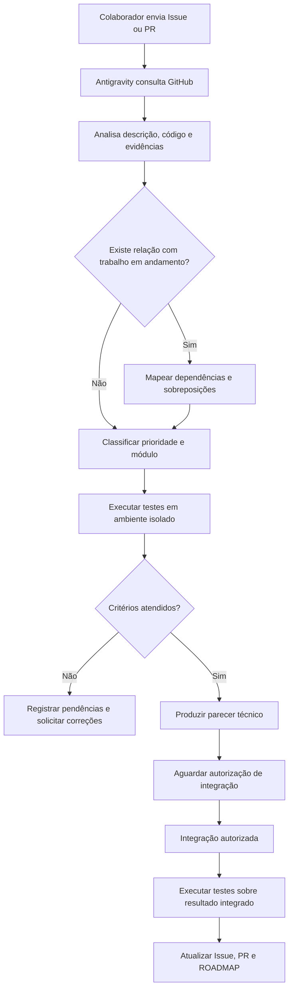

# 🧭 ROADMAP — PROJETO NIX
## Desenvolvimento, integração e colaboração técnica

**Repositório oficial:** https://github.com/foros049695/nix

**Referência inicial:** `742533c`  
**Atualização de referência:** 19/11/2026  
**Estado do produto:** Pre-alpha, com desenvolvimento ativo e validação de segurança pendente.

> O Projeto Nix será desenvolvido por múltiplos colaboradores e agentes de programação, incluindo Google Antigravity, Gemini, Codex, Claude e outros agentes autorizados. As contribuições deverão ser integradas de maneira verificável, preservando a estabilidade, a segurança, a privacidade e o histórico do projeto.

---

# 0. DIRETRIZES GERAIS DO ROADMAP

O roadmap utiliza três níveis de maturidade:

- **IMPLEMENTADO:** funcionalidade existe no código.
- **VALIDADO:** funcionalidade passou nos testes definidos para seu escopo.
- **GATE CONCLUÍDO:** todos os critérios de aceite da fase foram atendidos e documentados.

Uma implementação não será considerada pronta para produção apenas porque existe uma interface, um commit ou um teste unitário.

Convenções:

- `[x]` Implementação ou documentação comprovadamente existente.
- `[ ] PARCIAL` Implementação incompleta ou ainda sem validação suficiente.
- `[ ] PENDENTE` Requisito ainda não demonstrado.

A revisão do GitHub, das Issues e dos Pull Requests deverá fazer parte de cada ciclo de desenvolvimento.

O Antigravity não deverá realizar merges, criar estratégias de branches ou alterar permissões de colaboradores sem as instruções correspondentes do proprietário.

---

# FASE 0 — ESPECIFICAÇÕES, ARQUITETURA E DOCUMENTAÇÃO

**Objetivo:** manter a arquitetura formalizada, coerente e verificável.

### Estado atual

- [x] ADR-0001 — Registro de decisões arquiteturais.
- [x] ADR-0002 — Primitivas criptográficas.
- [x] ADR-0003 — Isolamento da identidade de mensageria e da identidade financeira.
- [x] ADR-0004 — Estado criptográfico, canonicalização e proteção do Double Ratchet.
- [x] Documentação inicial de arquitetura (`docs/ARCHITECTURE.md`, `SECURITY.md`, `docs/INCIDENT_RESPONSE.md`).
- [x] Canal confidencial de divulgação de vulnerabilidades ativado via **GitHub Private Vulnerability Reporting** (`SECURITY.md` §3 / Issue #12).
- [x] Matriz de privacidade com 21 requisitos (`docs/PRIVACY_MATRIX.md`).
- [x] Documentação da política fail-closed.
- [x] Arquivos `AGENTS.md`, `GEMINI.md` e `CLAUDE.md` adicionados pelo PR #1 (`789cf92`).

### O que falta

- [ ] PARCIAL Revisar divergências entre documentação e código (README vs relay JSON x PostgreSQL).
- [ ] PENDENTE Atualizar as descrições do relay e do PostgreSQL conforme a implementação real.
- [ ] PARCIAL Revisar a utilização efetiva das bibliotecas criptográficas.
- [ ] PENDENTE Verificar licenças e dependências (compatibilidade GPL-3.0).
- [ ] PARCIAL Relacionar todos os requisitos da matriz de privacidade a testes reproduzíveis (`./scripts/verify_privacy_matrix.sh`).
- [x] Avaliar e integrar as correções documentais propostas no PR #10 (integrado em `1799597`; `AGENTS.md` atualizado com isolamento de `$HOME` em testes e status da Issue #11).

**Gate 0:** documentação consistente com o código atual e requisitos rastreáveis.

**Situação: PARCIAL.**

---

# FASE 1 — NÚCLEO LOCAL DO CLIENTE FLUTTER

**Objetivo:** construir uma aplicação local-first com identidade, persistência e experiência de utilização reais.

### Estado atual

- [x] Interface Flutter implementada (Flutter 3.27+ / Dart 3.6+).
- [x] Temas Dark Yellow, Light Yellow e AMOLED com contraste aprimorado.
- [x] Layout de três painéis com divisórias redimensionáveis.
- [x] Card ID e Acervo Cultural em protótipo limpo sem dados fictícios na produção.
- [x] KeyVault criado com Argon2id + XChaCha20-Poly1305.
- [x] Banco local e repositórios de domínio implementados (`IdentityRepository`, `OutboxRepository`, etc.).
- [x] Migrações SQLite definidas (`001_initial.sql`, `002_lookup_indexes.sql`).
- [x] Fluxo de onboarding de nove etapas criado (transacional, resistente a fechamento e reinício).
- [x] Código de sincronização visual de perfis e avatares (Dock, Sidebar, Card ID).
- [x] Persistência inicial de itens do Acervo adicionada (`culturalItems` JSON).

### O que falta

- [ ] PARCIAL Confirmar SQLCipher verdadeiro no runtime distribuído. O PR #6 (integrado) faz o app reportar honestamente `SQLite-Development-Clearnet` quando `cipher_version` está ausente; o bundle Linux ainda não foi verificado com SQLCipher real.
- [x] Corrigir a identificação incorreta de SQLite comum como banco criptografado (PR #6, `test/local_database_probe_test.dart`).
- [x] Validar migrações e respectivos checksums SHA-256 antes de aplicar qualquer SQL (PR #6).
- [ ] PENDENTE Concluir proteção das chaves pelo mecanismo adequado de cada sistema operacional (Secure Storage / Keyring nativo).
- [ ] PARCIAL Validar backup e recuperação da identidade: o estado de onboarding persiste sem gravar a Seed A em claro; a restauração completa a partir do mnemônico em outra instalação ainda não foi testada.
- [ ] PARCIAL Testar onboarding completo sem atalhos: o teste de widget percorre WELCOME → TOR_CONSENT e conclui via `completeOnboarding()`; as etapas TOR_BOOTSTRAP → PROFILE_SETUP com Tor real não têm teste automatizado.
- [ ] PARCIAL Garantir carregamento da conta existente após reinicialização (restauração do snapshot transacional testada; reabertura do banco cifrado com a conta real ainda sem teste ponta a ponta).
- [x] Corrigir os erros do analisador Flutter (PR #3: 0 erros, 0 warnings; 100 `info` restantes sob `--no-fatal-infos`).
- [ ] PARCIAL Testar layouts, navegação e ações de interface (48 testes de widget/unidade; não cobrem todas as ações).
- [x] Confinar o apagamento local ao diretório alvo e sobrescrever arquivos in-place (PR #4, `test/shredder_confinement_probe_test.dart`).
- [ ] PENDENTE Documentar limites do apagamento em SSD/flash (wear leveling torna a sobrescrita não garantida; a proteção real é a destruição da chave).
- [ ] PENDENTE Avaliar PIN de coação, mantendo riscos e limitações explícitos contra análise forense de flash/SSD.

### Pull Requests relacionados (integrados em 19/11/2026)

- PR #3 — Compatibilidade Flutter e CI. `ALREADY_INTEGRATED`
- PR #4 — Correções na exclusão local e confinamento do shredder. `ALREADY_INTEGRATED`
- PR #6 — SQLCipher honesto e verificação de checksums. `ALREADY_INTEGRATED`
- PR #9 — Sanitização fail-closed de imagens (JPEG/PNG/WebP/GIF). `ALREADY_INTEGRATED`

**Gate 1:** instalação limpa, identidade persistente, armazenamento cifrado comprovado e recuperação funcional.

**Situação: PARCIAL.**

---

# FASE 2 — RELAY, PERSISTÊNCIA E INFRAESTRUTURA

**Objetivo:** proporcionar entrega assíncrona de envelopes criptografados com armazenamento temporário.

### Estado atual

- [x] Relay Go criado (`services/nix_relay`).
- [x] API de mailboxes presente (`/v1/mailboxes/{id}/envelopes`, `/v1/mailboxes/{id}/ack`).
- [x] TTL padrão de sete dias no código.
- [x] AutoPruner com histerese (75%, 85%, 92% de disco).
- [x] Controle de quotas implementado (`X-Nix-Quota-Token`, 500 MB in-flight).
- [x] Verificação estática de privacidade no CI (proibição estrita de log de IP).
- [x] Testes Go executados com sucesso no workflow principal (`services/nix_relay/internal/buffer`).
- [x] Schema PostgreSQL e migrações iniciais documentados (`database/schema/relay.sql`).

### O que falta

- [ ] PENDENTE Integrar o relay ao PostgreSQL real (atualmente persiste JSON por mailbox em disco).
- [ ] PARCIAL Executar testes de concorrência e persistência (`go test -race` aprovado; falhas de disco simuladas via `chmod` no PR #7; sem teste de carga concorrente).
- [ ] PENDENTE Validar autenticação de capabilities com assinatura e prazo.
- [x] Confirmar que erros de disco não produzem confirmações falsas: store/fetch/ack retornam HTTP 500 sem expor caminhos e revertem cotas (PR #7, `persistence_probe_test.go`).
- [x] Validar limites de anexos e do corpo HTTP: limite derivado do teto de anexo, 413 em excesso, JSON único (PR #8, `attachment_probe_test.go`).
- [ ] PARCIAL Validar expiração e limpeza após reinicialização.
- [ ] PENDENTE Testar backup e restauração automatizados.
- [ ] PENDENTE Implantar em laboratório um Onion Service v3 em Debian 13.
- [ ] PENDENTE Validar isolamento do listener administrativo (`admin_listen_addr`).
- [ ] PENDENTE Preparar uma VPS com configuração reproduzível via Ansible/Docker.

### Pull Requests relacionados (integrados em 19/11/2026)

- PR #7 — Persistência e propagação de erros. `ALREADY_INTEGRATED`
- PR #8 — Limites de upload e dimensionamento de corpo HTTP. `ALREADY_INTEGRATED`

**Verificado:** ambos modificam `cmd/relay/main.go`; o merge combinado foi automático e `go vet ./...` + `go test -race ./...` passaram localmente (Go 1.23.4) sobre o resultado integrado.

**Gate 2:** relay persistente, recuperável, autenticado e validado em rede Tor.

**Situação: PARCIAL.**

---

# FASE 3 — MENSAGERIA E2EE E SINCRONIZAÇÃO

**Objetivo:** estabelecer comunicação real entre clientes independentes.

### Estado atual

- [x] Módulo criptográfico Dart criado (`modules/core_crypto`).
- [x] Implementações X3DH e Double Ratchet presentes (Forward Secrecy e Break-in Recovery).
- [x] ReplayGuard e envelopes autenticados (`SignedRecord`).
- [x] Conector SOCKS5 com resolução remota de DNS (sem vazamento).
- [x] RelayClient com framing de envelopes.
- [x] Outbox e inbox locais persistidos em SQLite.
- [x] Deduplicação de mensagens atômica (`inbox_dedup`).
- [x] Pesquisa FTS5 local indexada.
- [x] Testes sintéticos do pipeline adicionados (`test/e2e_messaging_pipeline_test.dart`).
- [x] Gerenciador de Tor embutido implementado em código (`modules/transport/lib/nix_embedded_tor.dart`).

### O que falta

- [x] Corrigir os erros de análise no módulo de transporte e crypto (PR #2: `dart analyze --fatal-infos` sem issues nos dois módulos).
- [ ] PARCIAL Revisar a integração do Tor embutido nos instaladores e empacotamento Linux/Android.
- [ ] PARCIAL Testar bootstrap e conexão Onion real em rede Tor ao vivo.
- [ ] PARCIAL Issue #11 (HTTPS via SOCKS): o `NoSuchMethodError: _detachRaw` foi substituído por `UnsupportedTransportSchemeException` (fail-closed, antes de abrir socket, sem downgrade; `test/https_over_socks_probe_test.dart`). TLS real sobre o túnel (`RawSocket` → `RawSecureSocket`) continua pendente.
- [ ] PENDENTE Integrar autenticação de contatos e sessões fora de banda (QR Code recíproco).
- [ ] PENDENTE Testar comunicação entre dois clientes independentes em instâncias separadas.
- [ ] PARCIAL Validar mensagens fora de ordem e duplicadas: validado em testes sintéticos (`core_crypto_test.dart`, `e2e_messaging_pipeline_test.dart`); entre dois clientes reais, pendente.
- [ ] PENDENTE Testar recuperação após perda de conexão de rede.
- [ ] PENDENTE Implementar transferência completa de anexos E2EE fragmentados com manifesto.
- [ ] PENDENTE Implementar rotação de chaves em grupos (Sender Keys).
- [ ] PENDENTE Validar mensagens temporárias distribuídas.
- [ ] PARCIAL Executar testes de falha e recuperação de transporte (timeout do Tor encerra o processo filho; probes isolados de portas reais — PR #5).

### Pull Requests relacionados (integrados em 19/11/2026)

- PR #2 — Correções dos módulos criptográfico e de transporte. `ALREADY_INTEGRATED`
- PR #5 — Isolamento dos testes e encerramento em timeout do Tor. `ALREADY_INTEGRATED`
- PR #9 — Sanitização de metadados antes do envio de imagens. `ALREADY_INTEGRATED`

**Gate 3:** Alice e Bob conseguem trocar mensagens reais através do Tor, com autenticação, persistência, entrega offline e recuperação após falha.

**Situação: PARCIAL.**

---

# FASE 4 — BENCHMARK E CAPACIDADE DE 50 USUÁRIOS

**Objetivo:** determinar a capacidade real da infraestrutura.

- [x] Documento de objetivos de desempenho existente (`docs/PERFORMANCE.md`).
- [ ] PENDENTE Criar simulador de 50 clientes simultâneos.
- [ ] PENDENTE Simular mensagens e anexos de 2 MB.
- [ ] PENDENTE Simular reconexões em lote e tempestade de sincronização.
- [ ] PENDENTE Medir CPU e memória (meta: RSS < 500 MB no relay).
- [ ] PENDENTE Medir latência p50 e p95 sob circuito Tor.
- [ ] PENDENTE Executar teste contínuo de 60 minutos sob saturação.
- [ ] PENDENTE Avaliar crescimento do armazenamento e impacto prático do AutoPruner.
- [ ] PENDENTE Publicar resultados reproduzíveis.
- [ ] PENDENTE Dimensionar VPS com base em medições reais comprovadas.

**Gate 4: PENDENTE.**

---

# FASE 5 — COMUNICAÇÃO OFF-GRID

**Objetivo:** permitir comunicação local sem conectividade convencional.

- [x] Código experimental de malha Bluetooth (`modules/transport/lib/nix_bluetooth_mesh.dart`).
- [x] Testes iniciais de software com framing mágico `NIXB`.
- [ ] PENDENTE Validar comunicação Bluetooth em dispositivos físicos Android/Linux.
- [ ] PENDENTE Implementar adaptadores Meshtastic/LoRa via BLE/Serial.
- [ ] PENDENTE Integrar Reticulum (RNode/KISS).
- [ ] PENDENTE Implementar controle de airtime e limites regulatórios (`radio.proto`).
- [ ] PENDENTE Implementar mapas offline em formato MBTiles/MapLibre.
- [ ] PENDENTE Integrar ATAK-CIV via UDP `127.0.0.1:4242` sob consentimento explícito.
- [ ] PENDENTE Testar distribuição offline do APK real, com assinatura e checksum.

**Gate 5: PENDENTE.**

---

# FASE 6 — MONERO P2P

**Objetivo:** permitir integração financeira não custodial, preservando o isolamento entre mensageria e finanças.

- [x] Interface experimental de mercado Monero.
- [ ] PENDENTE Revisar a arquitetura da carteira interna descrita no roadmap original.
- [ ] PENDENTE Formalizar a integração externa não custodial (Seed B isolada).
- [ ] PENDENTE Verificar assinaturas reais dos anúncios (Ed25519).
- [ ] PENDENTE Implementar negociação pelo canal apropriado.
- [ ] PENDENTE Testar filtros, expiração e atualização de anúncios.
- [ ] PENDENTE Verificar separação de dados financeiros e de mensageria.
- [ ] PENDENTE Documentar o modelo de confiança das contrapartes.

**Gate 6: PENDENTE.**

---

# FASE 7 — NIX ARCHIVE

**Objetivo:** criar publicação verificável de conhecimento, artigos e refutações.

- [x] Documentação inicial (`docs/ARCHIVE.md`).
- [x] Interfaces preliminares (`PublicationRoomView`).
- [ ] PENDENTE Editor Markdown seguro e persistente com sanitização rigorosa de HTML.
- [ ] PENDENTE Objetos canônicos com CID (`schema: nix.archive.article.v1`).
- [ ] PENDENTE Histórico de revisões canônico.
- [ ] PENDENTE Assinaturas de publicações por autor/persona.
- [ ] PENDENTE Claims e refutações atreladas a trechos específicos.
- [ ] PENDENTE Grafo de referências `supersedes`.
- [ ] PENDENTE Replicação opt-in (S3/IPFS seguro sem DHT pública no perfil privado).
- [ ] PENDENTE Pesquisa e indexação local.
- [ ] PENDENTE Testes de integridade e detecção de adulteração de bytes.

**Gate 7: PENDENTE.**

---

# FASE 8 — NIX MEDIA, INDEX E GITHUB DISCOVERY

**Objetivo:** integrar catálogos, pesquisa e acervo pessoal.

- [x] Interfaces de mídia e indexação.
- [x] Catálogo estático Starwire com 4.188 entradas no protótipo.
- [x] Código inicial de Acervo Cultural persistente (`culturalItems` JSON).
- [ ] PENDENTE Integrar catálogos ao banco local definitivo (SQLCipher).
- [ ] PENDENTE Implementar conectores externos em sandbox isolada (TMDB, AniList, Jellyfin).
- [ ] PENDENTE Implementar indexação real de metadados.
- [ ] PENDENTE Separar formalmente pesquisa de metadados, resolução de magnet e transferência.
- [ ] PENDENTE Atualizar o catálogo Starwire a partir de fontes verificáveis.
- [ ] PENDENTE Validar downloads, permissões e tratamento de falhas.
- [ ] PENDENTE Verificar o comportamento de rede no perfil privado (zero vazamento clearnet).

**Gate 8: PENDENTE.**

---

# FASE 9 — HARDENING E RELEASE

**Objetivo:** preparar uma versão distribuível, auditável e recuperável.

- [x] GitHub Actions configurado (`.github/workflows/ci.yml`).
- [x] Verificação estática de privacidade (`scripts/verify_privacy_matrix.sh`).
- [x] Documentação de contribuição para agentes (`AGENTS.md`, `GEMINI.md`, `CLAUDE.md`).
- [x] Suítes locais verdes após integração combinada (#2–#10 + fix #11 + isolamento de snapshot de onboarding): `verify_privacy_matrix.sh`, Go `vet`/`test -race`, Dart `analyze --fatal-infos`/`test` e Flutter `analyze --no-fatal-infos`/`test` (48/48).
- [ ] PARCIAL Confirmar pipeline completo verde no GitHub Actions após push da `main` integrada.
- [ ] PENDENTE Implementar testes distribuídos de segurança.
- [ ] PENDENTE Gerar SBOM (Software Bill of Materials).
- [ ] PENDENTE Preparar builds reproduzíveis.
- [ ] PENDENTE Assinar artefatos de release com chaves oficiais (`minisign` / `signify`).
- [ ] PENDENTE Validar atualização e rollback transacional.
- [ ] PENDENTE Implementar testes multi-relay com tolerância a partições de rede.
- [ ] PENDENTE Planejar evolução pós-quântica (PQXDH / ML-KEM).
- [ ] PENDENTE Solicitar auditoria externa independente.

**Gate 9: PENDENTE.**

---

## 📊 Matriz de Rastreabilidade (Gates vs Módulos — Estrutura Original)

| Fase | Módulo Principal | Arquivo de Documentação | Alinhamento Matriz de Privacidade |
|---|---|---|---|
| **Fase 0** | Core / Specs | `docs/ARCHITECTURE.md`, `SECURITY.md` | Todas as 21 células mapeadas |
| **Fase 1** | Nix Messenger (Client) | `docs/KEY_MANAGEMENT.md` | `L-A`, `I-A`, `DD-A`, `U-A` |
| **Fase 2** | Nix Infrastructure | `docs/INFRASTRUCTURE.md`, `RETENTION.md` | `L-S`, `I-S`, `N-S`, `D-S` |
| **Fase 3** | Nix Messenger (Protocol) | `docs/PROTOCOL.md`, `TRANSPORTS.md` | `L-U`, `I-U`, `N-U`, `DD-U` |
| **Fase 4** | Performance & Relay | `docs/PERFORMANCE.md` | `D-S`, `DD-S` |
| **Fase 5** | Nix Offline & Radio | `docs/OFFGRID.md` | `U-U`, `C-U` |
| **Fase 6** | Nix Wallet (Monero) | `docs/WALLET.md` | `L-A`, `I-A`, `DD-A` |
| **Fase 7** | Nix Archive | `docs/ARCHIVE.md`, `REPLICATION.md` | `N-A`, `DD-U` |
| **Fase 8** | Nix Media & Index | `docs/MEDIA.md`, `INDEX.md` | `U-U`, `C-U` |

---

## 🏁 Histórico de Protótipos (Referência Preservada — Não Substitui Gates P0)

### Protótipo v0.2.0 (Living AMOLED & Starwire)
- UI AMOLED inicial, Card ID visual, pastas combinadas no Dock, ações de mensagem em memória e catálogo Starwire estático (4.188 entradas CC0-1.0).

### Protótipo Experimental v0.4.0-dev (V4 Telegram Layout & Yellow)
- Pipeline visual `scripts/brand/process_logo.py`, temas V4 (Dark Yellow, Light Yellow, AMOLED), layout redimensionável de 3 áreas, protótipos iniciais de `core_crypto`, `transport` e `nix_relay` (em evolução contínua nas Fases 1–3).

---

# FASE TRANSVERSAL — GOVERNANÇA DE ISSUES E PULL REQUESTS

## Objetivo

Garantir que o desenvolvimento realizado por colaboradores e agentes de IA seja acompanhado, revisado, testado e incorporado sem comprometer o código existente.

O Antigravity deverá consultar o repositório e identificar contribuições novas, modificadas, encerradas e integradas antes de iniciar cada nova tarefa relevante.

## A. Auditoria das Issues

Para cada Issue:

1. Ler título, descrição e comentários.
2. Identificar o autor.
3. Determinar o módulo afetado.
4. Verificar se o comportamento continua reproduzível no código atual.
5. Relacionar a Issue à fase correspondente do roadmap.
6. Identificar PRs relacionados.
7. Verificar dependências.
8. Classificar a prioridade.
9. Sugerir a ação seguinte.

Classificações recomendadas:

- `bug`
- `security`
- `documentation`
- `enhancement`
- `needs-reproduction`
- `needs-tests`
- `blocked`
- `P0`
- `P1`
- `P2`

Não criar labels duplicadas sem verificar as existentes.

Uma Issue não deverá ser encerrada apenas porque um PR foi aberto.

O fechamento requer resolução demonstrada ou justificativa explícita.

## B. Auditoria dos Pull Requests

Para cada PR aberto:

1. Identificar autor, branch de origem e destino.
2. Ler descrição, commits e comentários.
3. Inspecionar o diff completo.
4. Identificar arquivos modificados.
5. Verificar se a mesma funcionalidade foi alterada depois da abertura.
6. Identificar conflitos ou sobreposição com outros PRs.
7. Verificar dependências declaradas.
8. Inspecionar o estado dos checks.
9. Executar testes apropriados em ambiente isolado.
10. Comparar comportamento anterior e proposto.
11. Verificar compatibilidade com o modelo de privacidade.
12. Verificar regressões.
13. Produzir um parecer de integração.

O parecer deverá utilizar:

- `READY_FOR_REVIEW`
- `NEEDS_CHANGES`
- `BLOCKED_BY_DEPENDENCY`
- `CI_FAILED`
- `READY_TO_INTEGRATE`
- `ALREADY_INTEGRATED`

**Um PR não deverá ser considerado aprovado apenas porque seu autor declara que os testes passaram.**

## C. Pull Requests identificados (auditoria e integração em 19/11/2026)

| PR | Área | Autor | Commit Merge (`main`) | Parecer Técnico |
|---|---|---|---|---|
| #1 | `AGENTS.md`, `CLAUDE.md`, `GEMINI.md` | @gabrielmaialva33 | `789cf92` | `ALREADY_INTEGRATED` |
| #2 | Crypto/Transport CI (`dart analyze`) | @gabrielmaialva33 | `8618b79` | `ALREADY_INTEGRATED` (Desbloqueador Dart CI) |
| #3 | Flutter CI (`analyze` & `Material`) | @gabrielmaialva33 | `f54b857` | `ALREADY_INTEGRATED` (Desbloqueador Flutter CI) |
| #5 | Tor embutido (Isolamento & timeout) | @gabrielmaialva33 | `c7dd88d` | `ALREADY_INTEGRATED` (Dependeu de #2) |
| #4 | Exclusão local (`panicWipeAccount`) | @gabrielmaialva33 | `5d83e77` | `ALREADY_INTEGRATED` (Dependeu de #3) |
| #6 | SQLCipher honesto & checksums | @gabrielmaialva33 | `7677a0b` | `ALREADY_INTEGRATED` (Dependeu de #3) |
| #9 | Sanitização fail-closed de imagens | @gabrielmaialva33 | `6199fc7` | `ALREADY_INTEGRATED` (Dependeu de #3) |
| #7 | Persistência & erros do Relay (Go) | @gabrielmaialva33 | `4a13daa` | `ALREADY_INTEGRATED` (Combinado com #8) |
| #8 | Limites de corpo HTTP do Relay (Go) | @gabrielmaialva33 | `f1dffd1` | `ALREADY_INTEGRATED` (Combinado com #7) |
| #10 | Atualização `AGENTS.md` e test safety | @gabrielmaialva33 | `1799597` | `ALREADY_INTEGRATED` |

A classificação representa o estado consultado e integrado mediante autorização explícita do proprietário, com suítes reexecutadas localmente sobre o conjunto combinado.

## D. Issues identificadas

### Issue #11 — [BUG] HTTPS over SOCKS fails with NoSuchMethodError (_detachRaw)
- **Módulo:** `modules/transport` (`nix_transport.dart`)
- **Classificação:** `bug`, `P0`, `needs-implementation` (mitigação fail-closed aplicada; TLS real pendente)
- **Diagnóstico e Mitigação Atual:** O erro em tempo de execução `NoSuchMethodError: _detachRaw` ocorreu porque `SecureSocket.secure` não aceita wrappers `SocksSocket`. Foi implementada a exceção tipada `UnsupportedTransportSchemeException` (subclasse de `TransportBlockedException`) recusando esquemas diferentes de `http` antes da abertura de socket no caminho SOCKS, com 4 testes de regressão em `modules/transport/test/https_over_socks_probe_test.dart`.
- **Pendência Remanescente:** Implementar handshake SOCKS sobre `RawSocket` + upgrade para `RawSecureSocket` caso o transporte sobre Tor venha a exigir HTTPS (atualmente serviços `.onion` v3 autenticam na camada Onion).

### Issue #12 — Request: private channel for security reports (SECURITY.md §3)
- **Módulo:** Governança / Segurança
- **Classificação:** `security`, `P1`, concluída administrativamente
- **Ação Executada (com autorização do proprietário):** Recurso oficial **GitHub Private Vulnerability Reporting** ativado no repositório (`enabled: true` via API GitHub) e documentado em `SECURITY.md` e `docs/INCIDENT_RESPONSE.md` (`https://github.com/foros049695/nix/security/advisories/new`).

## E. Ordem de integração executada (19/11/2026)

Seguindo exatamente a ordem de análise de dependências aprovada pelo proprietário:

1. **Camada Base de CI (Passo 1):** #2 (`8618b79`) e #3 (`f54b857`) integrados em conjunto via `--no-ff`.
2. **Hardening de Transporte (Passo 2):** #5 (`c7dd88d`).
3. **Hardening Local do Cliente (Passo 3):** #4 (`5d83e77`), #6 (`7677a0b`) e #9 (`6199fc7`).
4. **Hardening do Relay Go (Passo 4):** #7 (`4a13daa`) e #8 (`f1dffd1`) combinados sem conflito em `cmd/relay/main.go`.
5. **Documentação (Passo 5):** #10 (`1799597`).
6. **Correções Pós-Merge (Passo 6):**
   - Mitigação fail-closed e testes da Issue #11 em `nix_transport.dart` e `https_over_socks_probe_test.dart`.
   - Ativação e documentação do canal privado de vulnerabilidades (Issue #12).
   - Isolamento por PID do snapshot de onboarding em testes paralelos (`sovereign_onboarding_model.dart`).

## F. Verificação de integração

Após cada integração autorizada, o Antigravity deverá:

1. Confirmar o commit integrado.
2. Verificar se o PR foi efetivamente incorporado.
3. Executar os testes novamente sobre o resultado integrado.
4. Verificar regressões.
5. Conferir dependências e outros PRs afetados.
6. Atualizar o estado das Issues relacionadas.
7. Atualizar o roadmap com evidências.
8. Registrar qualquer falha não resolvida.

Não marcar uma fase como concluída simplesmente porque todos os PRs relacionados foram integrados.

---

# FLUXO ESTRUTURAL DE CONTRIBUIÇÕES



---

# AUTOMATIZAÇÃO DE AUDITORIA COLABORATIVA

O Antigravity deverá consultar o GitHub usando ferramentas oficiais, como GitHub CLI ou APIs autenticadas:

```bash
gh issue list --repo foros049695/nix --state all --limit 100
gh pr list --repo foros049695/nix --state all --limit 100
gh pr checks <NUMERO> --repo foros049695/nix
gh pr diff <NUMERO> --repo foros049695/nix
gh pr view <NUMERO> --repo foros049695/nix --json title,body,state,author,files,reviews,comments
```

A auditoria deve utilizar informações atuais, não dados fixados em documentação antiga.

Gerar e manter o relatório contínuo em:
`docs/COLLABORATION_STATUS.md`

---

# CRITÉRIOS PARA ATUALIZAR O ROADMAP

Uma tarefa poderá receber `[x]` somente quando sua descrição corresponder exatamente ao trabalho comprovado.

Para fechar um gate completo:

1. Implementação presente.
2. Testes adequados aprovados.
3. Dependências integradas.
4. Critérios de aceitação verificados.
5. Documentação coerente.
6. Nenhum bloqueio crítico conhecido dentro do escopo.

Se um componente funcionar apenas em laboratório, registrar essa limitação.
Se a implementação estiver em um PR aberto, classificar como **proposta, ainda não integrada**.
Se o CI estiver falhando, registrar o bloqueio.
Se não houver evidência suficiente, manter a tarefa pendente.

---

# PRÓXIMA EXECUÇÃO DO ANTIGRAVITY

A ordem recomendada para o próximo ciclo (após publicação e confirmação do CI verde no GitHub Actions) é:

1. Triar relatórios confidenciais recebidos pelo Private Vulnerability Reporting (Issue #12).
2. Confirmar runtime verdadeiro de **SQLCipher** (`cipher_version != null`) e keyrings nativos no bundle Linux e APK Android (Fase 1).
3. Decidir na Issue #11 se TLS sobre SOCKS (`RawSocket` + `RawSecureSocket`) será priorizado agora ou mantido fora de escopo enquanto relays usarem Onion v3.
4. Revalidar onboarding de 9 etapas, Tor embutido ao vivo e reconexão após reinicialização em duas instâncias reais (Fase 1 & Fase 3).
5. Demonstrar mensageria E2EE real entre dois clientes independentes via relay/Tor (Gate 3).
6. Prosseguir para adaptação de persistência **PostgreSQL** e autenticação por capabilities no `nix_relay` (Fase 2).
7. Preparar simulação e benchmarking reproduzível de 50 usuários simultâneos (Fase 4).
8. Atualizar os gates e o relatório `docs/COLLABORATION_STATUS.md` a cada novo ciclo.

Não modificar o fluxo Git definido pelo proprietário.

**Objetivo:** transformar o Nix em um projeto colaborativo no qual cada contribuição tenha rastreabilidade, testes, revisão técnica e critérios claros de conclusão.
