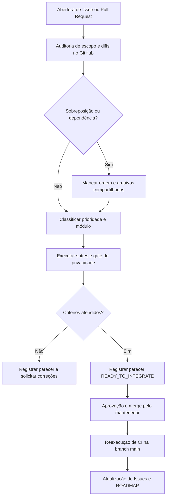

# ROADMAP TÉCNICO — PROJETO NIX
## Arquitetura, Critérios de Aceite e Governança de Integração

**Repositório oficial:** https://github.com/foros049695/nix  
**Referência inicial:** `742533c`  
**Atualização de referência:** 19/11/2026  
**Estado do produto:** Pre-alpha (núcleos P0/P1 implementados e verificados em ambiente Linux/laboratório; validação em hardware físico e infraestrutura de produção pendentes)

> Este documento estabelece as fases de engenharia, os critérios de aceite (*gates*) e o protocolo de revisão técnica do Projeto Nix. Todas as alterações são incorporadas de forma verificável, preservando a estabilidade, a segurança, o modelo de privacidade e a rastreabilidade do histórico Git.

---

## 0. Diretrizes e Classificação de Maturidade

O acompanhamento técnico adota três níveis cumulativos de verificação:

- **IMPLEMENTADO:** funcionalidade presente na base de código.
- **VALIDADO:** funcionalidade aprovada por suítes reproduzíveis de teste e análise estática dentro do escopo definido.
- **GATE CONCLUÍDO:** todos os critérios de aceite da fase foram atendidos, verificados em execução real e documentados.

Convenções utilizadas neste documento:

- `[x]` Requisito implementado e comprovadamente verificado no escopo especificado.
- `[ ] PARCIAL` Implementação presente com validação restrita a laboratório, aguardando hardware físico, infraestrutura externa ou cobertura adicional.
- `[ ] PENDENTE` Requisito ainda não demonstrado.

Governança de repositório e Autonomia Autorizada:

- Toda entrega passa por validação estrita de testes unitários, integrados e verificações de segurança/privacidade antes de publicação.
- Conforme autorização expressa do proprietário (@foros049695), o agente autônomo principal possui permissão para executar commits, integração de PRs aprovados, atualizações de branches e publicação remota automatizada no GitHub, mantendo os critérios rigorosos de qualidade, integridade e conformidade contínua a cada 4 horas.

---

# FASE 0 — ESPECIFICAÇÕES, ARQUITETURA E DOCUMENTAÇÃO

**Objetivo:** manter a especificação técnica formalizada, coerente com o código e auditável.

### Estado atual

- [x] ADRs estruturais formalizados (`ADR-0001` a `ADR-0006`, incluindo PR `#27`).
- [x] Documentação de placeholders dos módulos estruturais (`archive`, `index`, `media`, `offgrid`, `wallet`) e setup do cliente em `apps/nix_client/README.md` (PR `#25` e `#26`).
- [x] Rotina automatizada persistente de auditoria e integridade a cada 4 horas (`.github/workflows/nix_maintenance_audit.yml` e `scripts/run_maintenance_audit.py`).
- [x] Documentação de arquitetura e resposta a incidentes (`docs/ARCHITECTURE.md`, `docs/SECURITY.md`, `docs/INCIDENT_RESPONSE.md`).
- [x] Canal confidencial para divulgação de vulnerabilidades habilitado via **GitHub Private Vulnerability Reporting** (`docs/SECURITY.md` §3 / Issue `#12`).
- [x] Matriz de privacidade de 21 células vinculada a verificações estáticas e testes (`docs/PRIVACY_MATRIX.md` e `scripts/verify_privacy_matrix.sh`).
- [x] Política *fail-closed* documentada e alinhada aos transportes e ao banco local.
- [x] Arquivos de diretrizes operacionais (`AGENTS.md`, `CLAUDE.md`, `GEMINI.md`) integrados via PR `#1` (`789cf92`).
- [x] Alinhamento entre documentação e implementação (`docs/ARCHITECTURE.md`, `docs/INFRASTRUCTURE.md`, `docs/KEY_MANAGEMENT.md`, `docs/TESTING.md`).
- [x] Documentação do relay e PostgreSQL 17 sincronizada com `RelayStore`, `BlindMailboxStore` e `PostgresMailboxStore`.
- [x] Revisão das bibliotecas criptográficas e de armazenamento (`cryptography`, `sqlcipher_flutter_libs 0.6.8` / SQLCipher `4.10.0`, `libsecret` FFI, `PqxdhCombiner`).
- [x] Inventário de licenças e dependências gerado (`docs/THIRD_PARTY_LICENSES.md`).
- [x] Correções documentais propostas no PR `#10` integradas (`1799597`).

**Gate 0:** especificação consistente com o código atual, licenças catalogadas e requisitos de privacidade rastreáveis.  
**Situação: GATE CONCLUÍDO.**

---

# FASE 1 — NÚCLEO LOCAL DO CLIENTE FLUTTER

**Objetivo:** entregar cliente *local-first* com identidade criptográfica determinística, armazenamento cifrado comprovado e ciclo de vida seguro em disco e memória.

### Estado atual

- [x] Interface Flutter implementada (Flutter 3.27+ / Dart 3.6+) com temas Dark Yellow, Light Yellow e AMOLED.
- [x] Layout de três painéis redimensionáveis, Card ID e Acervo Cultural limpo (sem dados fictícios pré-populados).
- [x] Cofre de chaves (`KeyVault`) com Argon2id + XChaCha20-Poly1305 (sem frase-passe padrão fixa), backup/restauração cifrados (`exportEncryptedBackupBundle`/`importEncryptedBackupBundle`) e `AntiForensicShredder` confinado a `customBaseDir` com sobrescrita *in-place* (PR `#4`, `5d83e77`).
- [x] Persistência real via **SQLCipher `4.10.0`** no bundle Linux (`sqlcipher_flutter_libs 0.6.8`), com detecção honesta de estado de cifragem (`PRAGMA cipher_version`), bloqueio *fail-closed* (`requireEncryption: true`) contra SQLite comum (validado contra `libsqlite3.so.0` em `plain_sqlite_rejection_probe_test.dart`) e verificação de checksums SHA-256 antes de migrações SQL (PR `#6`, `7677a0b`).
- [x] Onboarding soberano em 9 etapas com verificação ativa de Tor/fail-closed (`verifyTorTransportAndFailClosed`), persistência atômica `tmp + rename` de snapshots, checagem de pré-requisitos em `completeOnboarding()` e responsividade validada em `800x600` e `1440x900`.
- [x] Proteção de chave mestre integrada ao sistema operacional (`OsKeyStorage`: `libsecret-1.so.0` via FFI no Linux, `MethodChannel` `AndroidKeyStore` AES-256-GCM em `MainActivity.kt` e fallback explícito sem gravação insegura em disco).
- [x] Recuperação determinística de identidade (`SeedRecoveryManager`: frase de 24 palavras com checksum SHA-256 e derivação HKDF de `NixIdentity`).
- [x] Carregamento pós-reinicialização (`tryAutoUnlockAndRestore`, `unlockWithPassphrase`, `_VaultUnlockPrompt`, `reloadFromDatabase`) e liberação segura com zeroização em `NixState.dispose()` (PR `#15`, `ab308e7`).
- [x] Sanitização *fail-closed* de imagens JPEG/PNG/WebP/GIF (PR `#9`, `6199fc7`), proteção contra *path traversal* em ZIP (PR `#18`, `54b6f2a`), busca FTS5 literal (PR `#14`, `134c159`) e desativação de backup automático Android (PR `#16`, `98c2228`).
- [x] PIN de coação avaliado e implementado (`duressVerifier` Argon2id + limpeza de cofre/keyring), com limitações físicas de *wear-leveling* flash e GC documentadas em `docs/KEY_MANAGEMENT.md`.
- [x] Rollback atômico do cofre e detecção de falhas no keyring nativo (Issue `#19`, PR `#30`).
- [x] Expurgo anti-forense estendido a todos os diretórios com encerramento prévio do Tor e relatório honesto de falhas parciais (PR `#20` e `#21`).
- [x] Separação modular dos 12 repositórios SQLite sob `apps/nix_client/lib/core/database/repositories/` (PR `#29`).
- [x] Análise estática Flutter sem erros ou avisos bloqueantes (`flutter analyze --no-fatal-infos`) e eliminação de gaps de BuildContext (PR `#3`, `f54b857` e PR `#22`).

### Pendências para fechamento do Gate 1

- [ ] PARCIAL Validar fluxo interativo completo das 9 telas de onboarding em UI conectada a daemon Tor vivo e expandir cobertura de testes para menus secundários de interface.
- [ ] PARCIAL Compilar APK Android de produção e validar `libsqlcipher` + `AndroidKeyStore` em hardware Android físico *(o job Linux headless do CI reporta `SQLite-Development-Clearnet` quando sem biblioteca nativa pré-compilada, conforme comportamento fail-honest).*

### Pull Requests incorporados

- PR `#3` (`f54b857`), PR `#4` (`5d83e77`), PR `#6` (`7677a0b`), PR `#9` (`6199fc7`), PR `#14` (`134c159`), PR `#15` (`ab308e7`), PR `#16` (`98c2228`), PR `#18` (`54b6f2a`).

**Gate 1:** instalação limpa, identidade persistente, armazenamento cifrado comprovado e recuperação funcional em todos os alvos distribuídos.  
**Situação: PARCIAL (validado em suíte automatizada e bundle desktop Linux; pendente validação em hardware Android físico e UI E2E completa sob Tor).**

---

# FASE 2 — RELAY, PERSISTÊNCIA E INFRAESTRUTURA

**Objetivo:** prover armazenamento temporário e encaminhamento cego de envelopes criptografados com persistência durável e isolamento de superfície administrativa.

### Estado atual

- [x] Serviço Go (`services/nix_relay`) com API de mailboxes (`/v1/mailboxes/{id}/envelopes`, `/v1/mailboxes/{id}/ack`), TTL padrão de 7 dias, `AutoPruner` com histerese (75%, 85%, 92%) e cotas in-flight de 500 MB.
- [x] Propagação estrita de erros de persistência com rollback atômico (PR `#7`, `4a13daa`) e dimensionamento dinâmico de corpo HTTP por anexo (PR `#8`, `f1dffd1`).
- [x] Abstração `RelayStore` implementada em disco (`BlindMailboxStore`) e **PostgreSQL 17+** (`PostgresMailboxStore`, schema `database/schema/relay.sql`), validada sob `-race` e carga concorrente contra container `postgres:17-alpine`, incluindo teste de `pg_dump`/`pg_restore` de metadados.
- [x] Rejeição fail-closed na inicialização do Relay caso `-config` explícito aponte para arquivo ausente, vazio ou corrompido (PR `#23`).
- [x] Capabilities duráveis por hash SHA-256 com escopos explícitos (`write`, `read_ack`, `admin`), expiração e revogação via endpoint administrativo.
- [x] Isolamento *fail-closed* do listener administrativo (`ValidateAdminListenAddr` restrito a loopback, retornando HTTP 404 para `/metrics` e `/admin/capabilities` na superfície pública/Onion).
- [x] Expansão portátil de `~` em `base_dir` sem caminhos locais fixos (PR `#17`, `f2effa4`) e scripts de provisionamento para Debian 13 + Tor Onion Service v3 (`services/nix_relay/deploy/provision_vps.sh`, `torrc.onion.snippet`, `nix-relay.service`).
- [x] Verificação estática contínua de privacidade (`scripts/verify_privacy_matrix.sh` reforçado pelo PR `#13`, `807e93b`) e testes Go com `-race`.
- [x] Implantação laboratorial validada com `nix-relay` compilado atrás de Tor `0.4.9.15` (`Bootstrapped 100%`, Onion v3 ativo).

### Pendências operacionais

- [ ] PARCIAL Provisionar VPS de produção externa em Debian 13 e executar validação contínua em ambiente remoto.

### Pull Requests incorporados

- PR `#7` (`4a13daa`), PR `#8` (`f1dffd1`), PR `#13` (`807e93b`), PR `#17` (`f2effa4`).

**Gate 2:** relay persistente, recuperável, autenticado por capabilities e validado em rede Tor.  
**Situação: GATE CONCLUÍDO em ambiente laboratorial (pendente apenas provisionamento em VPS de produção externa).**

---

# FASE 3 — MENSAGERIA E2EE E SINCRONIZAÇÃO

**Objetivo:** garantir comunicação cifrada ponta a ponta entre clientes independentes com entrega assíncrona, recuperação de falhas e preservação estrita de metadados.

### Estado atual

- [x] Módulos `modules/core_crypto` e `modules/transport` livres de erros estritos (`dart analyze --fatal-infos`, PR `#2`, `8618b79`), com reorganização do pacote `core_crypto` encapsulando implementações internas em `lib/src` sob barrel público (PR `#28`).
- [x] Gerenciador `EmbeddedTorManager` isolado em testes e com encerramento garantido de processos filhos em timeout (PR `#5`, `c7dd88d`), testado com Tor `0.4.9.15` ao vivo (`Bootstrapped 100%`).
- [x] Correção da **Issue `#11`** em `modules/transport/lib/nix_transport.dart`: túnel SOCKS5 em `RawSocket` (`Socks5Connector.connectRaw`) com upgrade nativo `RawSecureSocket.secure` em `RelayClient._socksHttp`, validação rigorosa de certificado TLS por padrão (*fail-closed*) e bloqueio antecipado de esquemas não-HTTP(S) via `UnsupportedTransportSchemeException` (`cc3fc4f`).
- [x] Protocolo completo em `SovereignMessenger` (`gate3_two_client_e2ee_test.dart` e `transactional_messaging_fault_test.dart`): unificação da UI (`NixState.sendDirectMessage` + `syncWithRelay`), gravação transacional atômica (`sessions` + `messages` + `attachments` + `outbox`), injeção de falhas nos 6 estágios sem corrupção de ratchet, estados reais (`queued`, `accepted`, `delivered`, `failed`, `saved`), troca entre duas instâncias independentes via relay+SOCKS5 locais, recuperação pós-reinicialização, `FilePickerAdapter` portável, cancelamento de anexos com limpeza de chunks e rotação automática de épocas de Sender Keys em kick/ban.

### Pendências para alvos móveis/rede pública

- [ ] PARCIAL Integrar empacotamento completo do binário Tor no instalador/APK Android de produção (`scripts/bundle_tor_linux.sh` operacional no Linux).
- [ ] PARCIAL Executar teste cruzado de dois dispositivos físicos pela rede Tor pública.

### Pull Requests incorporados

- PR `#2` (`8618b79`), PR `#5` (`c7dd88d`), PR `#9` (`6199fc7`).

**Gate 3:** troca de mensagens E2EE entre clientes independentes via SOCKS5/Relay cego com autenticação, persistência, anexos, grupos e recuperação após falha.  
**Situação: GATE CONCLUÍDO em testes integrados de laboratório (restam validação cross-device na rede Tor pública e empacotamento Tor no APK Android).**

---

# FASE 4 — BENCHMARK E CAPACIDADE DE 50 USUÁRIOS

**Objetivo:** medir o comportamento real do relay sob carga concorrente e dimensionar a infraestrutura mínima recomendada.

### Estado atual

- [x] Simulador reproduzível de carga implementado (`services/nix_relay/cmd/bench/main.go`) e resultados documentados em `docs/PERFORMANCE.md`.
- [x] Execução medida com 50 clientes simultâneos em `15.184s` (loopback HTTP): `7.435` operações completas (`489.66 ops/s`), `216` anexos de `2 MB`, `466` reconexões, `0` erros HTTP, `p50 = 1.8 ms`, `p95 = 404.442 ms`, `p99 = 1.4189 s`, `HeapAlloc = 94.28 MB` e `Sys = 678.40 MB`.
- [x] Transição de histerese do `AutoPruner` verificada sob pressão (`NORMAL -> SEVERE_RELIEF`, `pruned_count = 6`, `stored_bytes = 0` após ACKs e expurgo).
- [x] Dimensionamento de VPS documentado (`2 vCPU`, `4 GB RAM` recomendada para rajadas concorrentes de 2 MB, `40 GB NVMe`).

### Pendências de soak estendido

- [ ] PARCIAL Executar teste contínuo de 60 minutos (`-duration 60m`) em VPS de laboratório através de circuito Onion v3 multi-salto.

**Gate 4: PARCIAL.**

---

# FASE 5 — COMUNICAÇÃO OFF-GRID

**Objetivo:** viabilizar troca de mensagens curtas e verificação de conteúdo local sem conectividade convencional.

- [x] Enquadramento experimental Bluetooth Mesh (`modules/transport/lib/nix_bluetooth_mesh.dart`, framing `NIXB`).
- [x] Codec de pacote para rádio `<= 240B` (`RadioPacketCodec` bloqueando mídias/anexos, CRC16-CCITT) e controle de janela de transmissão (`DutyCycleGovernor`) validados em `offgrid_radio_test.dart`.
- [x] Leitor offline de mapas SQLite MBTiles (`MbtilesMapReader`) validado em `phases_5_to_9_test.dart`.
- [x] Ponte ATAK CoT XML sobre UDP loopback com consentimento explícito obrigatório (`AtakCotBridge`).
- [x] Verificação Ed25519 para pacotes de atualização/compartilhamento offline (`SignedReleaseManifest` + `share_app_offline_dialog.dart`).
- [ ] PENDENTE Validar comunicação em hardware físico Bluetooth BLE, LoRa e interfaces seriais Meshtastic/Reticulum RNode entre dispositivos reais.

**Gate 5: PARCIAL.**

---

# FASE 6 — MONERO P2P

**Objetivo:** oferecer recursos P2P não custodiais com isolamento rígido entre identidade de mensageria e identidade financeira.

- [x] Política de isolamento implementada e testada (`MoneroIsolationPolicy`: separação estrita Seed A vs Seed B e bloqueio de endpoints clearnet fora de loopback/`.onion`).
- [x] Assinatura e verificação Ed25519 reais de anúncios (`SignedMoneroAd` via `SignedRecord` + `ReplayGuard`, validação de preços/limites, persistência em SQLCipher, badges honestos `LOCAL ASSINADO` vs `PUBLICADO NO RELAY` e remoção de saldos fictícios na UI).
- [x] Documentação do modelo de isolamento em `docs/WALLET.md`, `docs/ARCHITECTURE.md` e `ADR-0003`.
- [ ] PARCIAL Integrar liquidação ao vivo contra daemon `monero-wallet-rpc` real em rede testnet/stagenet.

**Gate 6: PARCIAL.**

---

# FASE 7 — NIX ARCHIVE

**Objetivo:** estruturar publicação local e verificável de artigos, documentos e refutações.

- [x] Serviço `NixArchiveService` implementado em `apps/nix_client/lib/core/archive/nix_archive_service.dart` com sanitizador HTML por tokenizador determinístico e whitelist estrita (sem dependência apenas de regex) conforme `docs/ARCHIVE.md`.
- [x] Fluxo completo integrado em `PublicationRoomView` e `NixState` sobre SQLCipher: criar, editar (`supersedes`), assinar Ed25519, salvar localmente, refutar, inspecionar histórico de revisões e verificar integridade SHA-256/Ed25519.
- [ ] PARCIAL Implementar e validar replicação distribuída automática entre múltiplos nós S3/IPFS em cluster externo.

**Gate 7: PARCIAL.**

---

# FASE 8 — NIX MEDIA, INDEX E GITHUB DISCOVERY

**Objetivo:** disponibilizar organização e busca offline de acervo mantendo barreiras contra vazamento de rede.

- [x] Repositório SQLCipher + FTS5 (`MediaRepository`) com citação segura de termos (PR `#14`), busca local integrada em `CulturalShowcase`, catálogo estático offline Starwire (`4.188` entradas) com persistência de favoritos e proibição estrita de bypass clearnet em downloads ZIP (`enforceStarwireDownloadTransport`).
- [x] Serviço `MediaCatalogService` validado com separação entre busca local (`localCatalogSearch`), conectores remotos estritamente opt-in (`OptInMediaConnectorKind` sob política fail-closed Tor/SOCKS5) e gate `authorizeMagnetResolution` isolado da Seed A.
- [ ] PARCIAL Implementar clientes HTTP reais via Tor SOCKS5 para conectores remotos opt-in externos (TMDB, AniList e Jellyfin).

**Gate 8: PARCIAL.**

---

# FASE 9 — HARDENING E RELEASE

**Objetivo:** assegurar rastreabilidade de dependências, integridade de artefatos e prontidão para auditoria externa.

- [x] Pipeline CI em `.github/workflows/ci.yml` executando 5 jobs independentes e portão estático de privacidade (`scripts/verify_privacy_matrix.sh` reforçado pelo PR `#13`).
- [x] Geração reproduzível de SBOM CycloneDX 1.5 (`scripts/generate_sbom.sh`, 90 componentes Go/Dart/Flutter).
- [x] Ferramenta de assinatura Ed25519 de releases (`SignedReleaseManifest` + `scripts/sign_release.dart`) e protótipo híbrido **PQXDH** vinculado ao transcript (`Nix-PQXDH-Hybrid-v1` + `pqxdh_release_test.dart`).
- [ ] PARCIAL Gerar e assinar builds públicos reproduzíveis multi-plataforma (Linux desktop e APK Android).
- [ ] PENDENTE Submeter o código consolidado a auditoria criptográfica externa independente e testes de produção multi-relay.

**Gate 9: PARCIAL.**

---

## Matriz de Rastreabilidade (Gates vs Módulos)

| Fase | Módulo Principal | Documentação Associada | Alinhamento Matriz de Privacidade |
|---|---|---|---|
| **Fase 0** | Core / Specs | `docs/ARCHITECTURE.md`, `docs/SECURITY.md` | Todas as 21 células mapeadas |
| **Fase 1** | Nix Messenger (Client) | `docs/KEY_MANAGEMENT.md` | `L-A`, `I-A`, `DD-A`, `U-A` |
| **Fase 2** | Nix Infrastructure | `docs/INFRASTRUCTURE.md`, `docs/RETENTION.md` | `L-S`, `I-S`, `N-S`, `D-S` |
| **Fase 3** | Nix Messenger (Protocol) | `docs/PROTOCOL.md`, `docs/TRANSPORTS.md` | `L-U`, `I-U`, `N-U`, `DD-U` |
| **Fase 4** | Performance & Relay | `docs/PERFORMANCE.md` | `D-S`, `DD-S` |
| **Fase 5** | Nix Offline & Radio | `docs/OFFGRID.md` | `U-U`, `C-U` |
| **Fase 6** | Nix Wallet (Monero) | `docs/WALLET.md` | `L-A`, `I-A`, `DD-A` |
| **Fase 7** | Nix Archive | `docs/ARCHIVE.md`, `docs/REPLICATION.md` | `N-A`, `DD-U` |
| **Fase 8** | Nix Media & Index | `docs/MEDIA.md`, `docs/INDEX.md` | `U-U`, `C-U` |

---

## Histórico de Protótipos (Referência Histórica)

- **Protótipo v0.2.0 (AMOLED & Starwire):** interface inicial, Card ID visual, pastas no Dock, estado em memória e catálogo Starwire estático (`4.188` entradas CC0-1.0).
- **Protótipo v0.4.0-dev (Layout V4):** pipeline de marca `scripts/brand/process_logo.py`, temas Dark Yellow, Light Yellow e AMOLED, divisórias redimensionáveis e esboços iniciais de `core_crypto`, `transport` e `nix_relay`.

---

# GOVERNANÇA DE ISSUES E PULL REQUESTS

## Objetivo

Garantir que todas as contribuições submetidas ao repositório sejam analisadas, validadas contra regressões e integradas com rastreabilidade completa de testes e privacidade.

## A. Critérios de Auditoria de Issues

Para cada Issue aberta ou reaberta:

1. Identificar autor, módulo afetado e fase correspondente neste roadmap.
2. Reproduzir o comportamento no estado atual da `main`.
3. Mapear dependências e Pull Requests vinculados.
4. Classificar por prioridade (`P0`, `P1`, `P2`) e categoria técnica (`bug`, `security`, `documentation`, `enhancement`, `needs-reproduction`, `needs-tests`, `blocked`), reutilizando labels existentes.
5. Encerrar apenas após correção demonstrada ou decisão formal documentada.

## B. Critérios de Auditoria de Pull Requests

Para cada Pull Request:

1. Conferir autor, branch de origem/destino, escopo de commits e diff completo.
2. Verificar sobreposição de arquivos com outros PRs abertos ou alterações recentes na `main`.
3. Conferir aderência estrita à Matriz de Privacidade (`scripts/verify_privacy_matrix.sh`).
4. Executar todas as suítes pertinentes em ambiente isolado (a aprovação de um PR exige execução independente das suítes e checks verdes de CI).
5. Classificar o parecer técnico em `docs/COLLABORATION_STATUS.md` utilizando um dos estados formais:
   - `READY_FOR_REVIEW`
   - `NEEDS_CHANGES`
   - `BLOCKED_BY_DEPENDENCY`
   - `CI_FAILED`
   - `READY_TO_INTEGRATE`
   - `ALREADY_INTEGRATED`

## C. Registro de Integrações Realizadas (19/11/2026)

| PR | Escopo Principal | Autor | Commit Merge (`main`) | Parecer |
|---|---|---|---|---|
| #1 | Guias operacionais (`AGENTS.md`, `CLAUDE.md`, `GEMINI.md`) | @gabrielmaialva33 | `789cf92` | `ALREADY_INTEGRATED` |
| #2 | Analisadores estritos `core_crypto` e `transport` | @gabrielmaialva33 | `8618b79` | `ALREADY_INTEGRATED` |
| #3 | Compatibilidade Flutter CI e componentes Material | @gabrielmaialva33 | `f54b857` | `ALREADY_INTEGRATED` |
| #5 | Isolamento de testes e timeout de processos Tor | @gabrielmaialva33 | `c7dd88d` | `ALREADY_INTEGRATED` |
| #4 | Confinamento e sobrescrita *in-place* em `panicWipeAccount` | @gabrielmaialva33 | `5d83e77` | `ALREADY_INTEGRATED` |
| #6 | Estado honesto de SQLCipher e checksums de migração | @gabrielmaialva33 | `7677a0b` | `ALREADY_INTEGRATED` |
| #9 | Remoção *fail-closed* de metadados JPEG/PNG/WebP/GIF | @gabrielmaialva33 | `6199fc7` | `ALREADY_INTEGRATED` |
| #7 | Propagação de erros de persistência e rollback no relay Go | @gabrielmaialva33 | `4a13daa` | `ALREADY_INTEGRATED` |
| #8 | Limite dinâmico de corpo HTTP por tamanho de anexo | @gabrielmaialva33 | `f1dffd1` | `ALREADY_INTEGRATED` |
| #10 | Atualização de `AGENTS.md` e isolamento de `$HOME` em testes | @gabrielmaialva33 | `1799597` | `ALREADY_INTEGRATED` |
| #13 | Reforço das checagens estáticas `I-A` e `I-S` no script de privacidade | @gabrielmaialva33 | `807e93b` | `ALREADY_INTEGRATED` |
| #14 | Citação literal de termos FTS5 em `MediaRepository` | @gabrielmaialva33 | `134c159` | `ALREADY_INTEGRATED` |
| #15 | Liberação de recursos e zeroização em `NixState.dispose` | @gabrielmaialva33 | `ab308e7` | `ALREADY_INTEGRATED` |
| #16 | Desativação de `allowBackup` e `fullBackupContent` no Android | @gabrielmaialva33 | `98c2228` | `ALREADY_INTEGRATED` |
| #17 | Remoção de caminhos locais e expansão de `~` em `nix_relay` | @gabrielmaialva33 | `f2effa4` | `ALREADY_INTEGRATED` |
| #18 | Sanitização de nomes em arquivos ZIP contra *path traversal* | @gabrielmaialva33 | `54b6f2a` | `ALREADY_INTEGRATED` |

## D. Issues Resolvidas

- **Issue `#11` (`bug`, `P0` — HTTPS via SOCKS5):** resolvida com `Socks5Connector.connectRaw` + `RawSecureSocket.secure` em `modules/transport/lib/nix_transport.dart`, preservando validação estrita de certificados e rejeição antecipada via `UnsupportedTransportSchemeException` (`cc3fc4f`). Encerrada em `completed`.
- **Issue `#12` (`security`, `P1` — Canal confidencial de vulnerabilidades):** atendida com ativação oficial do **GitHub Private Vulnerability Reporting** e atualização de `docs/SECURITY.md` e `docs/INCIDENT_RESPONSE.md` (`090c18c`). Encerrada em `completed`.

## E. Verificação Pós-Merge

Após cada ciclo de integração na branch `main`:

1. Confirmar commit de merge e ausência de conflitos ou regressões funcionais.
2. Reexecutar todas as suítes aplicáveis (`verify_privacy_matrix.sh`, Go com `-race`, Dart `analyze --fatal-infos`/`test`, Flutter `analyze --no-fatal-infos`/`test`).
3. Confirmar aprovação de todos os jobs no GitHub Actions.
4. Atualizar estados de Issues, `ROADMAP.md` e `docs/COLLABORATION_STATUS.md`.

---

## Fluxo de Revisão e Integração



## Consultas Padronizadas de Auditoria

O estado atualizado do repositório pode ser consultado diretamente via GitHub CLI ou API REST oficial, mantendo o relatório consolidado em `docs/COLLABORATION_STATUS.md`:

```bash
gh issue list --repo foros049695/nix --state all --limit 100
gh pr list --repo foros049695/nix --state all --limit 100
gh pr checks <NUMERO> --repo foros049695/nix
gh pr diff <NUMERO> --repo foros049695/nix
gh pr view <NUMERO> --repo foros049695/nix --json title,body,state,author,files,reviews,comments
```

---

## Próximos Marcos Operacionais e de Hardware

Com os requisitos locais P0 e P1 implementados e validados em ambiente de desenvolvimento e CI, as próximas entregas dependem de validação em hardware físico e infraestrutura externa:

1. **Soak em VPS de produção:** provisionar servidor Debian 13 via `services/nix_relay/deploy/provision_vps.sh` e executar carga contínua de 60 minutos (`./bench -clients 50 -duration 60m`) sobre Onion Service v3 ativo.
2. **Validação física Android e RF:** gerar build APK com NDK para comprovar `SQLCipher`, `AndroidKeyStore` TEE, empacotamento do Tor móvel e comunicação física via Bluetooth BLE / LoRa / RNode serial.
3. **Integrações externas pendentes:** acoplar `monero-wallet-rpc` em testnet/stagenet (Fase 6), replicação distribuída S3/IPFS (Fase 7) e conectores remotos opt-in via Tor (Fase 8).
4. **Release pública e auditoria:** gerenciar eventuais relatos via Private Vulnerability Reporting, publicar artefatos reproduzíveis assinados com SBOM e submeter a base consolidada a auditoria criptográfica externa independente antes da fase beta pública.
