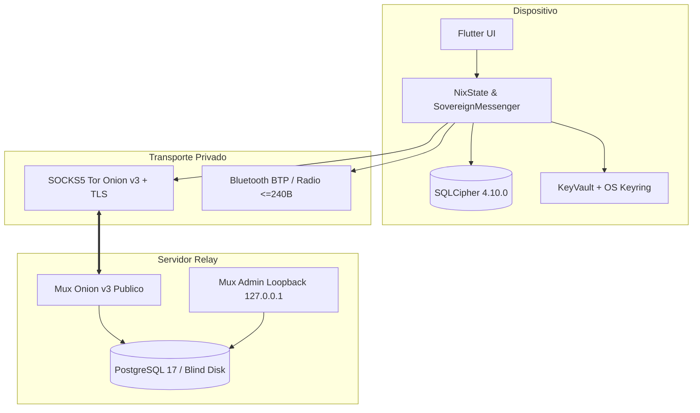

# 🏛️ Arquitetura do Sistema — Projeto NIX

## 1. Visão Geral dos Componentes Implementados

O **Nix** é estruturado como monorepo modular com fronteiras rígidas de criptografia, transporte e persistência:

- **Cliente Multi-plataforma (`apps/nix_client`):** Flutter/Dart (Linux Desktop + Android). Mantém chaves privadas no **KeyVault** (Argon2id + XChaCha20-Poly1305, sem frase-passe padrão fixa, com backup/restore cifrado) protegido por armazenamento nativo do SO (`libsecret` via FFI no Linux, `AndroidKeyStore` AES-256-GCM no Android ou frase-passe pura sem simulação) e banco **SQLCipher 4.10.0** em repouso com bloqueio *fail-closed* (`requireEncryption`) contra SQLite não cifrado. `NixState.sendDirectMessage()` e `syncWithRelay()` integram a UI diretamente ao pipeline transacional `SovereignMessenger` (transação SQLite única para `sessions`, `messages`, `attachments` e `outbox`, diferenciação de Mensagens Salvas e estados reais `queued`/`accepted`/`delivered`/`failed`).
- **Módulo Criptográfico (`modules/core_crypto`):** Ed25519 (autenticação/assinatura), X25519 (ECDH), XChaCha20-Poly1305 AEAD, Argon2id, X3DH, Double Ratchet serializável, SignedRecord + ReplayGuard e combinador híbrido **PQXDH (`Nix-PQXDH-Hybrid-v1`)**.
- **Módulo de Transporte (`modules/transport`):** Conector SOCKS5 estrito sem vazamento de DNS (`ATYP 0x03`), suporte **HTTPS/TLS real sobre SOCKS5** (`RawSecureSocket.secure` fail-closed contra certificados inválidos), cliente `TorControlClient` (`ADD_ONION`, `GETINFO`), gerenciador `EmbeddedTorManager`, malha Bluetooth `NIXB` e codec de rádio `<= 240B` (`RadioPacketCodec` + `DutyCycleGovernor` + `AtakCotBridge`).
- **Relay Transitório (`services/nix_relay`):** Servidor Go cego com abstração **`RelayStore`** suportando armazenamento atômico em disco (`BlindMailboxStore` + `.capabilities.json` SHA-256) e **PostgreSQL 17+** (`PostgresMailboxStore` usando `database/schema/relay.sql`), métricas e provisionamento administrativo estritamente em loopback (`127.0.0.1`), zero logs de IP (`r.RemoteAddr` banido estaticamente) e `AutoPruner` por histerese.

---

## 2. Fronteiras de Compartimentação (ADR-0003)

1. **Seed A (Mensageria) vs Seed B (Monero P2P):** Mnemonic Seed A de 24 palavras (com checksum SHA-256) deriva exclusivamente chaves Ed25519/X25519 da mensageria (`Nix-SeedA-Ed25519-v1` / `X25519-v1`). `MoneroIsolationPolicy` impede reutilização de seed e bloqueia RPC claro não-Tor/não-loopback.
2. **Nix Archive (`nix.archive.article.v1`):** Artigos e refutações canônicos assinados por Ed25519 com sanitização HTML anti-XSS em tabelas dedicadas (`archive_*`).
3. **Nix Media / Starwire (`media_items` + FTS5):** Busca offline de catálogo separada de resolução magnet (bloqueada por padrão no modo Tor estrito) e estado de transferência sem acesso à Seed A.

## Convites e diagnóstico nativo

O cliente monta o envio privado por convite recíproco assinado e sessão em SQLCipher. A configuração do relay vive nas preferências do cofre. O [runner Windows](WINDOWS_DESKTOP_IMPLEMENTATION.md) hospeda a interface Flutter e integra cofre do SO e diagnóstico local.
