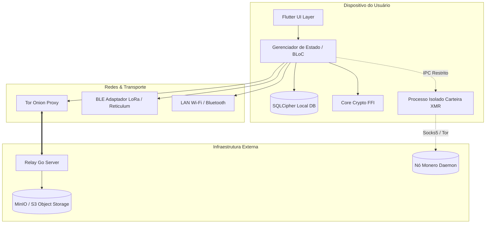

# 🏛️ Arquitetura do Sistema — Projeto NIX

## 1. Visão Geral dos Componentes

O **Nix** é estruturado como um monorepo modular composto por:
- **Cliente Multi-plataforma (`apps/nix_client`):** Desenvolvido em Flutter, executando no Android, Linux, Windows, macOS e iOS. É o responsável exclusivo por manter as chaves privadas e decifrar dados.
- **Relay Transitório (`services/nix_relay`):** Desenvolvido em Go (ou Rust), projetado como uma fila cega (blind store-and-forward) para armazenar mensagens temporariamente até a entrega ou expiração via TTL.
- **Módulos de Domínio (`modules/*`):** Bibliotecas isoladas com limites estritos de acesso à memória e rede.

---

## 2. Fronteiras de Compartimentação

1. **Mensageria vs Carteira:**
   - O processo da carteira é gerado separadamente ou isolado via sandbox FFI.
   - A **Seed A** (mensageiro) nunca compartilha memória ou função de derivação com a **Seed B** (Monero).
   - O comprometimento da chave de chat não permite assinar transações financeiras.
2. **Mensageria vs Publicação (Archive):**
   - O autor de uma publicação no Nix Archive utiliza uma persona editorial com chave Ed25519 independente.
   - Nenhuma assinatura pública do Archive pode ser vinculada à identidade do mensageiro.
3. **Mídia e Index vs Rede:**
   - Buscar metadados de filmes/séries e consultar manifests de torrents são ações estritamente desconectadas de conexões P2P BitTorrent ou DHT pública.

---

## 3. Decisões de Tecnologia

- **Cliente:** Flutter (Dart). Permite UI de alto desempenho em múltiplas plataformas mantendo uma única base de código tática/escura.
- **Banco de Dados Local:** SQLCipher (SQLite com criptografia transparente AES-256-CBC ou XChaCha20-Poly1305).
- **Backend Relay:** Go. Alta concorrência nativa via goroutines, baixo consumo de memória (< 500 MB RSS para 50 conexões), binário estático e facilidade de compilação sem dependências de runtime.
- **Serialização:** Protocol Buffers v3 (`proto/`). Garante tipagem estrita, retrocompatibilidade e serialização ultracompacta para rádio LoRa.
