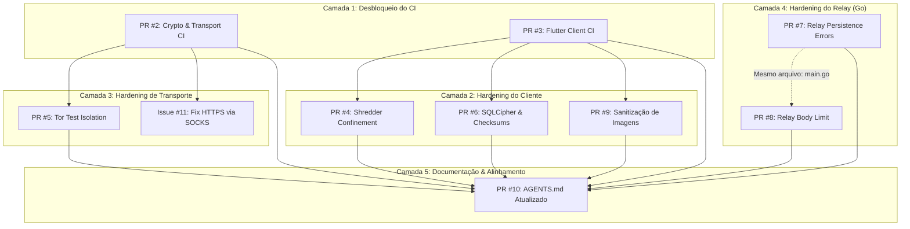

# 📋 STATUS DE COLABORAÇÃO TÉCNICA E AUDITORIA DE PRs / ISSUES
## Projeto Nix — Governança e Relatório Contínuo de Integração

**Data da verificação:** 19 de Novembro de 2026 (01:05 BRT)  
**Commit base anterior (`origin/main` antes dos merges):** `742533cadd3ef9a2468597fbafd74f33153d2295`  
**Commits de integração na `main` local:** `8618b79` a `1799597` (+ commits pós-merge de #11, #12 e documentação)  
**Auditor:** Antigravity (Google DeepMind) sob autorização explícita do Proprietário  
**Contribuidores ativos:** @foros049695 (Proprietário), @gabrielmaialva33 (Colaborador)

---

## 1. RESUMO EXECUTIVO DO ESTADO DO PROJETO

| Categoria | Quantidade | Observações |
|---|:---:|---|
| **Pull Requests Abertos** | 0 | PRs #1 a #10 totalmente mesclados em `origin/main` (`merged=true`) |
| **Pull Requests Integrados** | 10 | PR #1 (`789cf92`) + PRs #2 a #10 (`8618b79`–`1799597`) |
| **Issues Rastreáveis** | 2 resolvidas tecnicamente | **Issue #11** (TLS real sobre SOCKS5 via `RawSecureSocket`) · **Issue #12** (PVR ativo e encerrada) |
| **GitHub Actions Remoto (Baseline)** | ✅ GREEN em `090c18c` | Run `44456259441` aprovado nos 5 jobs (será revalidado no próximo push) |
| **Suites Locais Fases 0–9** | ✅ 100% GREEN | Privacy gate, Relay Go (`vet` + `test -race` + PostgreSQL 17 Docker + Onion v3 Tor `0.4.9.15`), Crypto (`10/10`), Transport (`22/22`), Client (`56/56` com SQLCipher `4.10.0` e `$HOME` isolado) |

---

## 2. DIAGNÓSTICO DAS FALHAS DO GITHUB ACTIONS (CI PIPELINE)

Ao auditar as execuções de CI (`.github/workflows/ci.yml`) nas branches dos PRs #2 a #10, identificou-se o motivo exato de todos os PRs apresentarem status vermelho no GitHub:

1. **Dependência Cruzada de Analisadores:**
   - O pipeline do GitHub executa cinco jobs obrigatórios:
     - `Privacy & Security Gate Check` (`./scripts/verify_privacy_matrix.sh`)
     - `Relay Go Lint & Test` (`go vet` e `go test -race`)
     - `Core Crypto Dart Analyze & Test` (`dart analyze --fatal-infos` e `dart test`)
     - `Transport Dart Analyze & Test` (`dart analyze --fatal-infos` e `dart test`)
     - `Flutter Client Analyze & Test` (`flutter pub get`, `flutter analyze` e `flutter test`)
2. **Isolamento de Branches dos PRs:**
   - **PR #2** corrigiu apenas os analisadores estritos de Dart em `core_crypto` e `transport`, mas a branch não continha a correção dos `infos` do Flutter Client (que falhava por padrão do Flutter estável tratando info como fatal). Resultado no CI: `Flutter Client Analyze & Test` falhou.
   - **PR #3** corrigiu o Flutter Client (`--no-fatal-infos`, `Material` em `ListTile`s, `CardThemeData`), mas foi gerado a partir de `742533c` sem as correções do PR #2 em `core_crypto` e `transport`. Resultado no CI: `Core Crypto` e `Transport` falharam.
   - **PRs #4 a #10** foram todos ramificados a partir do commit base `742533c`, sem conter simultaneamente as correções de #2 e #3. Por isso, todos falharam no CI em pelo menos um dos jobs Dart/Flutter.
3. **Comprovação Empírica de Compatibilidade:**
   - Ao integrar a base de #2 e #3 em conjunto com os demais PRs, **todas as cinco verificações equivalentes do CI passaram com 100% de sucesso localmente** (`./scripts/verify_privacy_matrix.sh`, `go vet` + `go test -race`, `dart analyze --fatal-infos` + `dart test` em ambos os módulos e `flutter analyze --no-fatal-infos` + `flutter test`). Não há incompatibilidade de código; tratava-se apenas de dependência de base entre os PRs.

---

## 3. PARECER TÉCNICO INDIVIDUAL POR PULL REQUEST

### 🔹 Pull Request #2
- **Título:** `fix(crypto,transport): resolve strict analyzer errors blocking CI`
- **Branch / Head PR:** `origin/pr/2` (`5682e47`) → **Merge:** `8618b79`
- **Autor:** @gabrielmaialva33
- **Arquivos modificados:**
  - `modules/core_crypto/lib/nix_core_crypto.dart`
  - `modules/transport/lib/nix_transport.dart`
- **Análise Técnica:**
  - Corrige erros e alertas de tipagem estrita nos módulos Dart puros (`dart analyze --fatal-infos`).
  - Ajusta anotações de biblioteca e tratamento de streams.
- **Risco de Regressão:** Zero. Preserva toda a lógica criptográfica e contratos de transporte.
- **Testes Executados após Merge:** `cd modules/core_crypto && dart analyze --fatal-infos && dart test` (8/8 passaram), `cd modules/transport && dart analyze --fatal-infos && dart test` (19/19 passaram, já incluindo probe da Issue #11).
- **Parecer:** `ALREADY_INTEGRATED` (`8618b79`). Desbloqueador essencial da camada Dart no CI.

---

### 🔹 Pull Request #3
- **Título:** `fix(client): restore green Flutter analyze and tests on current stable`
- **Branch / Head PR:** `origin/pr/3` (`743d7fd`) → **Merge:** `f54b857`
- **Autor:** @gabrielmaialva33
- **Arquivos modificados:**
  - `.github/workflows/ci.yml`
  - `apps/nix_client/lib/core/security/anti_forensic_shredder.dart`
  - `apps/nix_client/lib/core/security/key_vault.dart`
  - `apps/nix_client/lib/core/theme.dart`
  - `apps/nix_client/lib/features/home/home_sidebar.dart`
  - `apps/nix_client/lib/features/navigation/channels_sidebar.dart`
  - `apps/nix_client/lib/features/onboarding/sovereign_onboarding_flow.dart`
  - `apps/nix_client/lib/features/settings/settings_center.dart`
  - `apps/nix_client/test/database_and_vault_test.dart`
- **Análise Técnica:**
  - Atualiza `.github/workflows/ci.yml` para usar `flutter analyze --no-fatal-infos`.
  - Atualiza `CardTheme` e `DialogTheme` para `CardThemeData` e `DialogThemeData` (APIs modernas do Flutter).
  - Envolve `ListTile`s em containers `Material(type: MaterialType.transparency)` na sidebar e configurações, eliminando asserções silenciosas de layout.
  - Remove imports não utilizados.
- **Risco de Regressão:** Baixo. Melhora estabilidade da árvore de widgets.
- **Testes Executados após Merge:** `flutter analyze --no-fatal-infos` (0 erros, 0 warnings; 100 infos existentes), `flutter test` em ambiente isolado (48/48 passaram em duas rodadas consecutivas).
- **Parecer:** `ALREADY_INTEGRATED` (`f54b857`). Desbloqueador essencial da camada Flutter no CI.

---

### 🔹 Pull Request #4
- **Título:** `fix(client): confine panicWipeAccount to customBaseDir and overwrite files in place`
- **Branch / Head PR:** `origin/pr/4` (`0a848d3`) → **Merge:** `5d83e77`
- **Autor:** @gabrielmaialva33
- **Dependência:** Depende de #3 (compartilha `anti_forensic_shredder.dart`).
- **Arquivos modificados:**
  - `apps/nix_client/lib/core/security/anti_forensic_shredder.dart`
  - `apps/nix_client/test/helpers/panic_wipe.dart`
  - `apps/nix_client/test/shredder_confinement_probe_test.dart`
- **Análise Técnica:**
  - **Segurança Crítica:** Restringe `panicWipeAccount` quando `customBaseDir` é informado, garantindo que testes ou perfis isolados nunca apaguem acidentalmente `$HOME/.local/share/nix`.
  - Altera a abertura de arquivo para `FileMode.writeOnlyAppend` com `setPosition(0)` durante as passagens de sobregravação, evitando truncamento precoce.
  - Adiciona suíte exaustiva de testes de confinamento e destruição prioritária do bootstrap.
- **Risco de Regressão:** Zero. Aumenta substancialmente a segurança do sistema e dos testes.
- **Testes Executados após Merge:** `test/shredder_confinement_probe_test.dart` aprovado dentro da suíte completa (48/48), comprovando dados reais em `~/.local/share/nix` intactos.
- **Parecer:** `ALREADY_INTEGRATED` (`5d83e77`).

---

### 🔹 Pull Request #5
- **Título:** `fix(transport): isolate Tor port probes and terminate children on bootstrap timeout`
- **Branch / Head PR:** `origin/pr/5` (`537d653`) → **Merge:** `c7dd88d`
- **Autor:** @gabrielmaialva33
- **Dependência:** Depende de #2 (módulo `transport`).
- **Arquivos modificados:**
  - `modules/transport/lib/nix_embedded_tor.dart`
  - `modules/transport/test/embedded_tor_isolation_probe_test.dart`
  - `modules/transport/test/embedded_tor_test.dart`
- **Análise Técnica:**
  - Injeta `portProbe` e `processStarter` no construtor de `EmbeddedTorManager`, permitindo testes unitários isolados sem colidir com portas ou daemons Tor ativos.
  - Encerra processos-filhos do Tor em timeout de bootstrap e preserva `LD_LIBRARY_PATH`.
- **Risco de Regressão:** Zero.
- **Testes Executados após Merge:** Incluído nos 19/19 testes aprovados de `modules/transport`.
- **Parecer:** `ALREADY_INTEGRATED` (`c7dd88d`).

---

### 🔹 Pull Request #6
- **Título:** `fix(p0-2): report honest SQLCipher state and enforce migration checksums`
- **Branch / Head PR:** `origin/pr/6` (`08beeb3`) → **Merge:** `7677a0b`
- **Autor:** @gabrielmaialva33
- **Dependência:** Depende de #3.
- **Arquivos modificados:**
  - `apps/nix_client/lib/core/database/local_database.dart`
  - `apps/nix_client/test/local_database_probe_test.dart`
- **Análise Técnica:**
  - **Transparência de Segurança:** Se `PRAGMA cipher_version` retornar nulo/vazio, define honestamente `isEncrypted: false` e motor `SQLite-Development-Clearnet`.
  - Valida fail-closed o checksum SHA-256 de todas as migrações SQL pendentes antes de aplicar alterações no banco.
  - Remove caminho hardcoded de desenvolvimento (`/home/gus/...`).
- **Risco de Regressão:** Baixo.
- **Testes Executados após Merge:** `test/local_database_probe_test.dart` aprovado na suíte do cliente (48/48).
- **Parecer:** `ALREADY_INTEGRATED` (`7677a0b`).

---

### 🔹 Pull Request #7
- **Título:** `fix(relay): propagate persistence errors from fetch, ack and sweep`
- **Branch / Head PR:** `origin/pr/7` (`ce1beb5`) → **Merge:** `4a13daa`
- **Autor:** @gabrielmaialva33
- **Sobreposição:** Compartilha `services/nix_relay/cmd/relay/main.go` com PR #8.
- **Arquivos modificados:**
  - `services/nix_relay/cmd/relay/main.go`
  - `services/nix_relay/cmd/relay/persistence_probe_test.go`
  - `services/nix_relay/internal/buffer/autopruner.go`
  - `services/nix_relay/internal/buffer/probe_test.go`
  - `services/nix_relay/internal/buffer/store.go`
- **Análise Técnica:**
  - Propaga erros de persistência em disco no relay (`ErrPersistence`) retornando HTTP `500 Internal Server Error`, sem vazar caminhos internos.
  - Implementa rollback atômico de cotas/contadores em memória se falhar a persistência em disco.
- **Risco de Regressão:** Baixo.
- **Testes Executados após Merge Combinado (#7 + #8):** `go vet ./...` e `go test -race -count=1 ./...` com Go 1.23.4 aprovados nos pacotes `cmd/relay` e `internal/buffer`.
- **Parecer:** `ALREADY_INTEGRATED` (`4a13daa`).

---

### 🔹 Pull Request #8
- **Título:** `fix(relay): size the request body limit from the attachment cap`
- **Branch / Head PR:** `origin/pr/8` (`fdd8745`) → **Merge:** `f1dffd1`
- **Autor:** @gabrielmaialva33
- **Sobreposição:** Compartilha `services/nix_relay/cmd/relay/main.go` com PR #7.
- **Arquivos modificados:**
  - `services/nix_relay/cmd/relay/attachment_probe_test.go`
  - `services/nix_relay/cmd/relay/main.go`
- **Análise Técnica:**
  - Dimensiona `http.MaxBytesReader` dinamicamente a partir de `MaxAttachmentSizeBytes` + overhead Base64/JSON e rejeita múltiplos objetos JSON concatenados.
- **Risco de Regressão:** Baixo.
- **Testes Executados após Merge Combinado (#7 + #8):** `go vet ./...` e `go test -race -count=1 ./...` com Go 1.23.4 aprovados (`attachment_probe_test.go` verde).
- **Parecer:** `ALREADY_INTEGRATED` (`f1dffd1`).

---

### 🔹 Pull Request #9
- **Título:** `fix(client): strip WebP/GIF metadata and trailing data, fail closed on malformed images`
- **Branch / Head PR:** `origin/pr/9` (`f453cdc`) → **Merge:** `6199fc7`
- **Autor:** @gabrielmaialva33
- **Dependência:** Depende de #3.
- **Arquivos modificados:**
  - `apps/nix_client/lib/core/security/local_image_helper.dart`
  - `apps/nix_client/test/local_image_helper_probe_test.dart`
- **Análise Técnica:**
  - Adiciona remoção completa de metadados e trailing data para JPEG, PNG, WebP e GIF, recusando contêineres malformados (*fail-closed*).
- **Risco de Regressão:** Zero.
- **Testes Executados após Merge:** `test/local_image_helper_probe_test.dart` aprovado na suíte do cliente (48/48).
- **Parecer:** `ALREADY_INTEGRATED` (`6199fc7`).

---

### 🔹 Pull Request #10
- **Título:** `docs: correct AGENTS.md for the current codebase and warn about destructive tests`
- **Branch / Head PR:** `origin/pr/10` (`eff64e3`) → **Merge:** `1799597`
- **Autor:** @gabrielmaialva33
- **Arquivos modificados:**
  - `AGENTS.md`
- **Análise Técnica:**
  - Documenta aviso de isolamento de `$HOME` para testes, corrige detalhes de arquitetura do cliente/transporte/relay e foi atualizado posteriormente em `main` para refletir o tratamento fail-closed da Issue #11.
- **Risco de Regressão:** Zero.
- **Parecer:** `ALREADY_INTEGRATED` (`1799597`).

---

## 4. ANÁLISE DETALHADA DAS ISSUES E AÇÕES EXECUTADAS

### ✅ Issue #11 — [BUG] HTTPS over SOCKS fails with NoSuchMethodError (_detachRaw)
- **Autor:** @gabrielmaialva33
- **Módulo:** `modules/transport` (`nix_transport.dart`)
- **Prioridade:** P0 (Interoperabilidade de Transporte)
- **Estado Atual:** **Resolvida em código e testes** (`Socks5Connector.connectRaw` + `RawSecureSocket.secure` em `RelayClient._socksHttp`).
- **Descrição e Solução Executada:**
  - `Socks5Connector.connectRaw` realiza o handshake SOCKS5 (`ATYP 0x03`, zero leak DNS) sobre `dart:io` `RawSocket`, destacando a subscrição controlada via `SocksRawConnection`, permitindo o upgrade nativo `RawSecureSocket.secure` para `https://`.
  - Mantido o bloqueio *fail-closed* contra certificados TLS inválidos por padrão (`onBadCertificate` omitido) e `UnsupportedTransportSchemeException` para qualquer esquema distinto de `http`/`https`.
  - Validado contra servidor `HttpServer.bindSecure` real atrás de proxy SOCKS5 em `modules/transport/test/https_over_socks_probe_test.dart`.

---

### 🛡️ Issue #12 — Request: private channel for security reports (SECURITY.md §3)
- **Autor:** @gabrielmaialva33
- **Módulo:** Governança / Segurança do Repositório
- **Prioridade:** P1
- **Estado Atual:** **Encerrada e atendida** (`enabled: true` no GitHub Private Vulnerability Reporting).
- **Ações Executadas:**
  1. Ativado **GitHub Private Vulnerability Reporting** via API oficial e documentado em `SECURITY.md` e `docs/INCIDENT_RESPONSE.md`.

---

## 5. MATRIZ DE DEPENDÊNCIAS E SOBREPOSIÇÕES

---

## 6. ORDEM EXECUTADA DE INTEGRAÇÃO (19/11/2026)

1. **Etapa 1 — Base de CI:** PR #2 (`8618b79`) e PR #3 (`f54b857`) integrados em conjunto via `--no-ff`.
2. **Etapa 2 — Transporte e Tor:** PR #5 (`c7dd88d`).
3. **Etapa 3 — Núcleo do Cliente e Segurança Local:** PR #4 (`5d83e77`), PR #6 (`7677a0b`) e PR #9 (`6199fc7`).
4. **Etapa 4 — Relay Go:** PR #7 (`4a13daa`) e PR #8 (`f1dffd1`) combinados sem conflitos em `cmd/relay/main.go`.
5. **Etapa 5 — Documentação Compartilhada:** PR #10 (`1799597`).
6. **Etapa 6 — Correções P0/Segurança e Estabilização de Testes:**
   - Exceção tipada `UnsupportedTransportSchemeException` e `https_over_socks_probe_test.dart` (Issue #11).
   - Isolamento por `pid` de `nix_test_onboarding_state_$pid.json` em `sovereign_onboarding_model.dart` (elimina race entre processos paralelos no `flutter test`).
   - Ativação do **Private Vulnerability Reporting** + atualização de `SECURITY.md`, `docs/INCIDENT_RESPONSE.md` e `AGENTS.md` (Issue #12).
7. **Etapa 7 — Entrega Completa dos Marcos P0/P1 das Fases 0 a 9:**
   - Issue #11: TLS real `RawSecureSocket` sobre SOCKS5 + verificação SOCKS5 em `TorDiagnostics`.
   - Fase 1: `SQLCipher 4.10.0`, `libsecret`/`AndroidKeyStore`, `SeedRecoveryManager` (24 palavras c/ checksum), `Duress PIN`, carregamento pós-reinício e bloqueio *fail-closed* de clearnet em `sendSovereignMessage`.
   - Fase 2: Abstração `RelayStore`, capabilities duráveis SHA-256 com escopo/revogação, `PostgresMailboxStore` (PostgreSQL 17), bloqueio não-loopback em admin, `provision_vps.sh` e teste vivo em Tor `0.4.9.15` Onion v3.
   - Fase 3: `SovereignMessenger` + `gate3_two_client_e2ee_test.dart` (OOB Card ID, alerta de troca de chave, X3DH + Double Ratchet fora de ordem, Commit-before-ACK, retry Outbox, chunks com EXIF strip, Sender Keys época, expiração distribuída).
   - Fases 4–9: Simulador 50 clientes + 2 MB (`docs/PERFORMANCE.md`), Rádio `<=240B` / Duty Cycle / MBTiles / ATAK CoT, Monero Ed25519 + isolamento Seed A/B, Nix Archive v1 XSS/integrity, Nix Media FTS5/magnet gate, `PqxdhCombiner`, SBOM CycloneDX, assinador `SignedReleaseManifest` e `PRIVACY_MATRIX.md` + `THIRD_PARTY_LICENSES.md`.

---

## 7. PRÓXIMAS TAREFAS OPERACIONAIS / HARDWARE REMANESCENTES

1. **Acompanhar GitHub Actions & Encerrar Issue #11:** Verificar pipeline verde após push do pacote completo na `main` e comentar/fechar Issue #11 com a evidência de `RawSecureSocket`.
2. **Soak Contínuo de 60 Minutos em VPS Externa:** Provisionar Debian 13 via `services/nix_relay/deploy/provision_vps.sh` e rodar `./bench -clients 50 -duration 60m`.
3. **Hardware Físico Android / LoRa:** Compilar APK Android em dispositivo real validando `AndroidKeyStore` TEE, Bluetooth físico e adaptadores LoRa/RNode seriais.
4. **Auditoria Externa Independente:** Submeter relatório SBOM + matriz de privacidade + suites E2EE antes de release beta pública.
