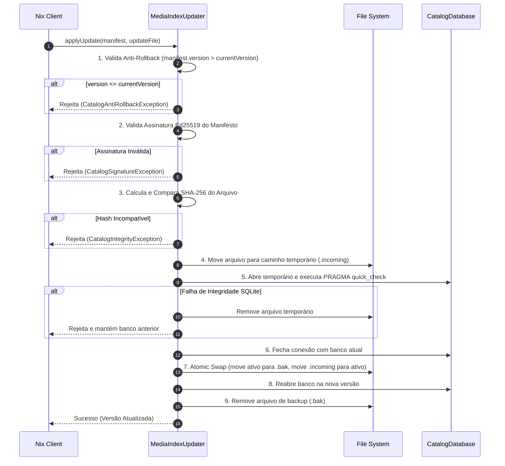

# Protocolo de Atualização Segura do Nix Media Index

## 1. Princípios de Segurança e Anti-Rollback

O protocolo de atualização do catálogo Nix foi projetado com garantias rigorosas de segurança contra ataques de adulteração de conteúdo, injeção de metadados maliciosos e ataques de recuo (*rollback attacks*).

Nenhuma atualização é aceita ou aplicada se não cumprir todos os seguintes requisitos:
1. **Autenticidade Criptográfica:** O manifesto da versão deve conter uma assinatura digital válida **Ed25519** emitida pela autoridade de catálogo autorizada.
2. **Integridade de Conteúdo:** O hash SHA-256 do arquivo baixado deve coincidir exatamente com o `sha256` declarado no manifesto assinado.
3. **Monotonicidade Estrita (Anti-Rollback):** A versão (`version`) do pacote deve ser estritamente maior que a versão atualmente instalada no dispositivo (`newVersion > currentVersion`).
4. **Isolamento e Atomicidade:** A integridade estrutural do banco deve ser validada em um arquivo temporário antes de qualquer alteração no banco ativo.
5. **Rollback Automático:** Caso ocorra qualquer falha na substituição ou validação, a base anterior permanece intacta e o arquivo corrompido é sumariamente excluído.

---

## 2. Estrutura do Manifesto de Atualização

O manifesto `manifest.json` possui o seguinte formato canônico serializado em JSON:

```json
{
  "version": 2,
  "sha256": "4a5e6f...",
  "itemCount": 54200,
  "publishedAt": 1795098000000,
  "signature": "3b2c1a..."
}
```

O campo `signature` é gerado sobre o vetor canônico de bytes:
```
UTF8("nix-catalog-v1:<version>:<sha256>:<itemCount>:<publishedAt>")
```

---

## 3. Fluxo de Execução do `MediaIndexUpdater`



---

## 4. Tratamento de Exceções e Resiliência

- Se o processo for interrompido abruptamente durante o passo 7, a inicialização do app detecta a existência de `.bak` e restaura automaticamente a integridade da versão estável.
- Nenhum dado do usuário ou do Acervo Pessoal (`nix_local_v4.db`) é afetado durante o processo, pois o banco do catálogo é um arquivo independente (`nix_catalog_v1.db`).
