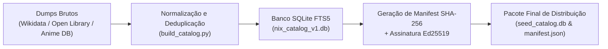

# Pipeline de Compilação e Empacotamento de Metadados

## 1. Visão Geral do Pipeline

O pipeline de compilação de metadados (`tools/metadata_builder/build_catalog.py`) é uma ferramenta determinística e reproduzível para transformar dumps brutos de dados abertos em um banco de dados SQLite FTS5 otimizado e assinado digitalmente para consumo no Nix Client.



---

## 2. Etapas do Processamento

### Etapa 1: Ingestão e Filtragem de Dados Brutos
- Leitura dos arquivos fonte (`.json`, `.tsv`, `.gz`).
- Filtragem de registros incompletos: obras devem conter ao menos `id`, `kind`, `title` e `year`.
- Remoção de tags HTML, formatação corrompida ou caracteres de controle inválidos.

### Etapa 2: Normalização e Mapeamento de Categorias
As obras são mapeadas estritamente para os 5 domínios culturais suportados:
- `film`: Filmes de longa e curta metragem.
- `series`: Séries de televisão, minisséries e produções seriadas.
- `anime`: Animação japonesa serializada e filmes de animação.
- `manga`: Mangás, manhwas e quadrinhos serializados.
- `book`: Obras literárias, romances, ensaios e ficção/não-ficção.

### Etapa 3: Deduplicação e Resolução Canônica
- Títulos canônicos e títulos originais (ex.: título em japonês ou alfabeto original) são indexados conjuntamente.
- O hash canônico `content_hash` é calculado sobre `SHA-256(kind + ":" + title + ":" + str(year) + ":" + creator)`.

### Etapa 4: Construção do Banco SQLite com FTS5
- Criação das tabelas `catalog_works` e `catalog_metadata`.
- Criação da tabela virtual `catalog_search` com FTS5 utilizando tokenizador `unicode61 remove_diacritics 2`.
- Instalação dos triggers de inserção, remoção e atualização.
- Inserção em lote (*bulk insert*) dentro de transações de até 50.000 registros para garantir alta performance.

### Etapa 5: Otimização de Armazenamento
- Execução de `VACUUM` e `PRAGMA optimize` para diminuir o tamanho do arquivo em disco.
- Configuração de `page_size = 4096`, `journal_mode = WAL` para concorrência de leitura sem lock.

### Etapa 6: Criptografia e Assinatura de Manifesto
- Cálculo do hash criptográfico SHA-256 do arquivo gerado.
- Criação de um `SignedCatalogManifest` contendo:
  - `version`: versão inteira incremental monotônica.
  - `sha256`: checksum SHA-256 do banco.
  - `itemCount`: número total de registros.
  - `publishedAt`: timestamp UTC em milissegundos.
  - `signature`: assinatura digital Ed25519 em hexadecimal gerada pela autoridade do catálogo Nix.

---

## 3. Uso da Ferramenta CLI

```bash
# Compilar catálogo de sementes verificado (25 obras distribuídas)
python3 tools/metadata_builder/build_catalog.py \
  --output apps/nix_client/assets/catalog/seed_catalog.db \
  --manifest apps/nix_client/assets/catalog/seed_catalog_manifest.json \
  --version 1

# Compilar catálogo completo a partir de dumps locais
python3 tools/metadata_builder/build_catalog.py \
  --wikidata-dump /caminho/wikidata-dump.json \
  --openlibrary-dump /caminho/ol_dump.txt.gz \
  --anime-dump /caminho/anime-offline-database.json \
  --output /caminho/nix_catalog_full.db \
  --manifest /caminho/nix_catalog_full_manifest.json \
  --version 2
```

## 4. Atualizações privadas no cliente

O Media Index pesquisa o banco local. A ação **Verificar Agora** consulta, via Tor,
um manifesto de metadados assinado com Ed25519. Quando encontra uma versão
superior, o cliente oferece a instalação e verifica a assinatura, o SHA-256 e a
integridade do SQLite antes de trocar o banco. O acervo pessoal fica separado.

Para distribuir atualizações, publique o manifesto e o arquivo `.db` indicado
nele no mesmo serviço Onion v3. Compile o cliente com
`--dart-define=NIX_CATALOG_MANIFEST_URL=<URL_ONION_DO_MANIFESTO>` e
`--dart-define=NIX_CATALOG_PUBLISHER_KEY_HEX=<CHAVE_PUBLICA_ED25519_EM_HEX>`.
Use somente a chave pública no cliente. As builds sem esses parâmetros
mantêm a busca local e exibem a atualização remota como indisponível.
