# Nix Media Index — Arquitetura Offline-First & Acervo Pessoal

## 1. Visão Geral e Princípios Fundamentais

O **Nix Media Index** implementa um catálogo cultural offline-first projetado para resolver um problema crítico de privacidade: a maioria dos aplicativos de catalogação de mídia (Letterboxd, MyAnimeList, Goodreads, TV Time) expõe em tempo real o histórico cultural, interesses intelectuais, pesquisas e hábitos de consumo do usuário a servidores de terceiros e corretores de dados.

O Nix inverte essa premissa por meio de uma arquitetura estritamente **desacoplada em duas camadas de persistência**:

1. **Catálogo Cultural Público (`nix_catalog_v1.db`):**
   - Banco de dados SQLite local, otimizado para leitura.
   - Contém metadados públicos sobre filmes, séries, animes, mangás e livros.
   - Indexado com **FTS5 (Full-Text Search)** com tokenizador Unicode61, permitindo buscas instantâneas por título, autor, diretor e ano.
   - Fornecido inicialmente em bundle (seed) e atualizado exclusivamente via pacotes de dados compactados, assinados digitalmente com Ed25519 e validados criptograficamente.
   - **Zero tráfego de rede durante consultas ou pesquisas:** nenhum termo digitado pelo usuário trafega pela rede.

2. **Acervo Pessoal Privado (`nix_local_v4.db`):**
   - Banco de dados relacional cifrado em repouso com **SQLCipher** (chave de 256 bits derivada via Argon2id).
   - Armazena as obras salvas pelo usuário (`media_items`), status de consumo (`want_to_watch`, `watching`, `completed`, `dropped`), avaliações de 1 a 5 estrelas, notas privadas, datas e contadores de episódios/capítulos.
   - Totalmente isolado do catálogo público: nenhum dado pessoal é mesclado no catálogo público e nenhuma lista pessoal é enviada para servidores externos.

---

## 2. Diagrama da Arquitetura Dual-Tier

```mermaid
flowchart TD
    subgraph "Interface do Usuário (Flutter)"
        UI_Search["Barra de Busca & Chips de Categoria"]
        UI_Acervo["Aba Meu Acervo Cultural"]
    end

    subgraph "Camada de Serviços (Dart)"
        Service["MediaCatalogService"]
        IndexUpdater["MediaIndexUpdater (Verificação Ed25519)"]
    end

    subgraph "Nível 1: Catálogo Público (Offline-First)"
        CatalogRepo["CatalogRepository"]
        CatalogDB[("SQLite nix_catalog_v1.db\nFTS5: catalog_search\nTriggers de Sincronização")]
    end

    subgraph "Nível 2: Acervo Pessoal Cifrado"
        MediaRepo["MediaRepository"]
        SQLCipherDB[("SQLCipher nix_local_v4.db\nmedia_items & library_entries\nChave Argon2id")]
    end

    UI_Search -->|Busca local instantânea| Service
    Service -->|FTS5 match prefix| CatalogRepo
    CatalogRepo --> CatalogDB

    UI_Acervo -->|Gerenciar obras e notas| Service
    Service -->|Salvar / Atualizar / Remover| MediaRepo
    MediaRepo --> SQLCipherDB

    IndexUpdater -.->|Atualização atômica assinada| CatalogDB

    classDef pub fill:#1f2937,stroke:#10b981,stroke-width:2px;
    classDef priv fill:#111827,stroke:#f59e0b,stroke-width:2px;
    class CatalogDB pub;
    class SQLCipherDB priv;
```



---

## 3. Modelo de Dados do Catálogo Público

O catálogo público SQLite utiliza a tabela `catalog_works` e a tabela virtual FTS5 `catalog_search`:

```sql
CREATE TABLE catalog_works (
    id TEXT PRIMARY KEY,
    kind TEXT NOT NULL CHECK(kind IN ('film', 'series', 'anime', 'manga', 'book', 'movie')),
    title TEXT NOT NULL,
    original_title TEXT,
    year INTEGER,
    creator TEXT,
    genres TEXT,
    overview TEXT,
    cover_url TEXT,
    external_ids TEXT,
    content_hash TEXT NOT NULL,
    updated_at INTEGER NOT NULL
);

CREATE VIRTUAL TABLE catalog_search USING fts5(
    title,
    original_title,
    creator,
    genres,
    content='catalog_works',
    content_rowid='rowid',
    tokenize='unicode61 remove_diacritics 2'
);
```

### Triggers de Sincronização Automática
- `catalog_works_ai`: insere automaticamente o novo registro no índice FTS5.
- `catalog_works_ad`: remove o registro do índice FTS5 na exclusão.
- `catalog_works_au`: reindexa o registro no índice FTS5 na atualização.

---

## 4. Modos de Privacidade e Proteção de Dados

O `MediaCatalogService` opera sob três modos de privacidade:

1. **`offlineStrict` (Padrão):**
   - Não efetua nenhuma requisição de rede para busca ou metadados.
   - Pesquisa 100% resolvida via FTS5 local.
   - Imagens de capa utilizam placeholders seguros locais quando offline.

2. **`privateTorUpdates`:**
   - Permite baixar pacotes assinados de atualização de metadados exclusivamente através de canais Onion v3 ou SOCKS5 sobre Tor.
   - Nenhuma informação de identificação do usuário é enviada na requisição de download.

3. **`optInExternalSearch`:**
   - Modo estritamente opcional onde o usuário pode permitir consultas sob demanda a provedores federados sem fins lucrativos, apenas com consentimento explícito e isolamento via proxy Tor.

---

## 5. Garantias Criptográficas e Imutabilidade
- Atualizações do catálogo são empacotadas em pacotes `.tar.gz` ou bancos SQLite delta acompanhados de um manifesto assinado `manifest.json`.
- A assinatura utiliza **Ed25519** assinado pela autoridade do catálogo Nix.
- O hash SHA-256 do arquivo de banco é conferido antes de qualquer substituição.
- A substituição é **atômica** com swap de arquivo e rollback automático em caso de corrupção ou erro de migração.
