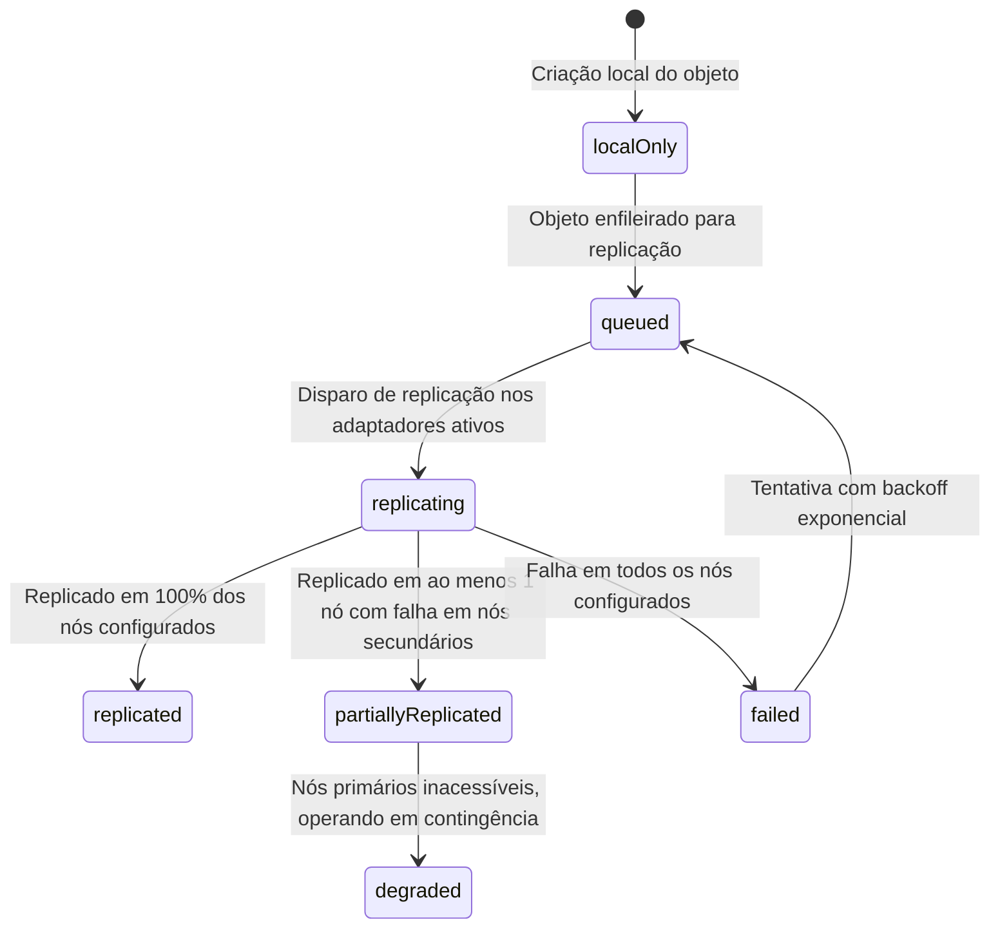

# Replicação Distribuída S3/IPFS — Arquitetura, Barreiras de Privacidade e Custos

## 1. Visão Geral da Replicação Distribuída

O subsistema de replicação (`apps/nix_client/lib/core/replication/replication_coordinator.dart`) provê redundância geográfica e persistência para publicações imutáveis e pacotes de catálogo sem comprometer a soberania dos dados do usuário.

A arquitetura adota um padrão de adaptadores polimórficos (`ReplicationAdapter`), permitindo replicar o mesmo payload imutável simultaneamente para:
1. **Buckets S3 / MinIO:** Armazenamento em nuvem compatível com API S3 via requisições HTTP assinadas AWS SigV4 sobre proxies Tor ou conexões diretas.
2. **Nós IPFS Kubo:** Rede distribuída interplanetária indexada por Content Identifiers (CIDs) calculados deterministicamente via SHA-256 / Multihash.

---

## 2. Máquina de Estados da Replicação

O ciclo de vida de replicação de cada objeto é governado por uma máquina de estados estrita:



---

## 3. Barreira de Privacidade Absoluta (*Privacy Barrier*)

Para evitar vazamento catastrófico de dados privados do usuário para a infraestrutura pública de replicação:

```dart
if (payload.isDraft || payload.containsPersonalKeys || payload.targetCollection == 'private_vault') {
  throw ReplicationPrivacyBarrierException(
    '[Fail-Closed] Tentativa de replicar conteúdo privado ou rascunho bloqueada pela Barreira de Privacidade do Nix.',
  );
}
```

### Regras Inegociáveis da Barreira:
1. **Rascunhos de Artigos (`isDraft: true`):** Bloqueados incondicionalmente em nível de coordenador de replicação.
2. **Material de Chaves Criptográficas:** Nenhuma chave privada (Ed25519, X25519, sementes BIP39, chaves de sessão Double Ratchet) jamais é passada para adaptadores de replicação.
3. **Acervo Pessoal e Histórico:** O banco privado SQLCipher (`nix_local_v4.db`) e tabelas de notas ou avaliações nunca são elegíveis para replicação externa. Apenas pacotes de catálogo públicos e publicações concluídas e assinadas são replicáveis.

---

## 4. Análise de Custos Operacionais e Dimensionamento

| Métrica | Cenário Econômico / Autônomo | Cenário Intermediário | Provedor Recomendado |
|---|---|---|---|
| **S3 Storage (MinIO auto-hospedado)** | \$0 / mês (servidor pessoal/VPS existente) | \$5 / mês (VPS 40GB SSD) | Hetzner Cloud / Contabo |
| **S3 Compatível Gerenciado** | \$0.005 por GB / mês | \$0.015 por GB / mês | Cloudflare R2 (sem custo de saída) / Backblaze B2 |
| **IPFS Kubo Pessoal** | \$0 / mês (nó local ou no relay) | \$0 / mês | Nó Kubo local integrado ao Nix Relay |
| **IPFS Pinning Service (opcional)** | Nível gratuito (até 1GB) | \$5 / mês | Pinata / Web3.Storage |

**Conclusão de Viabilidade Financeira:** Com o uso de Cloudflare R2 (que possui egress gratuito) e nós MinIO/Kubo locais, o custo de replicação do Nix é virtualmente nulo para publicações de texto e metadados culturais.
