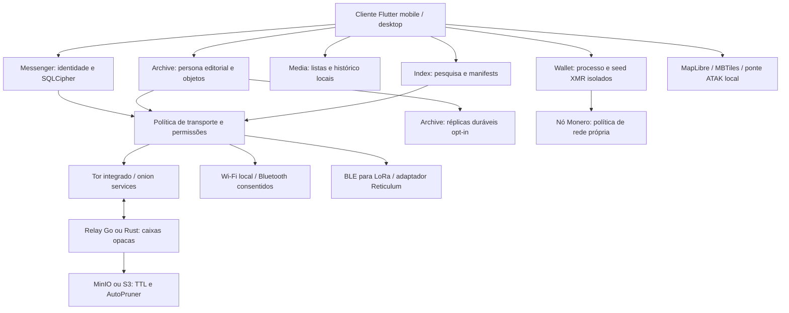

# 🏴‍☠️ PROJETO NIX — Comunicação, conhecimento e mídia com privacidade

> Especificação de desenvolvimento · revisão de 17/11/2026 · documento de projeto, sem atestado de implementação ou auditoria.

**Mensageiro E2EE soberano · infraestrutura sem identificação civil obrigatória · Tor/P2P · armazenamento temporário com limpeza dinâmica · rádio off-grid · Archive · Media · Index · carteira exclusivamente Monero (XMR).**

## Sumário executivo

O Nix é um ecossistema modular, auto-hospedável e de código aberto para comunicação privada, publicação de conhecimento, organização de mídia e transações não custodiais em XMR. Mantém o objetivo inicial de **50 usuários simultâneos**, com cliente Flutter mobile/desktop, relay Go ou Rust, SQLCipher, anexos cifrados, mapas offline, LoRa, Reticulum e interoperabilidade ATAK-CIV.

A configuração de referência permanece **2 vCPU, 2 GB RAM e 40 GB SSD/NVMe** para um relay inicial enxuto. Trata-se de uma hipótese a validar por medição, não de capacidade comprovada. Armazenamento durável do Archive, streaming, indexação extensiva e nó completo Monero exigem dimensionamento independente. A expansão para centenas de nós depende de testes de roteamento, abuso, sincronização e operação; modularidade, sozinha, não a garante.

Este README substitui propostas excessivas por requisitos verificáveis. Nenhum módulo promete anonimato absoluto, ausência completa de metadados, apagamento forense universal ou disponibilidade eterna. Tudo descrito como requisito ou fase continua **planejado**, salvo evidência futura no repositório. A matriz de privacidade enviada pelo proponente é uma base obrigatória de projeto, não uma certificação concedida ao Nix.

## 1. Princípios e decisões de engenharia

1. **Criptografia consolidada:** bibliotecas mantidas, protocolos especificados, versões fixadas e revisão especializada. Bibliotecas de primitivas não substituem a implementação correta de protocolos.
2. **Privacidade por padrão:** sem telefone, SMS, e-mail, identidade civil ou agenda enviados para criar uma identidade local. Sem publicidade direcionada, rastreadores ou identificador global entre módulos.
3. **Compartimentação:** mensageria, publicação, catálogo, indexação, rádio, infraestrutura e carteira têm chaves, permissões e bancos separados. A fronteira reduz o impacto de falhas; comprometimento do sistema operacional pode atravessá-la.
4. **Controle local:** dados privados cifrados no cliente, exportação explícita, backups opcionais e informação clara sobre o que deixa o dispositivo.
5. **Retenção mínima:** o relay é um buffer temporário. Réplicas duráveis do Archive são voluntárias, separadas e têm políticas próprias.
6. **Transporte sem regressão silenciosa:** indisponibilidade do Tor nunca autoriza conexão IP direta automática no perfil privado.
7. **Realismo off-grid:** rádio atende texto curto, alertas e telemetria consentida; fotos, áudio, vídeo e sincronização volumosa usam IP.
8. **Finanças exclusivamente XMR:** carteira, pagamentos de infraestrutura e liquidação financeira integrada usam apenas Monero. Negociações externas não geram suporte a outros ativos dentro do Nix.
9. **Construção assistida por IA com revisão:** desenvolvimento incremental, testes de integração e auditoria; código gerado não constitui evidência de segurança.

## 2. Arquitetura modular

| Módulo | Escopo | Fronteira obrigatória |
| --- | --- | --- |
| Nix Messenger | Mensagens E2EE, grupos, anexos, filas e temporizadores | Contatos e identidade locais; nenhuma chave financeira |
| Nix Archive | Editor, publicações verificáveis, refutações e evidências | Persona editorial opcional, distinta da identidade do chat |
| Nix Media | Filmes, séries, animes, mangás, livros, listas e reprodução | Histórico privado e conectores autorizados separadamente |
| Nix Index | Busca de fontes, torrents e magnets | Nenhum ingresso automático em swarm ou DHT pública |
| Nix Offline | Bluetooth, Wi-Fi local, LoRa, Reticulum e mapas | Consentimento específico para proximidade e localização |
| Nix Wallet | Carteira não custodial, recebimentos, envios e ofertas P2P em XMR | Processo e seed próprios; nenhuma derivação do mensageiro |
| Nix Infrastructure | Relays opcionais, TTL, armazenamento e métricas | Apenas dados cifrados privados e informação operacional mínima |



As setas representam fronteiras lógicas, não fluxos de chaves compartilhadas. Réplicas, conectores e nó XMR devem respeitar suas políticas de rede; o diagrama não autoriza saída direta. O núcleo expõe interfaces versionadas para identidade, armazenamento, transporte e consentimento. Chamadas entre módulos usam capacidades mínimas e dados explicitamente escolhidos pelo usuário.

### Inspiração em Briar e Cwtch

Do **Briar**, aproveitar o desenho local-first, sincronização entre dispositivos, comunicação por Tor e alternativas locais Bluetooth/Wi-Fi. Do **Cwtch**, aproveitar a separação de perfis, comunicação por onion services e preocupação com metadados e infraestrutura opcional. São referências de arquitetura: o Nix não herda automaticamente sua segurança ou interoperabilidade. Adaptadores compatíveis só poderão ser anunciados após especificação e testes entre implementações. Fontes: [Briar — funcionamento](https://briarproject.org/how-it-works/) e [Cwtch — documentação](https://docs.cwtch.im/).

## 3. Modelo de ameaças e limites

| Ameaça | Proteção pretendida | Limites e evidência necessária |
| --- | --- | --- |
| Interceptação e adulteração de rede | E2EE autenticada, verificação de contatos, transporte protegido | TLS e VPN não substituem E2EE; testar MITM, replay e troca de chaves |
| VPS apreendida ou comprometida | Relay sem chaves de conteúdo; objetos privados cifrados no cliente | Operador pode observar horários, tamanhos, caixas e disponibilidade; auditar tráfego e disco |
| Associação a cadastro civil | Criação local sem telefone/e-mail/CPF e sem upload de agenda | Rede, conteúdo, aquisição do aparelho e comportamento ainda podem identificar |
| Correlação entre módulos | Chaves, personas, bancos e circuitos de rede separados quando suportado | Mesmo dispositivo, horário e texto podem correlacionar atividades |
| Perda de aparelho bloqueado | SQLCipher, chave aleatória, proteção do sistema, bloqueio local | Aparelho desbloqueado, senha fraca, backups e malware mudam a proteção |
| Abuso e adversários internos | Convites, limites, bloqueios, validação de objetos e controle de recursos | Destinatários podem copiar, fotografar ou republicar mensagens |
| Censura e falhas de conexão | Tor, relays substituíveis e sincronização local consentida | Bloqueios amplos, ausência de pares e interferência de rádio podem impedir entrega |

Ficam fora das garantias: sistema operacional totalmente comprometido; observador global com correlação temporal; reconhecimento de autor por estilo ou conteúdo; coerção física; eliminação de todas as cópias em terceiros; recuperação sem backup; disponibilidade eterna; verdade inferida por votos. Tor reduz exposição de rede, mas não torna o uso universalmente indetectável. VPN/WireGuard mudam relações de confiança e não equivalem ao modelo de anonimato do Tor.

## 4. Infraestrutura enxuta e hospedagem

### Referência inicial

- **Relay:** 2 vCPU x86_64 ou ARM64, 2 GB RAM, 40 GB SSD/NVMe; Alpine Linux ou Debian Minimal, conforme compatibilidade das dependências.
- **Backend:** Go ou Rust, com buffers limitados e backpressure. A escolha definitiva depende de perfil de memória, manutenção e revisão.
- **Objetos:** MinIO ou serviço S3 compatível, com cotas e lifecycle complementado pelo AutoPruner.
- **Operação:** meta de 50 conexões simultâneas; orçamento histórico de US$ 5–10/mês apenas como estimativa de planejamento, a recotar com tráfego, impostos, região e armazenamento.
- **Separação de recursos:** a VPS não inclui automaticamente nó Monero, transcodificação, indexação pública ou réplica permanente do Archive.

### Escolha e administração do provedor

Preferir contratação sem identificação civil obrigatória, com pagamento em XMR. Diretórios como KYCnot.me são pontos de pesquisa, não garantias sobre operadores. Verificar termos atuais, retenção, acesso administrativo, disponibilidade e backups. País ou pagamento privado não garantem anonimato: cadastro, suporte e horários de pagamento podem criar vínculos.

Usar chaves SSH Ed25519 exclusivas, acesso restrito por firewall `nftables`, privilégios mínimos, atualizações e administração por canal controlado. Alterar a porta SSH pode reduzir ruído automatizado, mas não constitui defesa central. Desabilitar autenticação por senha quando possível e documentar recuperação administrativa.

### Monitoramento com minimização de dados

Prometheus, quando adotado, coleta CPU, RAM, I/O, ocupação, contagem agregada de conexões, erros e atrasos. Não usar IPs, identificadores de usuário, IDs de mensagem, termos de pesquisa ou endereços financeiros como labels. Painéis são privados, com retenção curta documentada; agregados também podem revelar atividade em grupos pequenos.

Não chamar essas métricas de prova de conhecimento zero. Proibir logs identificáveis em aplicação, proxy, sistema, contêiner, objeto, tracing, relatórios de erro e serviços terceirizados. Redirecionar um log para `/dev/null` não cobre toda a cadeia. Investigar crash dumps, swap, journal, snapshots e backups; incidentes exigem coleta excepcional minimizada e explicitamente documentada.

## 5. Armazenamento temporário e limpeza dinâmica

### Retenção base

Mensagens e anexos privados no relay recebem `expires_at = created_at + 7 dias`. Cada objeto expira individualmente. Dados baixados permanecem no SQLCipher local conforme a política escolhida. Expirar o relay não apaga cópias locais nem arquivos exportados. O cliente deve mostrar prazo e possibilidade de remoção antecipada por pressão de disco; não anunciar entrega garantida dentro do TTL.

| Estado | Entrada por ocupação | Ação | Retorno com histerese |
| --- | --- | --- | --- |
| Normal | < 75% | TTL base de 7 dias; varredura de órfãos a cada hora | — |
| Alívio leve | ≥ 75% | Aplicar teto de idade de 4 dias às pendências elegíveis mais antigas | < 70% |
| Alívio severo | ≥ 85% | Teto de idade de 48 horas; novos uploads limitados a 10 MB | < 75% |
| Bloqueio crítico | ≥ 92% | Rejeitar novas mídias; priorizar texto dentro de reserva limitada | < 85% |

Recalcular `effective_expires_at = min(expires_at, created_at + teto_do_estado)`; a redução nunca renova a vida do objeto. Ao aliviar a pressão, não ressuscitar conteúdo eliminado. Expurgar os mais antigos elegíveis primeiro, com processamento limitado e registro agregado das perdas. Se nenhum objeto tiver idade suficiente para liberar espaço, recusar uploads e aplicar cotas, sem esperar o disco lotar. Texto também deve ter limite; reserva esgotada exige backpressure e rejeição explícita.

Manter limite padrão de **50 MB por arquivo**, cota rotativa de **500 MB em trânsito por identidade de quota** e remoção de uploads multipart incompletos após **12 horas**. A identidade de quota pode ser um token limitado ao relay, sem identidade civil; criar várias identidades exige defesa contra abuso. Para 50 usuários, 500 MB representam até 25 GB antes de overhead: reservar espaço para sistema, índices, temporários e margens reais do armazenamento. Medir ocupação física, versões e multipart, não apenas tamanho lógico.

Testar reinício durante expurgo, relógio incorreto, concorrência, falhas S3, órfãos, recuperação de espaço e avisos de conteúdo indisponível. Limpeza por lifecycle não garante liberação imediata em todos os backends.

### SQLCipher, memória e senha de coação

Manter SQLCipher com chave aleatória de 256 bits, protegida por mecanismo local apropriado; Argon2id pode proteger material derivado de senha, com parâmetros calibrados por dispositivo. Incluir WAL, temporários, miniaturas, notificações, backups e exportações no inventário de dados.

A exclusão criptográfica depende de destruir **todas as cópias recuperáveis das chaves**, inclusive envelopes persistentes e backups. Zerar uma chave em RAM não basta se a senha, o keystore ou uma seed a puderem reconstruir. Sobregravação de arquivos em flash não garante apagar blocos remanescentes por wear leveling.

O Duress PIN permanece previsto, opcional e com escopo explícito por módulo. Não destruir a seed financeira por ação do mensageiro. Usar limpeza de memória resistente à otimização, reduzir cópias em fronteiras Dart/FFI e avaliar `mlock`, swap e dumps conforme a plataforma. Nem `memset_s` nem `sodium_memzero` oferecem eliminação instantânea universal de todas as cópias. Fonte: [libsodium — memória segura](https://doc.libsodium.org/memory_management).

## 6. Criptografia e Nix Messenger

### Perfil criptográfico a especificar e revisar

- **Identidade e assinaturas:** Ed25519 para contextos que realmente necessitem assinatura, com chaves distintas por domínio.
- **Acordo de chaves:** X25519 onde previsto pelo protocolo escolhido. Não converter ou reutilizar chaves entre funções sem especificação validada.
- **Sessão assíncrona:** manter X3DH como referência original e avaliar perfil híbrido PQXDH com biblioteca mantida. Documentar limites do perfil clássico e do perfil pós-quântico.
- **Catracas:** Double Ratchet para sessões par a par; HKDF-SHA256 e demais algoritmos conforme o perfil exato adotado.
- **Anexos e objetos independentes:** XChaCha20-Poly1305 pode ser escolhido com nonce de 192 bits, gestão de chaves e aleatoriedade segura. Colisões são extremamente improváveis com geração correta, não impossíveis.
- **Proteção local:** Argon2id e SQLCipher, com separação entre chave do banco e identidade de rede.

Não substituir livremente os algoritmos internos de uma biblioteca do Signal por primitivas da libsodium. Bibliotecas, formatos, licença, suporte Flutter/FFI, vetores de teste e migração precisam ser decididos em ADR. Referência: [especificações Signal](https://signal.org/docs/).

### Propriedades e experiência

Forward secrecy limita o impacto sobre mensagens passadas quando chaves antigas foram eliminadas; não protege histórico já decifrado e salvo no dispositivo. A recuperação após comprometimento depende da retirada do atacante e da incorporação de entropia nova adequada, incluindo passos DH; não ocorre necessariamente na mensagem seguinte.

Verificar contatos por QR Code ou fingerprints fora de banda e alertar sobre mudança de identidade. Isso reduz substituição de chaves quando a comparação é autêntica; não garante imunidade se o dispositivo ou o canal de comparação estiver comprometido.

Manter fila assíncrona store-and-forward, deduplicação, proteção contra replay, mensagens fora de ordem com limites de skipped keys e confirmação de entrega sem rastreamento adicional. Reenvio entre transportes preserva o objeto e não reutiliza nonce indevidamente. Compactar imagens e gerar miniaturas antes de cifrar; remover metadados EXIF quando aplicável, com escolha informada.

Grupos devem manter a proposta de Sender Keys como candidata, com distribuição segura, mudança de época e rekey após entrada/saída. Uma difusão cifrada por remetente reduz trabalho frente ao envio individual por destinatário, mas tráfego e distribuição inicial continuam dependentes do tamanho do grupo. Não afirmar custo constante global ou PCS de grupo sem demonstrar o protocolo. Sender Keys não resolve todos os efeitos de comprometimento.

Mensagens efêmeras seguem temporizador configurável pelo emissor e informação clara sobre cópias de destinatários. Notificações devem ocultar conteúdo por padrão. Voz permanece parte do escopo de comunicação IP, em etapa própria: exige sinalização e mídia E2EE, revisão de vazamentos de IP e nenhuma queda automática para mídia direta no modo privado. Não oferecer voz por LoRa.

### Pós-quântico

Tratar resistência pós-quântica como trilha de engenharia: escolher protocolo híbrido revisado, validar handshake e atualização de catracas, versionar negociação e impedir downgrade. PQXDH não torna automaticamente armazenamento, assinaturas e todo o ecossistema resistentes a adversários quânticos. Testar custo em mobile e rádio antes de anunciar suporte; não criar combinação criptográfica própria.

## 7. Tor, P2P e comunicação off-grid

### Perfis explícitos de transporte

| Perfil | Comportamento | Condição de segurança |
| --- | --- | --- |
| Privado, padrão para Internet | Tor integrado; onion services para pares e relays quando suportado | Falha fechada se Tor cair; sem fallback direto |
| Local/offline | Wi-Fi local ou Bluetooth, ativados explicitamente | Exibe exposição de proximidade e identificadores locais |
| IP direto, opcional | WebSocket com TLS 1.3, eventualmente WireGuard | Mudança explícita de perfil; mostra quem passa a ver o IP |
| Rádio | Adaptador BLE para LoRa ou Reticulum sobre interface compatível | Somente tráfego permitido e consentido; emissão é detectável |

Aplicar políticas a DNS, IPv4/IPv6, atualizações, miniaturas, mapas, players, plugins e carteira. Separar credenciais SOCKS/circuitos por módulo quando a integração suportar, sem afirmar independência completa contra correlação. Bloquear WebRTC ou qualquer descoberta direta que viole o perfil. Bootstrap e diretórios precisam de fontes substituíveis, validação e limites contra enumeração.

Relays são opcionais para operação com pares simultaneamente disponíveis. Entrega assíncrona depende de caixas/pares disponíveis e prazo de retenção. P2P direto na Internet revela endereços aos pares; P2P via onion reduz essa exposição. Nenhum modo elimina todas as informações de tempo e volume.

### LoRa, Reticulum e mapas

Preservar adaptadores para **Meshtastic**, **RNode/KISS** e **Reticulum** como integrações distintas. RAK4631 e modelos Heltec compatíveis são candidatos, sujeitos a verificação de firmware, interfaces e homologação; não presumir compatibilidade de qualquer revisão de hardware.

As taxas originais de aproximadamente 1,2–5,4 kbps são referências condicionais de configurações LoRa, não banda útil universal. Alcance e throughput dependem de spreading factor, largura de banda, codificação, retransmissões, contenção, antena e limites regulatórios. 915 MHz não é uma configuração universal: selecionar banda e parâmetros permitidos na região de uso.

Somente texto curto serializado em Protobuf, alertas, status e telemetria CoT autorizada entram na fila de rádio. Bloquear arquivos, imagens, áudio, vídeo e sincronização volumosa antes da fragmentação. Prever cotas de airtime, TTL, hops, prioridade, deduplicação, ACK limitado e descarte para impedir tempestades de retransmissão. Ausência de rota mantém a mensagem pendente até seu prazo, sem garantia de entrega. Cifra de enlace de uma malha não substitui E2EE entre clientes Nix.

Manter **MapLibre Native**, mapas vetoriais/raster offline e contêineres **MBTiles**, com adaptador ou servidor local quando necessário; validar suporte por plataforma e licenças dos mapas. Integração ATAK-CIV deve traduzir Cursor-on-Target em XML e, quando compatível, formato binário documentado. `127.0.0.1:4242/UDP` permanece porta candidata configurável: não implica compatibilidade automática nem autenticação. Validar schema, limites, origens e permissão da aplicação; outro processo local pode acessar loopback. Compartilhar localização somente por ação explícita, sem exportação silenciosa para redes externas.

## 8. Nix Wallet — exclusivamente Monero (XMR)

### Não custódia e isolamento

A carteira é opcional e não condiciona cadastro, uso do chat, leitura ou publicação. Ninguém no relay recebe seed, private spend key ou private view key. A geração e a assinatura acontecem localmente, por biblioteca Monero mantida, com API mínima e versões verificadas.

- **Seed A:** comunicação/recuperação da identidade do mensageiro, conforme esquema documentado.
- **Seed B:** carteira XMR, gerada com entropia independente. Não derivar da Seed A, senha do chat, conta de mídia ou identificador público.
- Personas do Archive e demais módulos usam chaves independentes. Não exportar um backup universal sem compartimentos e consentimento específico.
- Bancos, desbloqueios e segredos separados; preferir processo isolado e IPC autenticado com permissões restritas. Uma falha confinada ao mensageiro deve ser incapaz de solicitar assinatura financeira.
- Documentar formato mnemônico suportado, biblioteca, rede, altura de restauração e teste de recuperação. Seeds não são universalmente intercambiáveis entre formatos.

Perda da seed e dos demais meios válidos de recuperação pode significar perda definitiva. Isolamento lógico não protege contra um sistema operacional comprometido que leia ambos os módulos.

### Privacidade e conexão

Monero fornece mecanismos de confidencialidade de valores e proteção de vínculos entre remetente, destinatário e saídas. Esses mecanismos não eliminam identificação por contraparte, rede, comprometimento do dispositivo ou contexto comercial. Os detalhes criptográficos devem acompanhar a versão do protocolo efetivamente integrada.

Preferir nó próprio/controlado com roteamento de rede revisado ou nó remoto onion escolhido pelo usuário. Um nó próprio em IP direto também pode expor a origem de atividade; proteger apenas a conexão da carteira não prova que o tráfego P2P do daemon está protegido. Nó remoto não recebe automaticamente as chaves, mas pode observar conexões, submissões e manipular disponibilidade ou respostas. Não marcar um nó público como confiável por conveniência. Fonte: [Monero — nós remotos e privacidade](https://docs.getmonero.org/interacting/remote-nodes/).

Usar subendereços por relação de recebimento quando suportado, sem tratá-los como impedimento absoluto à correlação. Reutilização de endereços, horários, valores conhecidos pela contraparte, entregas físicas e conversões externas podem criar vínculos. Não publicar endereços financeiros junto ao perfil do chat ou artigos por padrão. Enviar comprovante, identificador de transação ou dados de visualização exige decisão explícita; chaves de visualização revelam informação sensível.

Não expor wallet RPC à Internet. Se necessário, restringir a processo/local autenticado, com controle de acesso e sem logs de segredos. O relay não intermedeia assinatura. Backups cifrados independentes, clipboard com cautela e ocultação de valores em notificações complementam a proteção.

### Fluxo financeiro e mural P2P

Antes da assinatura, mostrar rede, destinatário, valor em XMR, taxa estimada e total; permitir revisão do endereço e nunca assinar a partir de mensagem recebida sem confirmação. Diferenciar transação criada, transmitida, pendente, confirmada e saldo desbloqueado. Política de confirmações e tratamento de reorganizações devem ser documentados e configurados para o risco da operação.

O mural mantém ofertas efêmeras de bens, serviços e negociação entre pessoas, com liquidação integrada apenas em XMR. Não há custódia central nem pagamento automático; aceite mútuo de uma oferta não equivale a garantia, escrow ou entrega atômica. Fraude, disputa e reputação são problemas separados. Reputação financeira não deve virar identidade global do Nix.

Teste financeiro inicial em stagenet/regtest apropriado, incluindo restauração, taxas, saldo insuficiente, reenvio, nó malicioso, indisponibilidade do Tor e tentativas de acesso cruzado. Não usar fundos reais para validar protótipos.

## 9. Nix Archive — editor, integridade e refutações

### Publicação pública e acervos restritos

O Archive oferece editor Markdown, rascunho local cifrado, referências, anexos, revisão, pré-visualização e escolha explícita de público. **Artigo público é legível por qualquer pessoa que o obtenha**: proteção de transporte e publicação sem identidade civil não tornam seu conteúdo secreto. Acervos restritos exigem cifra no cliente e distribuição de chaves aos leitores; leitores autorizados podem exportar cópias.

Antes da publicação, oferecer remoção de EXIF e inspeção de nomes de arquivo, links externos, metadados e dados pessoais. Conteúdo e estilo podem identificar o autor; a interface não deve prometer autoria irremediavelmente anônima. Não carregar recursos externos de Markdown automaticamente; sanitizar HTML, SVG, links e anexos em sandbox.

### Objetos e versões verificáveis

Cada publicação é um objeto endereçado pelo hash de uma representação canônica versionada, com algoritmo fixado. Hash/CID permite detectar alteração dos bytes; não comprova verdade, autoria civil ou horário real. Um objeto novo corrige outro sem substituí-lo silenciosamente.

```json
{
  "schema": "nix.archive.article.v1",
  "title": "Título",
  "body": {"format": "markdown", "content": "Texto da publicação"},
  "claims": [{"id": "claim-001", "text": "Afirmação verificável"}],
  "references": [],
  "supersedes": null,
  "author_key": null
}
```

O identificador é calculado fora do objeto sobre seus bytes canônicos, evitando autorreferência. Assinaturas opcionais usam envelope separado com domínio e versão. Um pseudônimo persistente permite continuidade pública e também vinculação: nunca reutilizar a chave de chat ou carteira. Publicação sem assinatura persistente reduz essa ligação, mas não prova autoria nem impede cópia.

### Refutação e votação

Cada refutação tem objeto próprio, referência ao identificador exato da publicação, `claim_id`, trecho selecionado com contexto e posição, argumentos e fontes. Respostas podem receber novas refutações. Resolver seletores contra a versão correta; limitar profundidade e tamanho do grafo e rejeitar referências inválidas conforme o schema. Versões derivadas mantêm relação explícita `supersedes`.

Mostrar avaliações de evidência e votos positivos/negativos separadamente de integridade criptográfica. Votos não certificam fatos. Definir escopo de reputação, rate limits, mecanismos anti-Sybil e possibilidade de inspecionar critérios de ranking. Uma pessoa pode criar várias identidades anônimas; não prometer “um usuário, um voto” sem mecanismo e trade-offs demonstrados. Não usar pagamento como prova de verdade.

### Persistência, moderação e replicação

Separar completamente o TTL do relay das réplicas Archive. Retenção durável depende de nós que aceitem preservar objetos, pinning ou mecanismo equivalente, verificações periódicas, quotas e exportação. Hash não cria disponibilidade. Testar desaparecimento de réplicas, corrupção, recuperação e atualização de índices.

IPFS é candidato de armazenamento, não camada de anonimato: DHT, PeerIDs e CIDs podem expor relações de publicação e consulta. No modo privado, não conectar o cliente automaticamente à DHT pública; qualquer gateway/replicador adiciona relações de confiança que precisam de análise. Fonte: [IPFS — privacidade e criptografia](https://docs.ipfs.tech/concepts/privacy-and-encryption/).

Um nó pode recusar hospedar, remover sua própria cópia ou ocultar conteúdo do índice; isso não modifica o objeto nem apaga cópias de terceiros. Documentar denúncia, bloqueio local, desindexação, recurso e resposta a abuso sem prometer permanência absoluta ou apagamento global. Preservar histórico verificável não obriga cada operador a armazenar tudo.

## 10. Nix Media — catálogo e reprodução

Reunir filmes, séries, animes, mangás e livros com pesquisa, coleções, listas de interesse, favoritos, avaliações, resenhas e progresso de episódios/capítulos. Histórico e preferências ficam locais, cifrados e privados por padrão. Sincronização opcional exige E2EE própria e identidade separada.

Conectores candidatos incluem TMDB, AniList, catálogos bibliográficos, Jellyfin e reprodutores locais, sujeitos a APIs, termos, licenças e disponibilidade. Nenhuma integração é anunciada como pronta. Capas e metadados também revelam interesses: cache local, carregamento controlado, ausência de pixels remotos e encaminhamento conforme o perfil de rede.

O player ou bot opcional usa biblioteca local, servidor pessoal e fontes autorizadas. Bot que recebe texto ou arquivo passa a ser destinatário desses dados; estar no chat não preserva segredo perante o operador do bot. Exigir permissões por conector, indicar o destino e não encaminhar histórico completo. Transcodificação em servidor revela a mídia ao servidor que a executa; não a classificar automaticamente como E2EE.

Reprodução não dispara torrents silenciosamente. Plugins/add-ons precisam de sandbox, manifesto de permissões, origem verificável, limites de rede e atualização controlada. Bloquear player externo no perfil privado se não houver forma de verificar sua política de rede; exportar manualmente exige mudança informada de contexto. Usar fontes cuja distribuição seja permitida, com informação de licença quando disponível.

Integração com Archive permite críticas, resenhas, traduções e discussões vinculadas à obra, sem publicar listas privadas ou vincular automaticamente persona editorial à identidade Media.

## 11. Nix Index — descoberta de fontes e magnets

Separar três atividades: **pesquisar metadados**, **resolver um magnet** e **transferir conteúdo**. Pesquisar via Tor não protege automaticamente as outras duas. Resolver metadados pode iniciar comunicação com trackers, DHT e peers antes de baixar o arquivo.

O índice pode agregar manifests de fontes autorizadas e índices locais/replicados, com busca por tipo, título, idioma, tamanho, disponibilidade e licença declarada. Validar formato, limites, provenance e expiração; neutralizar URIs maliciosas, injeção, arquivos perigosos e excesso de resultados. Disponibilidade e licença declarada não provam autenticidade ou autorização.

No perfil privado, consulta a provedores compatíveis usa Tor/onion, sem cookies de identificação, logs de termos ou ID global. Provedores ainda podem observar consultas; rotação de circuitos não garante consultas não vinculáveis. DHT pública, trackers e peer discovery não são iniciados pelo cliente privado. Um indexador externo que use DHT tem exposição própria e não deve compartilhar a identidade do usuário.

**Não oferecer BitTorrent sobre Tor como transferência anônima.** O Tor Project alerta para exposição de IP por clientes e protocolos de torrent. Referência: [Tor — uso com torrents](https://support.torproject.org/about-tor/using-and-sharing/torrent/).

Transferência direta, quando implementada, fica em perfil separado e explícito, indicando IP visível a pares, trackers e operadores relevantes. VPN não cria garantia de anonimato. No perfil privado, um magnet permanece somente um registro até existir transporte compatível revisado; cópia/exportação não deve disparar aplicativo externo automaticamente. Rede P2P alternativa com camada de anonimato é pesquisa futura, dependente de implementação e testes específicos.

Aceite obrigatório: buscar e visualizar magnets não gera tráfego de swarm; nenhuma conexão DNS/UDP/IPv6 escapa ao perfil; cancelamento interrompe resolução; queda do proxy não produz fallback; índice e player não acessam chaves de outros módulos.

## 12. Matriz obrigatória de privacidade — The Hated One

Base: imagem **“The Hated One Privacy Score (Simplified) — Messaging Apps / maximum score criteria”** anexada pelo proponente. Os sete eixos e três contextos são preservados abaixo. A tradução em testes é uma especificação do Nix, não um método oficial de pontuação nem endosso do autor da imagem.

Cada célula tem um ID verificável. **Estado inicial de todas: planejado, não demonstrado.** Para aceitar uma célula, registrar versão/commit, plataforma, configuração, procedimento, resultado e limites. Testes negativos podem revelar falhas; um resultado favorável não prova anonimato universal.

| Eixo | Account — conta | Usage — uso | Service — serviço |
| --- | --- | --- | --- |
| **Linkability** | **L-A:** criar duas personas sem dados civis; comparar bancos e exportações e confirmar ausência de ID/chave compartilhados entre módulos | **L-U:** capturar tráfego em cadastro, chat, consulta e reconexão; verificar Tor por padrão e ausência de saída direta; documentar horários/tamanhos observáveis | **L-S:** auditar dependências, endpoints e configurações; nenhum SDK de rastreamento, anúncios direcionados ou compartilhamento de dados entre apps/dispositivos |
| **Identifiability** | **I-A:** cadastrar sem telefone, e-mail ou documento; nenhum campo civil obrigatório, upload de agenda ou telemetria identificável | **I-U:** testar Tor na rede normal, IPv6, DNS e falha de proxy; nenhum acesso externo direto no perfil privado | **I-S:** inspecionar discos, logs, backups e integrações após uso de dados sentinela; nenhum dado civil coletado para rastreamento ou retido pelo serviço |
| **Nonrepudiation** | **N-A:** revisar autenticação pseudônima e provar que mensagens privadas não exigem assinatura pública transferível nem vínculo civil; personas editoriais assinadas são exceção explícita | **N-U:** revisar protocolo de negação plausível e metadados com especialista; Tor padrão; não alegar que teste funcional prova deniability | **N-S:** executar expiração e auditar persistência; nenhum histórico identificável de uso, relacionamentos ou recibos além do mínimo técnico documentado |
| **Detectability** | **D-A:** observar criação de identidade; nenhum endpoint de cadastro civil ou SDK identificador; documentar detecção possível do aplicativo na rede/aparelho | **D-U:** Tor integrado ativo por padrão; simular falhas e verificar bloqueio; a presença de tráfego Tor pode continuar detectável | **D-S:** testar exportações administrativas e terceiros; nenhuma retenção/partilha de dados identificáveis; documentar contagens operacionais agregadas |
| **Data Disclosure** | **DD-A:** testar bloqueio local, verificação de contatos e resistência a substituição de chave; FIDO/2FA para administração/contas compatíveis, sem inventar autenticação remota no cliente local | **DD-U:** verificar cifra/autenticação em chat, grupos, anexos e voz antes de liberar cada recurso; nenhum plaintext privado no relay; publicação pública sinalizada como tal | **DD-S:** testar retenção mínima, inventariar processamento técnico necessário, publicar código/licenças e dependências; revisão de criptografia madura e plano de migração pós-quântica |
| **Unawareness** | **U-A:** inspecionar usos das credenciais e testar permissões; nenhum reaproveitamento para publicidade, catálogo, carteira ou finalidade não consentida | **U-U:** testes de compreensão devem confirmar que o usuário entende exposição por rádio, IP direto, bots, publicação e transferência; mudança de contexto exige escolha informada | **U-S:** publicar modelo de financiamento, operadores, finalidades, retenções, processadores e limitações; comparar documentação com tráfego e configurações reais |
| **Noncompliance** | **C-A:** revisar acesso e tratamento de credenciais, autorizações e obrigações aplicáveis; nenhuma coleta ou utilização incompatível com finalidade informada | **C-U:** revogar consentimento e verificar interrupção de conectores, localização e sincronização; nenhum bypass após recusa ou atualização | **C-S:** demonstrar gestão de riscos, resposta a incidentes, revisão de dependências, processo de vulnerabilidades e responsabilidades de operadores |

### Interpretações necessárias para aplicação honesta

- **Nonrepudiation:** aqui representa risco de prova atribuível a uma pessoa. Assinaturas públicas do Archive produzem continuidade verificável e podem aumentar vinculação; não aplicá-las automaticamente ao chat privado. Deniability criptográfica não impede screenshots ou testemunho de destinatários.
- **Detectability:** Tor padrão é requisito, mas não significa esconder universalmente que Tor ou Nix estão sendo usados.
- **Data Disclosure:** “sem processamento de dados” não pode ser lido literalmente: roteamento e armazenamento processam bytes e metadados mínimos. Documentar e minimizar isso. Artigos públicos e fontes de mídia públicas não são comunicações secretas E2EE.
- **2FA/FIDO:** aplicar onde há autenticação de serviço/administração e suporte real. Não exigir telefone nem criar identificador global para cumprir um rótulo. Documentar equivalência e lacunas do modelo local.
- **Noncompliance:** testes de software não certificam conformidade jurídica em todas as jurisdições; documentar obrigações por implantação e decisões que afetem retenção e publicação.

Qualquer exceção deve identificar célula afetada, impacto, alternativa e aprovação registrada do projeto. Recursos que contrariem o perfil privado ficam bloqueados nesse perfil até revisão; nenhuma nota máxima é autodeclarada.

## 13. Roadmap com marcos verificáveis

Não há datas artificiais. Nenhuma caixa marcada significa entrega concluída. Os marcos originais são preservados e ampliados; funcionalidades experimentais permanecem desativadas até passar seus gates.

### Fase 0 — Especificação, ameaças e fronteiras

- [ ] Inventário do escopo, ADRs, formatos, licenças e protocolo escolhido.
- [ ] Modelo de ameaças por módulo e registro das 21 células da matriz.
- [ ] Política de transporte sem fallback e separação das seeds definida.
- **Aceite:** revisão de arquitetura, fluxos de dados e plano de evidências sem alegações absolutas.

### Fase 1 — Núcleo local do mensageiro

- [ ] Flutter com interface escura/tática responsiva e acessível.
- [ ] Identidade sem dados civis; SQLCipher; proteção por senha e libsodium onde apropriado.
- [ ] Chaves separadas, bloqueio e protótipo de exclusão criptográfica.
- **Aceite:** restauração e bloqueio testados, ausência de plaintext em temporários e dependências revisadas.

### Fase 2 — Infraestrutura e armazenamento dinâmico

- [ ] Relay Go/Rust, WebSocket seguro, Tor/onion e hospedagem com pagamento XMR.
- [ ] MinIO/S3, TTL de 7 dias, cotas, multipart e AutoPruner com histerese.
- [ ] Métricas minimizadas e auditoria de todos os caminhos de log.
- **Aceite:** pressão de disco simulada, reinício seguro, rejeição controlada e nenhuma saída direta quando Tor falha.

### Fase 3 — Comunicação e sincronização

- [ ] Sessões autenticadas com Double Ratchet, QR e alerta de mudança de chave.
- [ ] Anexos e miniaturas cifrados, fila offline, grupos e temporizadores.
- [ ] P2P via onion e sincronização local consentida; avaliar voz IP em subfase própria.
- **Aceite:** replay, corrupção, perda/reordenação, membros removidos e troca de transporte testados; perfil criptográfico revisado.

### Fase 4 — Carga e validação para 50 usuários

- [ ] Bot de teste com 50 clientes: texto, imagens, reconexões e filas.
- [ ] Medir memória, CPU, latência p50/p95, erros, tráfego e disco em hardware declarado.
- [ ] Meta inicial do processo relay: RSS < 500 MB na carga definida; medir separadamente armazenamento, Tor e total da VPS.
- [ ] Duress PIN opcional com limites e recuperação documentados; auditoria de segurança independente conforme recursos.
- **Aceite:** ensaio reproduzível de pelo menos 60 minutos, sem perda silenciosa, crescimento de fila sem limite ou estouro de memória; publicar taxas e tamanhos usados. Definir SLO de latência antes do ensaio conforme rede/perfil.

### Fase 5 — Offline, LoRa e ATAK

- [ ] Bluetooth/Wi-Fi local, adaptador Meshtastic e adaptador Reticulum/RNode.
- [ ] Filtro de rádio, filas limitadas, mapas MBTiles/MapLibre e ponte CoT.
- **Aceite:** ensaio com hardware e firmware declarados, airtime medido, mídia bloqueada, replay tratado e localização recusada sem transmissão.

### Fase 6 — Carteira e ofertas P2P em XMR

- [ ] Biblioteca Monero, seed independente, processo isolado e backup separado.
- [ ] Nós configuráveis, política de rede, revisão de taxas e estados de confirmação.
- [ ] Mural efêmero de ofertas, sem custódia e sem identidade financeira global.
- **Aceite:** testes sem fundos reais, restauração demonstrada e tentativa de assinatura por outro módulo rejeitada.

### Fase 7 — Nix Archive

- [ ] Editor e rascunhos locais, objetos canônicos, hashes e personas opcionais.
- [ ] Refutações por trecho/claim, votos, evidências e limites antiabuso.
- [ ] Réplicas opt-in, revisão de DHT/gateways, moderação e exportação.
- **Aceite:** adulteração detectada, seletores corretos, nenhuma publicação involuntária e recuperação demonstrada após perda de uma réplica.

### Fase 8 — Nix Media e Nix Index

- [ ] Catálogo universal, listas, progresso, conectores e player/bot opcional.
- [ ] Pesquisa e manifests/magnets separados da resolução e transferência.
- [ ] Sandbox, permissões, fontes autorizadas e isolamento de histórico.
- **Aceite:** pesquisa não ingressa em swarm; nenhum plugin/player contorna política de rede; recusas e revogações são respeitadas.

### Fase 9 — Endurecimento, pós-quântico e expansão

- [ ] Avaliar perfil híbrido mantido, testes de downgrade e migração de clientes.
- [ ] Builds reproduzíveis quando viáveis, assinatura de releases, SBOM e revisão externa.
- [ ] Ensaiar múltiplos relays e centenas de nós com falhas, abuso e partições.
- **Aceite:** relatório de limites, matriz com evidências por plataforma e nenhuma promoção de experimento a garantia sem validação.

## 14. Matriz de documentação técnica

Os caminhos abaixo são **documentos a produzir**. Este README não afirma que já existam ou que a implantação esteja pronta em tempo fixo.

| Documento proposto | Conteúdo mínimo |
| --- | --- |
| `docs/ARCHITECTURE.md` | Componentes, fronteiras, processos, fluxos de dados e decisões Go/Rust/Flutter |
| `docs/SECURITY.md` | Modelo de ameaças, protocolo, chaves, FS/PCS, grupos e divulgação de vulnerabilidades |
| `docs/PROTOCOL.md` | Schemas Protobuf, negociação, canonicalização, limites, replay e interoperabilidade |
| `docs/INFRASTRUCTURE.md` | Provedor, administração, firewall, relay, S3 e coleta operacional |
| `docs/RETENTION.md` | TTL, histerese, quotas, multipart, relógios, snapshots e falhas de expurgo |
| `docs/PERFORMANCE.md` | Carga de 50 clientes, p50/p95, RSS por processo, recursos totais e capacidade medida |
| `docs/OFFGRID.md` | Região de rádio, hardware/firmware, interfaces, airtime, Reticulum e CoT |
| `docs/WALLET.md` | XMR, biblioteca, seeds independentes, restauração, nós, assinatura e ameaças financeiras |
| `docs/DEPLOYMENT.md` | Implantação reproduzível, verificação de releases, atualização, rollback e recuperação |
| `docs/PRIVACY_MATRIX.md` | 21 IDs da matriz, procedimentos, evidências, exceções e responsável pela revisão |
| `docs/TRANSPORTS.md` | Tor, onion, SOCKS, DNS/IPv6, P2P, perfis diretos e falha fechada |
| `docs/BRIAR_CWTCH.md` | Inspirações, diferenças e critérios prévios a qualquer anúncio de interoperabilidade |
| `docs/ARCHIVE.md` | Editor, objetos, versões, seletores, refutações, votos e assinaturas opcionais |
| `docs/REPLICATION.md` | Réplicas, disponibilidade, pinning, risco de DHT, backup e garbage collection |
| `docs/MODERATION.md` | Abuso, denúncia, bloqueio, desindexação e recurso |
| `docs/MEDIA.md` | Catálogos, histórico, metadados externos, player, bots e permissões |
| `docs/INDEX.md` | Fontes, manifests, magnets, pesquisa, resolução e transferência separadas |
| `docs/KEY_MANAGEMENT.md` | Inventário de chaves, domínios, backups, exclusão e limites por plataforma |
| `docs/POST_QUANTUM.md` | Perfil candidato, dependências, migração, desempenho e escopo das garantias |
| `docs/PRIVACY.md` | Modelo de financiamento, finalidades, operadores, retenção, consentimento e terceiros |
| `docs/INCIDENT_RESPONSE.md` | Contato, triagem, resposta, coleta mínima e comunicação de incidentes |
| `docs/TESTING.md` | Testes funcionais, de protocolo, negativos, fuzzing e gates de release |
| `docs/adr/` | Decisões com contexto, opções, consequências e versões afetadas |

## 15. Como iniciar o desenvolvimento assistido por IA

1. Concluir a Fase 0 e começar o núcleo da Fase 1; manter rádio, carteira, publicação e plugins fora do caminho crítico inicial.
2. Trabalhar um componente por vez, com interface e critérios de aceite definidos; não solicitar implementação improvisada de protocolos criptográficos.
3. Entregar o MVP de 50 usuários com chat E2EE, Tor, anexos cifrados e retenção verificável antes de ampliar o ecossistema.
4. Revisar permissões e dependências, executar os testes pertinentes e registrar resultados. Não inserir seeds ou dados pessoais em prompts, fixtures, logs ou relatórios.
5. Publicar limites conhecidos e distinguir claramente protótipo, experimento, beta e versão revisada.

## 16. Fontes e rastreabilidade

Base de escopo: arquivo anexado **PROJECT_NIX_README.md**, com arquitetura, parâmetros de armazenamento, seis fases originais e nove cadernos técnicos preservados nesta revisão e ampliados. Base da matriz: imagem anexada **image(20261117-210106).png**, com sete eixos e contextos Account, Usage e Service. São materiais fornecidos pelo proponente; não equivalem a auditoria externa.

As referências oficiais estão ligadas junto às decisões técnicas relevantes. Elas descrevem os sistemas de origem; a combinação proposta para o Nix exige validação própria. Preços, serviços, bibliotecas e APIs precisam ser reavaliados na implementação. O cumprimento dos requisitos deste documento depende de código, operação e evidências que ainda serão produzidos.

> A complexidade aumenta o trabalho necessário para demonstrar segurança. Cada módulo deve declarar seus dados, suas chaves, seus transportes e seus limites.
